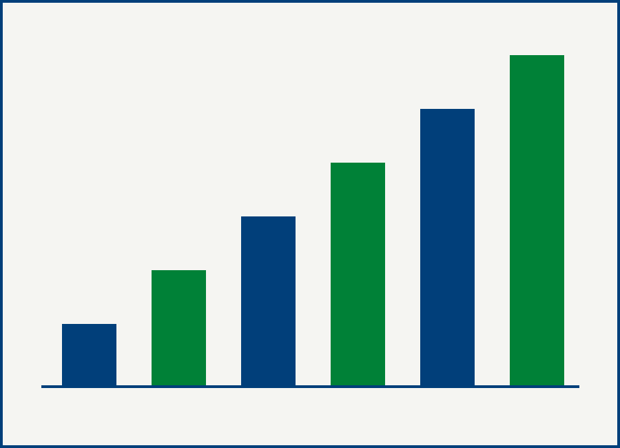

# MEMORIAL

---

## Apresentação

Este arquivo é ao mesmo tempo um exemplo e um teste: ele usa todos os recursos
que o modelo oferece, e serve para você conferir que a sua instalação funciona
antes de escrever qualquer coisa. Gere o PDF dele primeiro.

O cabeçalho acima, entre as linhas de três traços, alimenta a folha de rosto e a
capa. São seis campos, e todos aparecem no PDF. Troque-os pelos seus.

A linha isolada com três traços, logo depois do título MEMORIAL, vira quebra de
página.[^quebra] É assim que se separam as partes do documento.

[^quebra]: Esta é uma nota. No modelo, ela não vai para o pé da página: vai para
    a margem, ao lado do parágrafo que a chamou. É o recurso mais característico
    deste desenho, e vem do livro de Edward Tufte.

## Como escrever o texto

O corpo é Markdown comum. **Negrito** e *itálico* funcionam como em qualquer
editor. Os títulos de seção usam `##` e os de subseção, `###`.

As notas de margem são notas de rodapé normais do Markdown, com `[^nome]` no
texto e a definição em qualquer lugar do arquivo.[^segunda] Use-as para a
digressão que interromperia a frase, para a referência bibliográfica e para o
comentário que você faria em voz baixa.

[^segunda]: Notas curtas funcionam melhor. A margem tem a largura de um terço da
    página, e uma nota de dez linhas empurra as seguintes para longe do ponto em
    que foram chamadas.

> As citações recuadas usam o sinal de maior que no começo da linha. No modelo,
> elas saem em corpo um ponto menor que o do texto, sem aspas e sem itálico.

### Figuras

Uma figura na margem precisa de duas coisas: uma linha em branco antes dela e a
marcação `{.margin}` depois do parêntese. Faltando qualquer uma das duas, a
imagem vai para o meio do texto, em tamanho natural, e a legenda desaparece.

{.margin}

O texto continua normalmente ao lado da figura. Para uma imagem que ocupe toda a
largura do texto, basta omitir o `{.margin}`.

### Tabelas

As tabelas usam barras verticais. A largura de cada coluna no PDF vem do número
de traços na linha de separação, e não do conteúdo: é assim que se controla qual
coluna fica mais larga.

| Ano | Atividade | Instituição |
|:--:|:-----------------------------|:--------|
| 2024 | Disciplina de Metodologia | Universidade Y |
| 2025 | Orientação de mestrado | Universidade Y |

---

## Estrutura sugerida

O memorial não tem forma legal obrigatória, mas a lei manda que ele considere
ensino, pesquisa, extensão, gestão acadêmica e produção profissional relevante.
Uma ordem que funciona é a cronológica, com as seções abaixo, porque ela deixa a
trajetória se explicar sozinha.

1. Apresentação, com o fio que atravessa o documento
2. Formação
3. Docência, por período ou por instituição
4. Pesquisa e produção científica
5. Extensão
6. Gestão acadêmica
7. Balanço geral, com os números
8. Considerações finais e trabalhos em curso
9. Anexos, com as listas completas

Os números do balanço (turmas ministradas, orientações concluídas, trabalhos
publicados, citações) são o que a banca confere. Vale levantá-los antes de
escrever, porque eles mudam o que se pode afirmar.
