# MEMORIAL

---

## Apresentação

Apresento este memorial como parte do processo de promoção à classe de Professor Titular da Carreira de Magistério Superior da Universidade de Brasília. Seu objetivo é expor a trajetória acadêmica que construí desde meu ingresso no curso de graduação em Direito desta Universidade, em 1992, até minhas atividades atuais como Professor Associado da Faculdade de Direito.

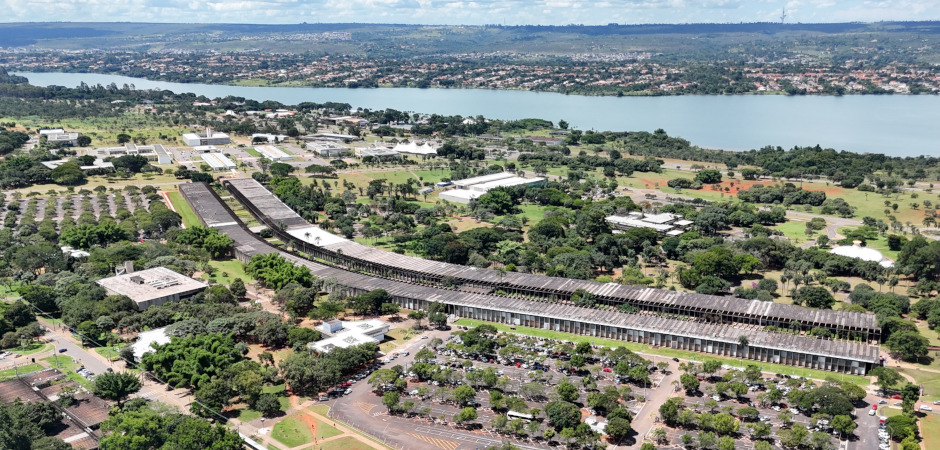{.margin}

Mais do que descrever produções, orientações e atividades (tarefa que cabe ao currículo Lattes que acompanha este memorial), procuro aqui reconstruir o sentido articulado dessa travessia: as escolhas que a orientaram, as influências que tive, as inovações com as quais contribuí e as inflexões metodológicas e temáticas que marcaram minha vivência na UnB. Trata-se de exercício de autorreflexão sobre um percurso de estreitos vínculos com a Universidade de Brasília, onde realizei graduação (1992-1996), mestrado (1997-1999) e doutorado (2005-2008), e onde exerço magistério superior, em regime de dedicação exclusiva, desde 2009.

Peço desculpas antecipadas por um memorial tão longo, mas circunscrever a tabelas descritivas todas as relações que tive com meus mestres, meus alunos e meus colegas não faria justiça à importância afetiva que eles têm em meu caminho. Não me sentiria bem em resumir várias relações tão densas e longas, nas quais investimos tantos esforços e sentimentos, em simples referências a título de uma dissertação defendida ou de um artigo publicado.

Não entendi o trabalho de escrever este memorial como um requisito burocrático, mas como um ensaio de autobiografia intelectual, que justificasse adequadamente o pedido que aqui faço: de ser reconhecido como Professor Titular, chegando à classe mais alta desta carreira a que me tenho dedicado há mais de um quarto de século.

Eu aportei na pesquisa empírica durante meu mestrado, tentando entender a função retórica das decisões judiciais. Continuei nesta linha quando, depois de estudar bastante hermenêutica e retórica, compreendi que não deveria levar a sério demais os argumentos dos juristas. A percepção de que os fundamentos decisórios muitas vezes não passam de formas artificiais (e tipicamente inconscientes) de justificar as próprias intuições do julgador deslocou minhas atenções da semântica dos discursos para a análise pragmática dos comportamentos dos agentes, que somente poderiam ser identificados a partir de uma observação detida das práticas decisórias. Fiz a travessia dos argumentos semânticos para os comportamentos observáveis, tentando equilibrar a abordagem empírica da ciência política com uma interpretação historicamente ancorada da linguagem judicial. Tudo isso temperado com a convicção filosófica de que a linguagem é um labirinto do qual não podemos escapar porque não existe sentido fora de nosso universo simbólico. Pensar é cultivar paradoxos e é deles que tento falar em meus relatos.

As narrativas contidas neste memorial são organizadas em torno de quatro elementos cuja recorrência, ao longo do tempo, forma as linhas de continuidade que tecem a unidade do meu percurso:


1. **Filosofia e Teoria do Direito**, a partir de abordagens linguísticas, constituem a temática transversal que atravessa as minhas reflexões e a minha prática docente. Com os professores do Departamento de Filosofia da UnB, aprendi que o mundo do qual falamos é uma construção linguística e, desde então, tenho me dedicado a compreender as categorias que utilizamos para cartografar nossas experiências e para inventar nossos universos simbólicos.
2. **Direito e Política**, questão que retorna quando investigo como os discursos e instituições jurídicas se articulam com as políticas. Ela atravessa debates sobre legitimidade e desenho institucional, sobre a democracia e sua crise, e análises de processos políticos e institucionais concretos.
3. A **Pesquisa empírica em direito**, com foco no Supremo Tribunal Federal, tem sido a minha abordagem mais constante de investigação. O STF me interessa desde o meu mestrado, mas foi quando ingressei no Instituto de Ciência Política (IPol) que a necessidade de articular pesquisas teóricas com objetos empíricos se tornou uma dimensão inafastável das minhas abordagens.
4. **Metodologia de pesquisa** é o tema mais recente dos meus esforços, no qual a ciência de dados aplicada ao direito ocupa o primeiro plano. Embora possa parecer paradoxal que uma pessoa cuja formação foi toda dedicada à filosofia tenha se interessado por dados, gráficos e programação, acho isso a coisa mais natural do mundo, considerando que meu ponto de partida é a filosofia da linguagem. Tudo o que pode ser dito é linguagem e a metodologia não passa de um esforço para construir relatos compreensíveis, enquanto a ciência de dados não é uma ciência, mas uma habilidade para contar histórias críveis a partir de evidências empíricas.

Esses elementos são temas, não no sentido de assuntos, mas de estruturas musicais recorrentes, que retomo ao longo de minha carreira em múltiplas combinações. Eles constituem os fios que organizam a minha produção, cruzando-se com os eixos que estruturam a minha atividade:

1. Uma **prática docente inovadora**, que sempre buscou equilibrar rigor conceitual com uma abertura sensível à subjetividade dos alunos, seguindo as inspirações abertas por meu mestre Warat.
2. Uma **abertura dialógica**, no seio de grupos de estudos e pesquisas em que buscamos construir caminhos autônomos e originais, junto com os companheiros de grupo e com os estudantes que oriento.
3. Uma **produção acadêmica aplicada**, concentrada em produzir materiais didáticos de acesso aberto, bem como produtos técnicos e bibliográficos capazes de produzir impacto social efetivo.
4. Uma **gestão acadêmica** voltada a contribuir para a estruturação institucional das unidades em que atuei na Universidade.

Neste memorial, busco (re)construir o tecido composto pelo entrelaçamento destas linhas temáticas e destes eixos de atuação, resultado dos esforços que desenvolvi ao longo desses quase 35 anos de vida acadêmica na UnB.

## 1 Formação: da graduação ao mestrado

### 1.1 Prelúdio

Eu nasci no Hospital de Base, em um parto guiado pelas mãos de um professor da Universidade de Brasília, onde meu pai era estudante de medicina. Pouco depois, minha mãe também ingressou na Universidade, no curso de Processamento de Dados. A UnB, portanto, é uma referência para mim desde os primeiros passos, quando eu sabia apenas que ela era o local de onde vinham as balas que minha mãe trazia e as pilhas de formulários contínuos em que eu traçava meus desenhos de criança.

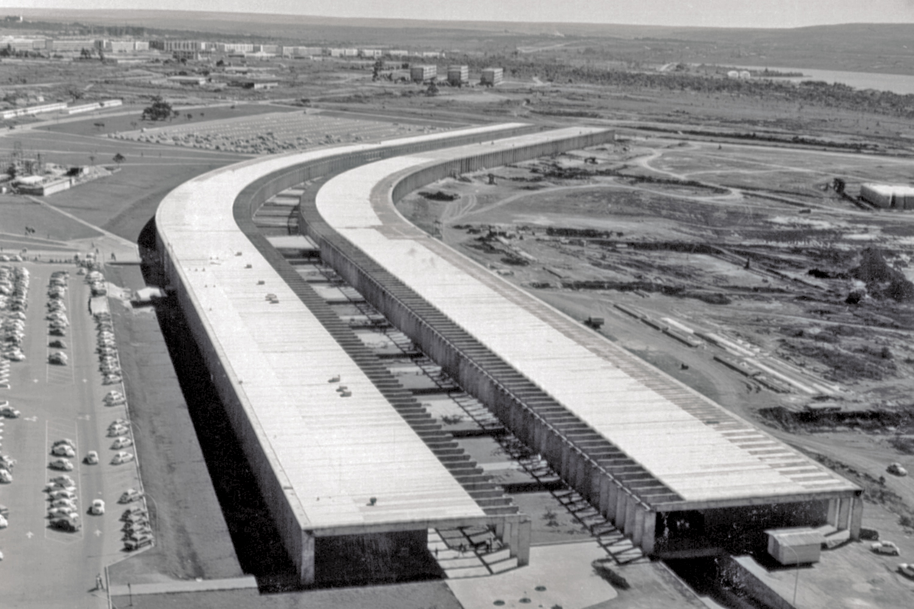{.margin}

Durante a infância, eu queria ser cientista porque essa era a ocupação de quem fazia descobertas e invenções. Ser professor mesmo, desses que dão aulas, nunca foi uma ocupação que eu me lembro de ter desejado. Eu gostava de dinossauros e pensava em ser astronauta ou astrônomo[^cosmos]. No início dos anos 1990, quando eu terminava o ensino médio, meu plano era cursar física ou filosofia.

[^cosmos]: Sagan, Carl. *Cosmos*. Sou de uma geração que assistiu encantada à série Cosmos, todos os domingos, aprendendo a considerar os cientistas como os heróis da modernidade. Em 1988, em meu aniversário de 13 anos, ganhei o livro Cosmos, que iniciou minha biblioteca de livros "adultos".

As matemáticas me pareciam um espaço lúdico, em que eu poderia passar a vida montando quebra-cabeças abstratos. Também me atraíam as leituras de Sartre e Nietzsche, nas fronteiras entre os textos filosóficos e literários. Porém, eu intuía que era limitada a relevância social tanto das ciências exatas como da filosofia. A influência de Frank Herbert[^Herbert] me fazia pensar que a engenharia social representava um desafio mais estimulante que desvendar equações. Minhas leituras e releituras dos livros de Duna me convenceram de que a combinação de arranjos institucionais, equilíbrios econômicos e ideologias políticas formava as estruturas que mantinham a coesão das sociedades e as transformavam ao longo da história.

[^Herbert]: Herbert, Frank. *Duna*. Rio de Janeiro: Nova Fronteira, 1984. Os cinco livros da coleção Duna tiveram sobre mim uma influência profunda e duradoura, pois neles aprendi muito sobre as relações entre política, economia, ecologia e sociedade.

Em 1991, quando a Constituição da República acabava de ter sido promulgada e as eleições diretas para presidente eram uma grande novidade, o processo de democratização do país nos estimulava a ter um senso aguçado de responsabilidade social. Na hora de preencher o formulário de inscrição para o vestibular, depois de ler muitas vezes as tantas opções que se abriam, quase escolhi matemática, mas acabei optando pelo curso de direito, essa área que me parecia nebulosa, pois ninguém da minha família tinha nela formação nem experiência.

Eu não cogitava ser delegado, nem juiz, menos ainda advogado. A sociedade era injusta, como sempre foi. Naquele contexto, o direito me parecia a escolha mais semelhante a uma engenharia social e, nessa medida, talvez fosse um instrumento cujo domínio ampliaria minha capacidade de intervir no processo político. Com utopias desse tipo eu vim parar neste curso, nesta Universidade, com 17 anos recém-completados, no primeiro semestre de 1992.

### 1.2 Graduação: explorando as fronteiras entre filosofia e direito (1992-1996)

A primeira vez em que pisei no prédio da FA[^fac] foi no dia em que prestei o vestibular. Depois das provas, fui explorar a universidade com alguns amigos que até hoje me acompanham. Correndo da chuva, saímos do Minhocão, subimos a colina e viemos encharcados parar neste edifício desconhecido e curioso, de concreto aparente e jardins exuberantes, com um espelho d'água vazio e atravessado por uma ponte de metal inesperadamente amarela. Naquele momento, não tinha como imaginar que este seria o espaço ao qual eu voltaria mais vezes em meu meio século de vida.

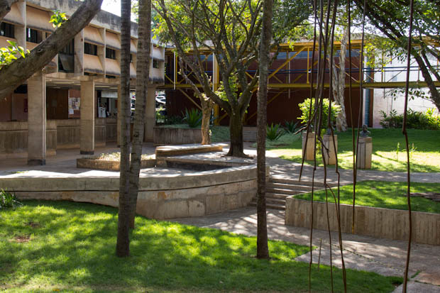{.margin}

[^fac]: **FA**: Até 1994, os departamentos de Direito, Ciência Política e Relações Internacionais estavam integrados na Faculdade de Estudos Sociais Aplicados (FA). Mesmo depois que a Faculdade de Direito foi instituída, o prédio que era da FA continuou sendo compartilhado pelos três cursos, até que o Instituto de Ciência Política (IPol) e o Instituto de Relações Internacionais (IREL) recebessem um novo prédio, em 2012, quando eu era professor do IPol.

Ingressei no bacharelado em Direito da Universidade de Brasília em 1992. É possível que nenhuma outra turma tenha gerado tantos professores para a Universidade: atualmente, somos quatro docentes na Faculdade de Direito, eu, Ana Frazão, Marcio Iorio e Othon Lopes. Além disso, Francisco Todorov foi professor voluntário durante duas décadas. Ser formado junto com pessoas tão capazes (tanto eles como os que seguiram outros caminhos) me fez entender que, no ensino superior, a influência dos professores não é maior do que a relevância dos diálogos com os colegas com quem discutimos cada texto, cada descoberta, cada acontecimento político desta nossa história tão conturbada.

O início do curso foi promissor. Tive a sorte de ser matriculado na turma de Introdução ao Direito ministrada pelo professor **Inocêncio Mártires Coelho**, que nos apresentou o campo jurídico com uma perspectiva filosófica e hermenêutica. Esta não era a abordagem mais típica daquele período, no qual os professores que constituíam a faculdade eram majoritariamente juristas práticos, de amplos conhecimentos dogmáticos, mas com pouca dedicação à pesquisa e à filosofia do direito. Como era comum naqueles anos, tive uma formação jurídica doutrinocêntrica[^metodologia]: nós líamos os teóricos do direito que sistematizavam os saberes dogmáticos na forma de livros e de comentários aos códigos.

[^metodologia]: **Formação doutrinocêntrica**: vide Costa, A. A; Fulgêncio, H. A. **[Educação Jurídica e Metodologia de Pesquisa: desafios da formação contemporânea](https://www1.unicap.br/ojs/index.php/dpc/article/view/3092)**. Direito, Processo e Cidadania. v.3, p.78 - 99, 2024. Neste artigo recente, caracterizamos como *doutrinocêntrica* a educação jurídica até os anos 1990, antes que a jurisprudência se tornasse o centro de gravidade da cultura jurídica brasileira.

Era preciso aprender as leis, mas o mais importante era saber interpretá-las conforme os cânones dogmáticos que organizavam a sensibilidade dos juristas do século passado. O estudo da lei era instrumental: aprendíamos a consultar os códigos para resolver os problemas que nos eram apresentados. Minha limitada memória nunca foi um empecilho para a minha formação, pois tornar-se jurista era aprender a dominar um tipo específico de discurso, estruturado em torno de certos parâmetros tópico-retóricos, que serviam como marcadores de uma pessoa que sabia "pensar juridicamente".

Em 1993, entrei por concurso público nos quadros do TJDFT, do qual fui servidor por três anos. Eu estudava na UnB pela manhã, trabalhava no judiciário à tarde e voltava para estudar novamente quase todas as noites. Nesta época, ingressei no Centro Acadêmico, onde por três gestões fui representante discente nas reuniões do Colegiado do Departamento de Direito. Foi na política estudantil que aprendi a falar em público, a conduzir reuniões, a organizar seminários e a produzir argumentos adequados a cada assembleia. Assim, desenvolvi no CADIR várias das habilidades que utilizo em minha prática docente.

A partir do segundo ano, com o predomínio de disciplinas dogmáticas, o curso de direito ocupou pouco espaço nos meus interesses e na minha dedicação. Logo percebi que não era necessário estudar muito para as disciplinas jurídicas, sendo suficiente uma presença atenta nas aulas, acompanhada por uma revisão cuidadosa nas vésperas de provas. Minha vida universitária se consolidou no seguinte formato: eu cursava cinco disciplinas no Direito e duas na Filosofia, as quais exigiam mais estudo e dedicação do que todas as disciplinas jurídicas reunidas. Com isso, ao final do curso de direito, eu tinha obtido a maioria dos créditos necessários para me formar também em filosofia.

Naquele momento, o docente que mais me marcou foi o professor **Nelson Gomes**, com quem fiz a disciplina em que provavelmente mais aprendi: Evolução das Ideias Filosóficas e Científicas. Tratava-se de uma matéria desafiadora em sua improvável extensão: um panorama geral da filosofia e da ciência, especialmente da epistemologia, ao longo de toda a história, o que gerava uma bibliografia infindável e uma quantidade gigantesca de coisas a aprender. Essa disciplina foi minha introdução à Filosofia da Linguagem, envolvendo minhas primeiras leituras de Frege e de Russell, que determinam até hoje minhas percepções sobre os paradoxos envolvidos em nossas interações linguísticas. Olhando em perspectiva, creio que eu me preparei a vida toda para ensinar essa matéria, que nunca lecionei: traçar um panorama geral do que significa a aventura do conhecimento humano.

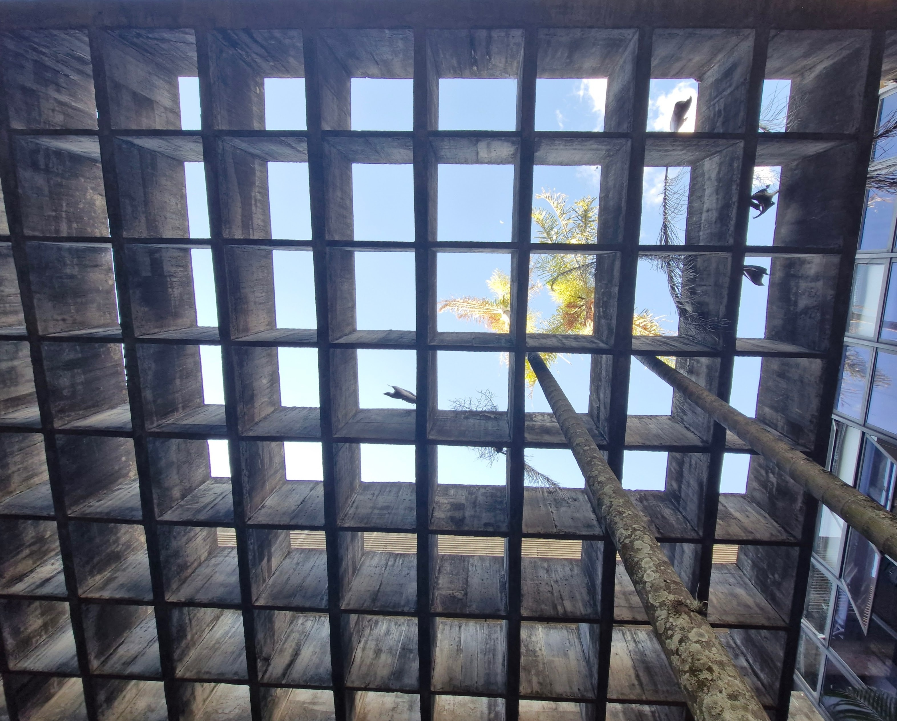{.margin}


Paralelamente, aprendia sobre ontologia e linguagem lendo Fernando Pessoa com o professor Celestino Pires, um português de incrível sutileza, que ministrou a matéria de seminários mais interessante que já cursei. Também estudei as filosofias da linguagem com Julio Cabrera, que promovia um cruzamento entre as tradições analíticas e continentais, enriquecendo nossas concepções sobre os potenciais e limites das abordagens centradas na linguagem.

Só bastante tempo depois entendi o quão rara era a possibilidade que o Departamento de Filosofia da UnB nos oferecia: professores de absoluta excelência, que exploravam as fronteiras das filosofias da linguagem, articulando as reflexões mais contemporâneas com uma base clássica, relida de modo crítico e original. Foi na filosofia que aprendi o quanto uma aula de graduação poderia ser desafiadora e complexa.

No terceiro ano do curso, o descompasso entre meu interesse pelas disciplinas filosóficas e jurídicas me parecia tão insustentável que quase abandonei o bacharelado em direito para me dedicar exclusivamente aos estudos de filosofia. Felizmente, tive o bom senso de entender que só faltavam dois anos e que era melhor terminar a graduação já iniciada, ainda mais que eu já trabalhava no sistema de justiça, no gabinete do juiz **Alexandre Machado Vasconcelos**, com quem aprendi imensamente. O trabalho prático com o direito era mais estimulante do que os estudos dogmáticos que eu fazia na faculdade, o que me dava a esperança de que o esforço de chegar ao fim do bacharelado terminaria valendo a pena.

Logo após minha formatura, em 1996, prestei novo vestibular e ingressei como aluno do Departamento de Filosofia da UnB. Apesar de ter durado somente um ano, meu período de graduando em filosofia definiu os interesses acadêmicos que persegui ao longo da década seguinte: ética e hermenêutica, conteúdos das disciplinas que ministrei com mais frequência entre os anos 2000 e 2015.

O entusiasmo pela ética foi estimulado pelos cursos da professora **Maria Clara Dias**, então docente visitante no Departamento de Filosofia, os quais criaram a base para que eu me tornasse professor dessa matéria, tanto na Faculdade de Direito como no Instituto de Ciência Política. Devo à Maria Clara não apenas a compreensão da Fundamentação da Metafísica dos Costumes (que eu havia tentado ler antes, várias vezes, sem o menor sucesso...) mas o interesse pelas teorias éticas contemporâneas.

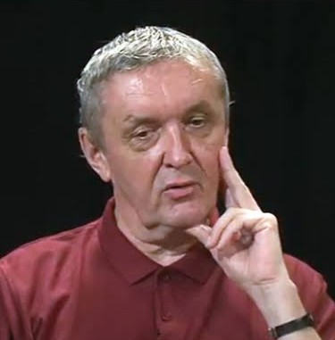{.margin}


A hermenêutica filosófica eu aprendi com um professor sérvio recém-chegado ao Brasil: **Miroslav Milovic**, uma das influências fundamentais na minha formação como filósofo e pesquisador. Durante muito tempo, segui o Miro em seus cursos e grupos de pesquisa, tendo ele se tornado um interlocutor constante e meu orientador de doutorado. Das tantas coisas que eu aprendi com ele, a que mais repito em minhas aulas é traçar no quadro uma linha do tempo e organizar a evolução das ideias ao longo dos séculos, articulando as inovações teóricas com as transformações sociais.

### 1.3 O mestrado e a investigação sobre a razoabilidade (1997-1999)

Em 1997, ingressei no mestrado em direito, que tentei compatibilizar com a graduação em andamento. Não consegui. Terminei sendo jubilado da filosofia, após dois semestres sem ter cursado o mínimo de disciplinas necessário para a manutenção da matrícula.

Na década de 1990, o mestrado em direito era um curso destinado a que os alunos lessem os textos teóricos dos quais somente tinham ouvido falar na graduação. Não se tratava de um programa voltado à pesquisa e à investigação, mas à consolidação teórica de estudantes, que deveriam dominar os textos básicos da erudição jurídica para que pudessem dar seguimento a suas pretensões acadêmicas. Foi esta a época em que li com mais voracidade, me aventurando em todos os tipos de livros que conseguia garimpar na BCE. Nunca comprei tantos livros quanto no final dos anos 1990 e no começo dos 2000, pois ainda não existiam as bibliotecas digitais que nos dão acesso a praticamente tudo o que foi escrito pelos juristas e filósofos.

Minha dedicação aos estudos também não permitiu que eu os compatibilizasse com meu trabalho como servidor do STJ, onde ingressei como analista judiciário logo que me formei, em 1996. Como eu ainda estava no estágio probatório, não tinha direito a uma licença sem vencimentos e acabei pedindo exoneração. Escolhi ser bolsista da CAPES, com menos dinheiro, mas com uma dedicação integral que me era nova, pois eu havia trabalhado no poder judiciário ao longo de toda a minha graduação.

No mestrado, fiz a minha primeira pesquisa empírica, concentrando-me nos padrões argumentativos mobilizados pelo STF para julgar casos com base no princípio da proporcionalidade, categoria que estava em consolidação naquela época e chamava a atenção dos juristas como uma grande novidade argumentativa. Estávamos no ápice do neoconstitucionalismo, com a sua crença de que era necessário submeter a política a um estrito controle judicial porque uma interpretação valorativamente densa dos textos constitucionais deveria nos conduzir a uma sociedade mais justa.

Havia já algumas dissertações sobre esse princípio, todas elas majoritariamente teóricas e orientadas pelo prof. Gilmar Mendes, que adotava uma abordagem focada na experiência alemã e na teoria de Robert Alexy. No mestrado, tive aulas com Juan Vicente Sola, diplomata argentino e professor da Universidade de Buenos Aires, com quem aprendi a incorporar referências teóricas dos EUA e analisar decisões da Suprema Corte. Sob sua orientação, escrevi e defendi uma dissertação[^dissert] na qual desenvolvi uma base teórica de matriz linguística para analisar a função retórica, nas decisões do STF, das crescentes referências aos princípios da razoabilidade e da proporcionalidade.

[^dissert]: Costa, Alexandre. *O princípio da razoabilidade na jurisprudência do Supremo Tribunal Federal*. Dissertação de mestrado. Programa de Pós-Graduação em Direito, UnB, 1999.

Em vez de me concentrar nos casos em que o STF havia realizado ponderações de princípios, eu decidi coletar e analisar todas as decisões do Supremo que faziam menção à razoabilidade ou à proporcionalidade, para tentar compreender o sentido argumentativo desse *topos*. Minha conclusão[^resumo-pp] foi a de que não havia uma função retórica estável para essas referências, o que inviabilizava a elaboração de um modelo teórico consistente a partir da jurisprudência do STF e contestava empiricamente a tese, então dominante, de que o STF teria incorporado a lógica de ponderação de Alexy.

[^resumo-pp]: Como digo no resumo da dissertação, o trabalho faz "uma avaliação dos acórdãos em seu conjunto, buscando delinear os traços que os unem ou diferenciam, com o objetivo de estabelecer uma classificação das decisões que funcione como base para a construção de uma teoria do princípio da razoabilidade que leve em conta os precedentes do STF e possa servir como uma orientação adequada para as decisões futuras. Conclui-se que as decisões do STF não fazem referência ao princípio da razoabilidade segundo uma teoria coerente, o que impossibilita a descrição deste princípio a partir de um modelo teórico consistente".

Não publiquei o mestrado logo que ele foi defendido, pois a edição de livros era um empreendimento caro, cujo ônus recaía sobre os próprios autores, no caso de obras que não tinham um alto potencial de vendas, como ocorria na maioria dos livros acadêmicos. Naquele tempo, era comum que os escritores pagassem pela tiragem de mais de 1000 exemplares necessários para diluir minimamente os altos custos de criar uma matriz de impressão *offset*[^offset]. Para um ex-bolsista e professor iniciante em universidades particulares, não parecia valer a pena o custo-benefício dessa empreitada.

[^offset]: ***Offset***: A impressão offset exigia a gravação dos textos em um cilindro de alumínio (a matriz), sendo o alto custo da matriz diluído no baixo custo das impressões. Para ser produzido com um valor compatível com os outros livros do mercado editorial, um texto técnico precisava ter uma tiragem de mais de 1000 exemplares, patamar muito superior às projeções de venda.

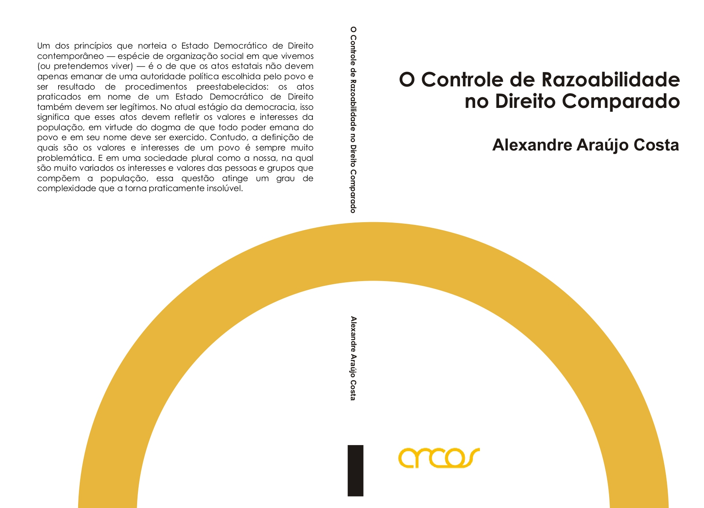{.margin}

A publicação da minha dissertação ocorreu apenas nove anos depois, aproveitando a oportunidade decorrente de uma alteração no mercado editorial, que passou a admitir pequenas tiragens de livros impressos sob demanda. Nessa ocasião, pelas dimensões da dissertação, dividi o trabalho em duas partes, que foram publicadas de forma independente.[^mestrado1][^mestrado2]

[^mestrado1]: Costa, Alexandre. *O Controle de Razoabilidade no Direito Comparado*. Brasília: Thesaurus, 2008. 35 citações no GS.
[^mestrado2]: Costa, Alexandre. *O princípio da proporcionalidade na jurisprudência do STF*. Brasília: Thesaurus, 2008. 14 citações no GS.

Nunca mais deixei de pesquisar as decisões judiciais, sobretudo as do Supremo. Tampouco abandonei as abordagens hermenêuticas centradas na compreensão do caráter linguístico das interações sociais, que não pensam o direito em termos de aplicação correta, mas de estratégias retóricas de fundamentação. Meu doutorado representou uma exploração teórica dos caminhos que foram abertos na investigação empírica realizada no mestrado.

Alguns anos depois, descobri que meu ex-orientador havia publicado como se fosse dele uma parte substancial da seção teórica da minha dissertação, excluindo apenas as referências explícitas ao STF e sua jurisprudência[^cjc]. Infelizmente, da primeira vez que um texto meu foi publicado em outras línguas, foi sem uma indicação adequada da autoria.

[^cjc]: Sola, Juan Vicente. *Control Judicial de Constitucionalidad*. Buenos Aires: Abeledo Perrot, 2001. Atualmente o GS contabiliza 72 citações desta obra.

## 2 Docência antes do doutorado (1998 a 2005)

### 2.1 Primeiras experiências docentes

No segundo ano do meu mestrado, com 23 anos, ministrei minha primeira disciplina universitária: um curso de Instituições de Direito Público e Privado, para estudantes de administração. Essa experiência não ingressou no meu currículo porque eu lecionei a matéria na qualidade de monitor de um professor substituto. Porém, ela é o marco inicial da minha experiência docente, que completa 28 anos em 2026, ou seja, mais de metade dos meus 51 anos de vida.[^idade]

[^idade]: Nasci em 1975, ou seja, no meio da ditadura militar. Completei a graduação em 1996, o mestrado em 1999 e o doutorado em 2008.

Quando terminei o mestrado, em 1999, encontrei-me desempregado. Eu havia abandonado os cargos públicos que ocupava, justamente no momento em que as políticas neoliberais do governo FHC fizeram com que minguassem as vagas destinadas aos concursos, especialmente para a docência universitária, que já era o caminho que eu desejava seguir.

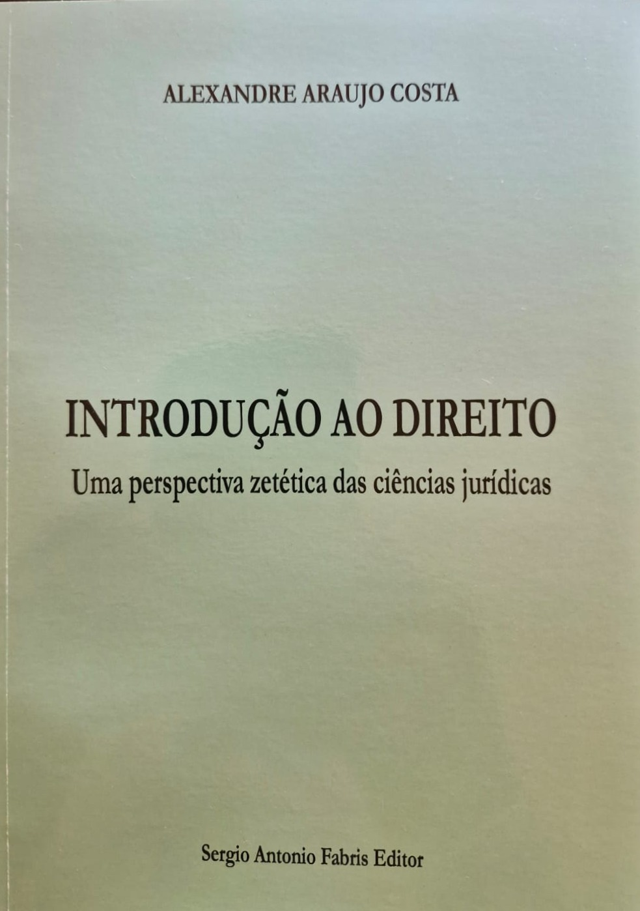{.margin}

Naquele momento, estava se implantando no DF um novo centro universitário, o IESB, que começou como um pequeno curso, no início da Asa Sul. Fui convidado para ser professor de Introdução ao Direito em suas primeiras turmas. Os textos que escrevi naqueles anos deram origem a meu primeiro livro[^intro-dir]: uma obra de introdução ao direito que abordava o discurso dogmático sob um ponto de vista crítico, a partir da filosofia da linguagem e da hermenêutica.

[^intro-dir]: Costa, Alexandre A. *Introdução ao direito: uma perspectiva zetética das ciências jurídicas*. Porto Alegre: Fabris, 2001. Contabiliza 64 citações no Google Scholar (GS), sendo 6 delas a partir de 2024, o que indica ainda haver interesse em seu conteúdo.

Meu pai, **Herculano Araújo Oliveira Costa Filho**, leu o livro ainda na versão de prova e me disse que então compreendeu melhor a minha escolha pela atividade docente, quando eu poderia ter ingressado em alguma carreira jurídica que me daria menos trabalho e maior remuneração. Ver as próprias ideias consolidadas em um texto autônomo, que segue vida própria e pode influenciar a vida de outras pessoas, é uma atividade que gera um tipo de realização que não me parecia comum em outras carreiras. Foi nessa época que minha vocação docente se consolidou.

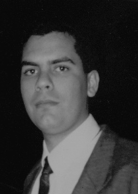{.margin}

Em 2001, ingressei como Professor Substituto na UnB, tornando-me responsável por uma disciplina recém-criada, que ainda estava em consolidação: Ética e Direito. Lecionei essa matéria por muitos anos: uma turma por ano, entre 2001 e 2007, em todas as qualidades nas quais lecionei na UnB antes do concurso: substituto, pesquisador colaborador e depois professor voluntário.

Naquele período, a turma que ingressava no curso diurno fazia Ética no Departamento de Filosofia e os alunos do curso noturno faziam Ética e Direito comigo, nas sextas à noite. Ética e Direito era uma disciplina peculiar: como o curso de filosofia era diurno, não havia disponibilidade para ofertar essa disciplina no período da noite. A experiência com esta matéria se mostrou vital para a minha aprovação para o cargo de Professor Adjunto, pois vim a ingressar no Instituto de Ciência Política (IPol), em 2009, em um concurso especificamente voltado para selecionar um docente capaz de lecionar Ética e Política.

Enquanto professor substituto, também ministrei turmas de Filosofia do Direito e de Introdução ao Direito 2, disciplina que passei a lecionar com o conteúdo de Hermenêutica e Teoria da Argumentação. Embora essa não fosse a temática definida na ementa, eu não compreendia como os estudantes de direito poderiam fazer um bacharelado em que simplesmente não existia nenhuma disciplina específica sobre hermenêutica e interpretação. Felizmente, esses temas passaram a ser o conteúdo padrão de Introdução ao Direito 2, desde aquela época.

Para Introdução ao Direito 2, desenvolvi uma série de textos sobre hermenêutica jurídica, que circularam na forma de textos sobre os modelos de hermenêutica e que serviram como base para a segunda parte da minha tese de doutorado, que trata especificamente das abordagens de hermenêutica jurídica.

O quadro abaixo indica as disciplinas que lecionei entre 2001 e 2004, com a ressalva de que Proficiência não era uma disciplina de ensino, mas uma atividade consistente em elaborar, aplicar e corrigir as provas de Proficiência, que avaliavam o rendimento global dos estudantes.

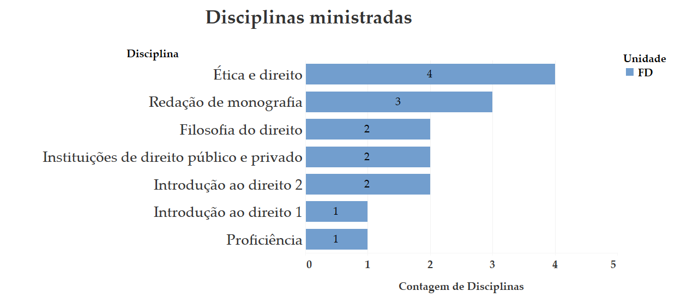

Este foi o meu tempo inicial de formação como professor. Eu tinha menos de 30 anos e a experiência docente era o centro da minha vida profissional, mesmo que, a partir de 2003, eu não tivesse remuneração pelas atividades que realizei na UnB. As turmas que lecionei neste período foram as únicas que me convidaram a ser patrono de suas formaturas, em 2006 e 2007, quando eu já era doutorando e atuava como professor voluntário.

Foi uma época curiosa, em que eu dava aulas de filosofia e teoria do direito, mas me mantinha por meio de uma ocupação que precisava manter em sigilo: eu era elaborador de provas de concursos para o CESPE, naquele momento em que o governo Lula 1 expandia novamente o acesso a cargos públicos e a UnB tinha o protagonismo na busca de elaborar avaliações mais complexas e críticas, que fossem capazes de selecionar pessoas não apenas pela memória, mas pela capacidade de análise e de solução de casos concretos.

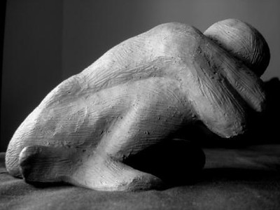{.margin}

Fui examinador do CESPE por vários anos, participando de mais de 60 bancas, nas quais aprimorei minha capacidade de modelar questões objetivas e de articular a teoria jurídica com o discurso dogmático. Foi uma grande escola de precisão linguística e revisão meticulosa, na qual toda ambiguidade e desatenção terminava gerando a frustrante anulação de questões que haviam demandado tanto tempo de formulação.

### 2.2 Primeiras orientações

No segundo semestre de 2001, logo que ingressei como professor substituto na Faculdade de Direito, assumi a disciplina de Redação de Monografia. Essa função não me tornava orientador das monografias dos estudantes, mas uma espécie de coordenador informal de pesquisa, responsável por gerir as atividades de atribuição de orientadores, marcação de bancas, homologação dos avaliadores indicados e consolidação das informações sobre as defesas. Nessa condição, também fiz a proposta do primeiro Regulamento do TCC da graduação em direito, que foi aprovado à época pelo Colegiado.

Pode causar certo estranhamento que um professor substituto atuasse nessas funções, coordenando atividades, propondo resoluções e, inclusive, participando das sessões do Conselho da Faculdade. Todavia, isso não me parecia excepcional, tendo em vista que eu havia participado dessas reuniões durante anos, como representante do Centro Acadêmico, o que fazia com que a minha presença fosse de certa forma naturalizada. Somente com o tempo compreendi que esse tipo de comportamento, em que eu atuava como docente da faculdade sem efetivamente o ser, poderia ser fonte de um certo embaraço.[^coment]

[^coment]: Por exemplo, certa vez, um dos professores da área de teoria do direito falou com o Diretor da Faculdade que não achava adequado que uma disciplina tão central como filosofia do direito fosse ministrada por professores de fora do quadro. Ele falou isso na minha frente, deixando claro que se referia a mim. Eu não fui afastado das turmas, mas comecei a entender que o comportamento esperado dos substitutos e voluntários não era aquele que eu adotava.

Embora a turma de Redação de Monografia fosse uma atividade mais administrativa que acadêmica, eu também ministrava algumas aulas sobre projeto de pesquisa, sobre procedimentos de defesa e sobre as funções dos orientadores. A Faculdade de Direito tem uma disciplina específica de Projeto de Monografia, mas ela é realizada no meio do curso, de modo que os formandos muitas vezes abandonavam os planejamentos feitos naquela disciplina e tinham de formular novos projetos. Assim, a disciplina começava com uma orientação geral dos estudantes sobre os projetos, antes mesmo que eles fossem encaminhados a seus orientadores, o que tornou esta a minha primeira experiência com Metodologia de Pesquisa, que veio a se tornar um dos temas fundamentais da minha trajetória como docente.

Foi neste contexto que comecei minha carreira de orientador com meu amigo **Shigueru Sumida**[^sumida], que estudou comigo na graduação, onde foi meu companheiro de Centro Acadêmico. Em 2001, Shigueru fazia uma especialização em direito ambiental, oferecida pela UnB, e me convidou para orientá-lo por amizade, mais do que por competência.

[^sumida]: Sumida, S. *A competência Municipal para aplicar sanções administrativas ambientais*. Especialização em Direito Ambiental, 2001.

No ano seguinte, orientei minhas duas primeiras monografias de graduação. O TCC de **Estêvão Waterloo**[^ew], com quem eu havia trabalhado no STJ, também foi um convite mais ligado à proximidade que tínhamos do que a meus conhecimentos sobre direito processual penal. Já a monografia de **Matheus Gonçalves Ferreira**[^mgf] foi a primeira que decorreu da minha proficiência no tema, pois ele realizou uma atualização do meu mestrado, analisando as decisões que haviam feito menções ao princípio da proporcionalidade nos três anos seguintes à minha defesa.

[^ew]: Waterloo, E. *Transação Penal*. TCC, Direito, 2002.
[^mgf]: Ferreira, M. G. *Os princípios da proporcionalidade e do devido processo legal na jurisprudência do STF*. TCC, Direito, 2002.

Também comecei neste ano a orientar na iniciação científica, com a inserção no PIBIC (Programa Institucional de Bolsas de Iniciação Científica) de estudantes que haviam sido meus alunos em 2002 e concluíram seus trabalhos de iniciação científica em 2003, tratando de temas que seguem como linhas de continuidade do meu trabalho: filosofia política, ética e hermenêutica jurídica.[^garcia-pibic][^rommel-pibic][^dilano-pibic][^freitas-pibic]

[^garcia-pibic]: Garcia, André P. *Discursos de legitimidade constitucional*. PIBIC, 2003.
[^rommel-pibic]: Rommel, Rodrigo. *Direito e razão: o papel da racionalidade no pensamento jurídico*. PIBIC, 2003.
[^dilano-pibic]: Oliveira, Marcos D. *Fundamentação da Ética*. PIBIC, 2003.
[^freitas-pibic]: Freitas, Thiago. *Os Limites da Fundamentação da Ética e do Direito*. PIBIC, 2003.

Em 2003, quando ainda era professor substituto,[^garcia-tcc] tive o maior número de orientações simultâneas de monografia da minha carreira. Além de **André Garcia** e **Rodrigo Rommel**, que foram meus orientandos de iniciação científica e apresentaram desenvolvimentos daqueles trabalhos, também supervisionei cinco pesquisas de temáticas variadas, realizadas por estudantes que se aproximaram de mim por terem sido meus alunos de filosofia do direito ou de redação de monografia, disciplinas que eu ministrava para estudantes do final do curso.

[^garcia-tcc]: Garcia, André P. *A legitimidade do direito: análise do conceito em Kelsen e Habermas*; Rommel, Rodrigo. *Tópica e sistemática no discurso jurídico*; Mateus, Luciana P. *As Agências Reguladoras como Mecanismo de Intervenção no Modelo Estatal Brasileiro*; Viana, Lívia C. *O acordo de leniência no modelo antitruste brasileiro e a repressão multiorgânica ao cartel*; Gonçalves Júnior, Paulo R. *O acordo de leniência como instrumento de investigação antitruste*; Boson, Daniela M. C. *Da vingança privada à mediação criminal*; Algares, Helenilda. *A política criminal na aplicação das penas*.

### 2.3 **Luis Alberto Warat**: amor e filosofia da linguagem

Warat não era só uma pessoa. Ele era um abalo sísmico, que modificava o horizonte de quem convivia com ele.

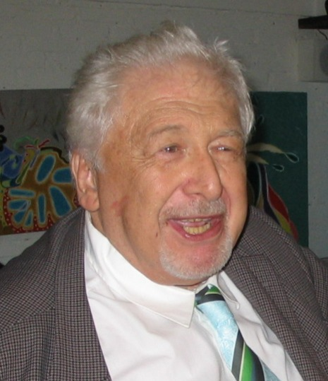{.margin}

Nesse período entre o mestrado e o doutorado, meu encontro com meu mestre e amigo Luis Alberto Warat foi o que teve influência mais profunda em mim. Quando eu lecionava no IESB, me aproximei do professor gaúcho Jairo Bisol, que havia sido meu contemporâneo no mestrado e que, além de ser um refinado professor de teoria jurídica, também coordenava um grupo de pesquisa com os seus alunos do curso de direito da UPIS. Certo dia, ele me convidou para um churrasco em sua casa, na qual ele me apresentaria ao Warat. Este foi o início de vários anos de uma colaboração muito estreita, em que Luis passou a ser o meu principal interlocutor jurídico, além de um amigo muito próximo.

Nesse dia, perguntei a Luis Alberto Warat como deveria chamá-lo. Ele riu e disse: da forma que você preferir. Os brasileiros costumam dizer "vará", como se ele fosse francês. Ele mesmo tendia a pronunciar "uárat", mas o nome pouco importava. Daí perguntei como a mãe dele o chamava, e ele respondeu: Luis. Desde então, passei a chamá-lo de Luis, quando falava diretamente com ele. Porém, segui chamando de Warat o autor dos textos, quando falava sobre ele, pois essa era a forma típica pela qual as pessoas se referiam a ele. Na minha fala, esses dois nomes se entrelaçam: Luis quando falo da pessoa privada, Warat quando falo da pessoa pública.

Luis estava se transferindo para Brasília, com o objetivo de se integrar na equipe que permitiria que o Programa de Pós-Graduação em Direito abrisse o primeiro curso de Doutorado em Direito no DF. Logo que ele chegou aqui, estava envolvido com cursos autônomos de mediação, que ele ministrava por meio da Almmed (Associação Latino-americana de mediação e metodologia do ensino do direito), uma associação que ele presidia (e que, no fundo, era ele mesmo). Ele conseguiu um espaço no subsolo de um prédio na Asa Sul, onde ministrou alguns cursos sobre Kelsen (*Kelsen: Sinfonia e Fuga*) e também sobre mediação. Entre 2002 e 2004, eu o auxiliei bastante nesses projetos, tanto para permanecer em sua companhia quanto para ajudá-lo a se inserir em Brasília.

Dos contatos com Warat surgiu um dos meus textos ainda hoje mais citados: *Cartografia dos Métodos de Composição de Conflitos*[^cart-metodos], escrito como contribuição para o Grupo de Estudos em Arbitragem, Mediação e Negociação. Nesse capítulo, elaborei o esboço de uma teoria que organizasse os vários conceitos ligados às estratégias de composição de conflitos, a partir da distinção waratiana entre mediação e conciliação.

[^cart-metodos]: Costa, Alexandre. *Cartografia dos Métodos de Composição de Conflitos*. In: Azevedo, André G. (org.). Estudos em Arbitragem, Mediação e Negociação. Brasília: Brasília Jurídica, 2003. 68 citações no Google Scholar. Este é um texto com muitas citações, especialmente devido ao fato de que André Gomma, coordenador do Grupo, tornou-se uma das maiores referências no tema, o que deu visibilidade tanto às coletâneas que ele organizou quanto a meu esforço de categorizar os vários métodos de composição.

Naquela época, Luis tinha uma vida nômade. Sua casa era em Buenos Aires, mas ele se mantinha viajando de um lugar para outro, de um seminário a outro, ficando em Brasília na casa de amigos ou em hotéis. Apesar de sua saúde precária, ele mantinha um ritmo intenso de compromissos profissionais e uma agenda social também extensa. Toda vez que ele chegava na cidade, em torno dele se juntava um conjunto de pessoas interessantíssimas, com as quais era muito enriquecedor conviver.

Luis foi meu grande mestre. O professor que mais me influenciou em tantas dimensões que não sou capaz de contar. Aprendi com ele que é preciso escrever para que as nossas ideias possam circular além de nós. Existem alguns professores cuja grande contribuição são os pesquisadores que ele forma, e não os textos que ele escreve. Luis contribuiu para formar muitas pessoas de imensa envergadura, em várias gerações, mas sua principal contribuição são seus próprios textos. Para mim, o autor precedeu a pessoa: quando encontrei Warat, eu já conhecia e admirava vários de seus textos sobre direito, filosofia e linguagem.

Também aprendi com ele que é preciso se modificar sempre: ele era uma metamorfose de interesses, perseguindo sempre novas ideias e novas práticas, sempre mais interessado em surfar as novas ondas do que em repetir os conceitos que eram ligados a seu nome. Compreendi algo que é muito difícil praticar nestes novos tempos: que a conexão com os estudantes é fundamental para fomentar ambientes criativos, nos quais as pessoas tenham liberdade de pensar e viver com ousadia. Essa conexão somente existe quando o professor está genuinamente interessado nas outras pessoas e se dedica mais a ouvir do que a falar. A ideia de que o professor deve ocupar um lugar vazio, para dar protagonismo aos estudantes, é tão simples quanto desafiadora.

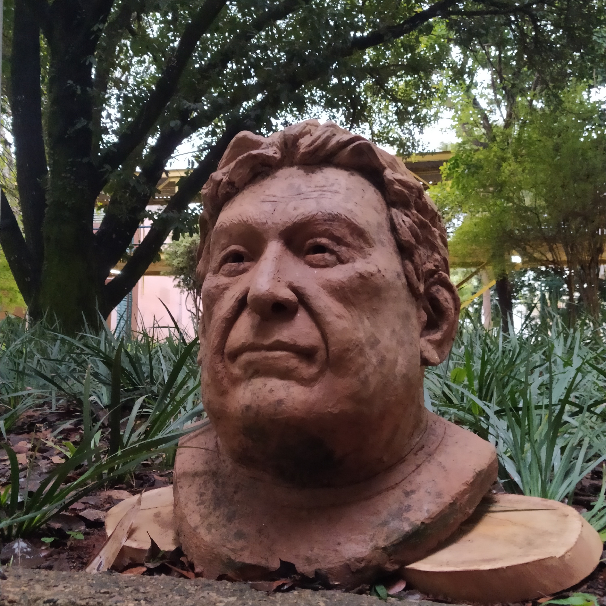{.margin}

Durante anos, eu organizava as minhas ideias e as levava para Luis, que as demolia com carinho, reduzindo a pó minhas pretensões, mas sempre abrindo caminhos para construções melhores, mais ousadas, mais sofisticadas. Luis pensava com uma liberdade ímpar, que nos contagiava e contaminava. Ele nunca foi formalmente meu orientador, mas também nunca deixou de ser. Em todas as aulas que eu ministro, ele é a voz silente que me acompanha e o padrão contra o qual eu avalio os meus pequenos sucessos em metodologias criativas e saltos carpados pedagógicos.

Luis é meu professor do mundo das ideias. Criativo, rigoroso, afetivo, ousado, inquieto, minucioso, exigente. Tudo isso ao mesmo tempo e com uma intensidade que o consumiu demasiadamente. Ele faleceu mais novo do que deveria, cuidou mais dos outros do que de si, mas viveu muitas vidas em uma.

### 2.4 Direito e Arte: Grupos de Literatura

No início de minhas atividades como professor substituto, combinei com **Nelson Passos** e **Daniela Diniz** de lermos juntos o Crime e Castigo, cuja tradução diretamente do russo para o português havia acabado de ser lançada. Semanalmente, avançávamos a leitura e nos encontrávamos para conversar sobre nossas formas de compreender a obra de Dostoievski. Dessa experiência nasceu a minha primeira orientação que explorava as fronteiras entre direito e arte: o PIBIC de Nelson[^nelsonp], que explorou a proximidade entre os discursos jurídico e literário. A partir de certas intuições de Tolstói, Nelson indicou que, em ambos os discursos, a verossimilhança é um elemento mais relevante que a efetiva correspondência com os fatos, pois ela viabiliza a conexão com o leitor e, nessa medida, permite mobilizar a atenção do auditório e o seu convencimento.

[^nelsonp]: Lima, Nelson Passos. *Ética estética: direito e arte*. PIBIC, 2004.

Essa experiência me convenceu de que a leitura autônoma e coletiva da literatura era uma ferramenta importante para a formação de intérpretes capazes e sensíveis. Desde então, não proponho a criação de grupos de Direito e Literatura, em que a leitura dos textos seria uma oportunidade para conversar sobre o direito, mas simplesmente Grupos de Literatura, em que as conexões com o direito surgem da eventual sensibilidade dos leitores, e não de uma necessidade estrutural.

Essa percepção me fez sugerir para a minha turma de Ética de 2003 a criação de um grupo sem hierarquia, que se constituísse como espaço aberto de diálogo. O desafio foi aceito por um grupo de estudantes muito especial na minha carreira, sendo que um deles continua até hoje comigo, acompanhando minha trajetória em todas as suas fases: **Felipe Justino de Farias**.[^literat] Nos anos seguintes, foram constituídos outros grupos de literatura, de cinema e de teatro, também compostos por alunos criativos e inquietos, que debateram livros e filmes, escreveram contos e encenaram peças[^grupos].

[^literat]: Além de Felipe, estavam neste grupo **Beatriz Simas**, **Carlos Augusto**, **Esla Ferreira**, **Hanna Xavier**, **Laura Alencar**, **Marília Siqueira**, **Michel Amaral**, **Mônica Ramos**, **Olavo Marinho** e **Taciana Meirelles**. 
[^grupos]: Esses grupos incluíram, entre outros estudantes: **Aline Nascimento, Ana Zélia Carvalhedo, Almir Evaristo, Bruno Vial, Cássia Silva, Clara Motta, Desirée Timo, Diego Curcino, Elisa Pires, Igor Rech Oliveira, Flavia Danigno, Gustavo Capela, Guilherme de Moraes Rego, Henrique Souto, Hugo Martins, Ildegard Hevellyn Alencar, Kalline Rodrigues, José David Geiman, Laura Lima, Liana Issa, Lívea Manrique, Lorena Nisiyama, Lucas Chaves, Luciana Freire, Manoela Barros, Márcio Freitas, Mateus Takano, Pedro Lucas Costa, Pedro Felipe Santos, Ronald Barbosa, Tahinah Martins, Túlio Cambraia, Victor Menezes e Vinicius Campelo.**

Desde então, em todos os meus cursos de Introdução e de Filosofia, sigo a prática de estimular os alunos a constituir grupos para a análise e produção de obras artísticas, como atividades fundamentais para o seu itinerário formativo. A inspiração waratiana é evidente: não se trata de promover o traçado de uma conexão explícita entre os textos e o direito, mas de propiciar o encontro dialógico de subjetividades e a construção coletiva de interpretações sobre obras complexas.

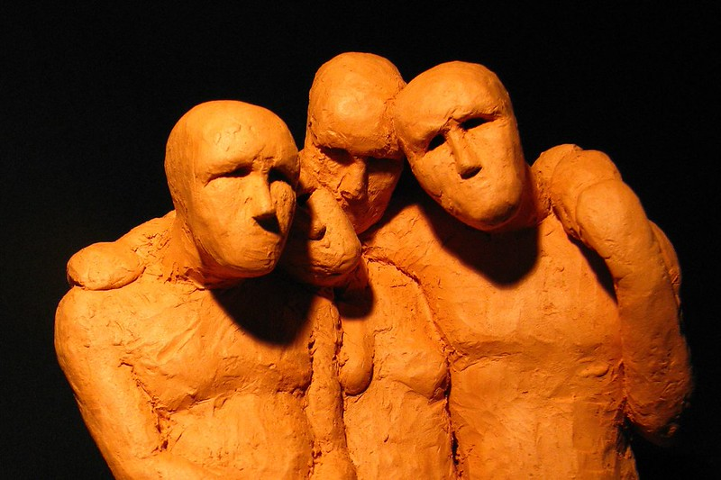{.margin}

### 2.5 Grupo de Pesquisa Pensamento Social - GPPS

Se Warat foi minha influência fundamental no direito, Miro foi o meu principal professor de filosofia, com quem aprendi a necessidade de agregar uma pluralidade de pessoas para avançar coletivamente na crítica e na transformação da realidade. Desde a minha graduação em filosofia, acompanhei as aulas do Miro, seus cursos sobre filosofia política e hermenêutica e fiz parte das míticas reuniões no Bar da Linda, onde criamos o Grupo de Pesquisa Pensamento Social, com o objetivo expresso de sermos duplamente ancorados no tempo atual: usar a filosofia contemporânea para pensar os problemas da contemporaneidade.

Estávamos em 2003, uma época de profundo otimismo. Vivíamos no primeiro governo de esquerda do país, envolvidos no desafio de como tornar a sociedade mais justa e mais aberta para as diferenças. O futuro parecia promissor e não acreditaríamos, naquela época, que 20 anos mais tarde lidaríamos com as ameaças autoritárias e o retrocesso democrático que enfrentamos hoje. Parecia, então, que o mundo seguiria um ritmo de paz e de abertura, que um outro mundo era efetivamente possível.

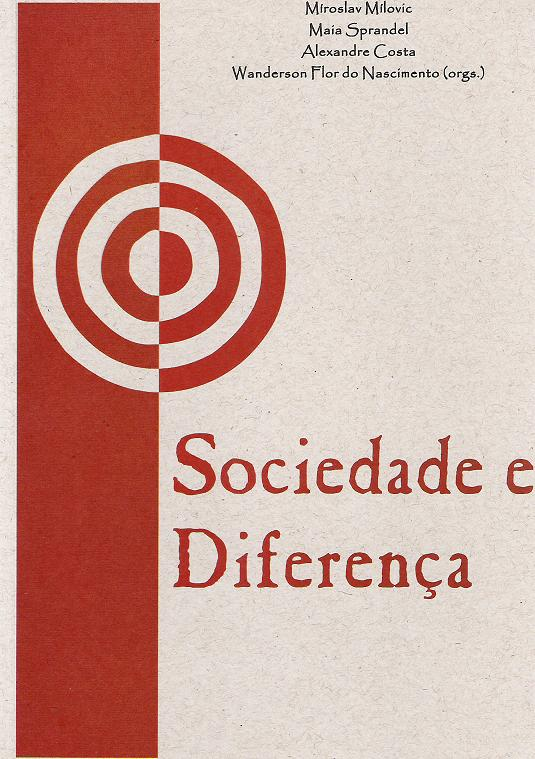{.margin}

Junto com Miro, com **Maia Sprandel**, com **Wanderson Nascimento**, com **Juliano Benvindo** e vários outros amigos, nós nos reuníamos semanalmente e consolidamos nossas reflexões no primeiro livro que ajudei a organizar: "Sociedade e Diferença",[^soc-dif] coletânea em que publicamos vários textos interligados, sendo que o meu foi o "Cartografia da Racionalidade Moderna",[^cart-rac] no qual desenvolvi, com base em uma combinação de Lyotard e Guattari, uma tentativa de mapear as narrativas típicas da modernidade, marcadas pela busca de completude e de consistência.

[^soc-dif]: Milovic, Miroslav; Costa, Alexandre; Sprandel, Maia; Nascimento, Wanderson. *Sociedade e Diferença*. Editora Casa das Musas, 2005.

[^cart-rac]: Costa, Alexandre. Cartografia da Racionalidade Moderna. In: *Sociedade e Diferença*, 2005. Mais de dez citações no GS.

O texto de convite para o lançamento do livro em Brasília, feito no saudoso Balaio Café da 201N, caracterizava bem nossas preocupações e várias das estruturas que depois retomei, para organizar meus pensamentos: cartografias, polifonias, reflexos especulares.

> Por que a diferença nos causa tanto embaraço?
>
> A sociedade moderna nos prometeu a libertação por meio de uma utopia da igualdade, que não se concretizou. Apesar disso, somente recebemos bússolas para lidar com o que é igual, homogêneo, familiar.
>
> Negamos ao outro o seu desejo, porque a diversidade angustia e desagrega. Seus olhos são o espelho em que me vejo, mas sua imagem não é a reprodução da minha. Então, os nossos sonhos de justiça precisam equilibrar o direito à igualdade com a possibilidade da diferença.

> Movidos por essas perplexidades, nós nos unimos para escrever este livro, que analisa as origens filosóficas das nossas dificuldades de lidar com o problema da diferença e avalia os reflexos de levar a sério o Outro.
>
> Este é um livro polifônico, em que as relações entre o Sujeito e o Outro são tratadas sob vários enfoques interdependentes, como os da Ética, da Política, da Psicologia, do Direito e da Economia. A soma dessas vozes forma uma sinfonia dividida em cinco movimentos, cujos temas e relações são explorados na introdução do livro, que acompanha este convite para o seu lançamento em Brasília.

O principal sucesso do GPPS foi o lançamento de nossa obra conjunta no Fórum Social Mundial de 2005, realizado em Porto Alegre, no qual nossa proposta de uma "Sociedade da Diferença" foi capaz de estabelecer diálogos com múltiplos grupos sociais, indicando que a filosofia podia ser articulada com práticas inovadoras e emergentes. Os debates que fizemos às margens do Guaíba, sob um sol escaldante, desenvolvendo uma oficina poeticamente intitulada "A insustentável leveza da igualdade", ainda hoje repercutem nas minhas formas de conceber o potencial transformador da filosofia, do direito e da arte.

No ano seguinte, com apoio da Fundação João Mangabeira, gravamos um vídeo chamado Curso Sociedade e Diferença[^csd], no qual os vários autores e organizadores expuseram as ideias desenvolvidas na coletânea. Desde 2006, o curso é livremente disponibilizado pela Fundação, em seu portal na Internet.

[^csd]: [Curso Sociedade e Diferença](https://www.fjmangabeira.org.br/introducao/). 2006. O curso está dividido em vários vídeos, que foram produzidos pela Fundação João Mangabeira, ligada ao PSB.

## 3 Doutorado (2005 a 2008)

### 3.1 Tese: diálogos entre hermenêutica jurídica e filosófica

Em 2005, foi feita a primeira seleção para o curso de Doutorado da UnB e eu apresentei um projeto para tratar das relações entre hermenêutica filosófica e jurídica. Por causa da ordem alfabética, fui um dos primeiros candidatos a ser avaliado em uma entrevista feita por uma banca tão diversa que tudo o que eu respondia a um dos membros era questionado pelos outros. Minha impressão foi a de que eu teria sido obviamente desclassificado, mas tive a fortuna de ter sido um dos dez aprovados em uma turma majoritariamente composta por docentes da Faculdade de Direito.

Neste projeto, eu entrelaçava os estudos de vários anos voltados à disciplina de Hermenêutica Jurídica (Introdução ao Direito 2), ministrada na UnB, estabelecendo as proximidades e diferenças que as abordagens jurídicas (centradas na interpretação normativa) têm com a hermenêutica filosófica de matriz gadameriana, focada em uma descrição do processo de compreensão da linguagem e de suas complexidades. Em virtude da temática, por mais que Warat fosse o meu interlocutor mais próximo, escolhi Miroslav como orientador para meu trabalho de doutoramento.

A tese que vim a defender se chama *Direito e Método: Diálogos entre a Hermenêutica Filosófica e a Hermenêutica Jurídica*, também elaborada com bolsa CAPES.[^tese-citacoes] Ela permanece, em suas linhas essenciais, como o horizonte teórico que orienta meu trabalho até hoje, ainda que progressivamente tensionada pelo encontro com abordagens empíricas e com o realismo jurídico.

[^tese-citacoes]: *Direito e Método: Diálogos entre a Hermenêutica Filosófica e a Hermenêutica Jurídica* (UnB, 2008). 81 citações no Google Scholar.

O trabalho sugere que a hermenêutica filosófica de Gadamer oferecia à teoria do direito não uma chave metodológica pronta (como por vezes se a apresentava), mas um deslocamento radical: ela nos conduz ao abandono da pretensão de que a interpretação jurídica pudesse ser devidamente descrita como um conjunto de métodos a serem aplicados ou como uma estrutura argumentativa. Reconhecer a historicidade da compreensão, a função produtiva dos prejuízos e o caráter dialógico da interpretação impõe ao jurista uma autorreflexão permanente sobre seus próprios pressupostos. A consciência dessa historicidade desestabiliza a ideia de interpretação correta, que orienta os discursos dogmáticos, e reforça a tese kelseniana de que as decisões jurídicas são inafastavelmente políticas, na medida em que exigem tomadas de posição valorativa.

Entendo que essa tese consolida a formação que tive no Departamento de Filosofia da UnB, no qual pude explorar diversas facetas das abordagens filosóficas da linguagem e dos desafios de sua compreensão. As contribuições da filosofia contemporânea são pouco palatáveis para o senso comum dos juristas, comprometido que está com a construção de narrativas que legitimem as práticas interpretativas e decisórias do direito. Ao evidenciar os limites dos discursos dogmáticos, bem como seus pressupostos ideológicos, as abordagens linguísticas colocam em risco as formas de vida (ou ordens do discurso) que emergem da prática dos juristas e do modo como eles descrevem sua atividade.

Desde a minha graduação, aprendi com Warat que é preciso olhar o direito a partir da linguagem, para desconstruir os mitos e teorias que envolvem a aplicação da lei. Porém, quando convivi longamente com Luis, ele estava mais interessado nas conexões entre direito e arte, decorrências de sua desilusão com as repetidas tentativas de ensinar aos juristas sobre os limites ideológicos de seus discursos. Luis me disse que desistiu desse caminho quando dava aulas para magistrados e notou que evidenciar as condicionantes ideológicas de sua atuação não tinha poder transformador sobre as práticas decisórias: compreender os aspectos ideológicos de sua atividade não fazia os juízes modificarem seus padrões decisórios. Luis intuiu que a subjetividade que decidia era a mesma, fosse consciente ou não dos elementos ideológicos da dogmática e das teorias hermenêuticas que a organizam.

Nesse momento, Luis compreendeu que era preciso investir na transformação da subjetividade dos próprios juristas, e não nos mecanismos pelos quais eles organizam seus discursos, o que o levou a investir primeiramente na mediação (em que a autocomposição poderia subverter a lógica da aplicação normativa) e depois em práticas artísticas que pudessem contribuir para que os juristas desenvolvessem uma subjetividade mais sensível e mais aberta (sem a qual a mediação era impossível e as decisões judiciais podiam se constituir em manifestações autoritárias de poder).

Eu continuava acreditando que havia um espaço para a filosofia, ou seja, para que uma modificação na descrição do que os juristas fazem tivesse impactos nas práticas decisórias efetivas. Foi essa convicção no potencial transformador da filosofia que me fez seguir com Miro as minhas análises hermenêuticas, mesmo que elas também fossem elaboradas em um diálogo contínuo com Warat.

### 3.2 Projeto Arcos: parcerias com Henrique Costa

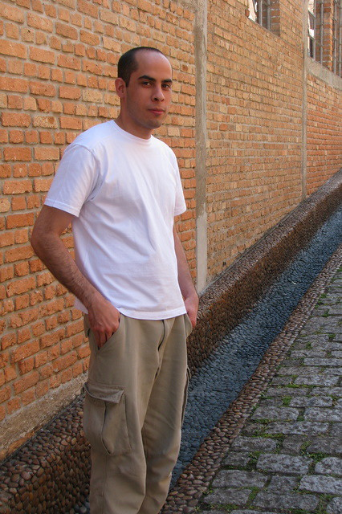{.margin}

Em 2007, meu irmão Henrique Araújo Costa concebeu o projeto de criar uma plataforma de publicação independente, na qual um dos elementos centrais fosse a possibilidade de que os leitores comentassem os textos contidos na página. O Boletim Zero, no qual o projeto foi lançado ao mar, começava assim:

> O Arcos tem por ideal estimular a polifonia no campo do direito. Queremos ajudar os autores a ter maior visibilidade e, principalmente, a que estabeleçam um diálogo mais direto e aberto com os leitores. Durante os últimos meses, a equipe do Arcos trabalhou na construção do Portal e na elaboração de ferramentas capazes de possibilitar a concretização desses objetivos.
>

Cada momento histórico traz as suas dificuldades referentes à possibilidade de que boas ideias conquistem espaço na arena pública. Em 2007 as informações ainda circulavam no formato de blogs e sites, cada qual desenvolvido e alimentado por seus autores, o que gerava uma barreira significativa de entrada para quem tinha boas ideias, mas poucos conhecimentos de informática. Como essas páginas eram iniciativas isoladas, havia uma dificuldade muito grande de lhes conferir visibilidade. Hoje, com a hegemonia das redes sociais, tornou-se mais fácil "produzir conteúdo", mas continua sendo um desafio imenso o de conquistar visibilidade, ainda mais depois que a circulação das informações se concentrou em um pequeno número de plataformas, cada qual submetida a algoritmos voltados a maximizar os ganhos com publicidade.

O projeto Arcos buscava surfar a mesma onda que movia as redes sociais que se consolidavam naquela época: servirem como espaço para que as pessoas publicassem os conteúdos que produziram, sem uma curadoria direta (que tornaria a manutenção economicamente inviável), mas apostando na própria autorregulação dos conteúdos, que seriam mais visíveis caso fossem bem avaliados pelos outros leitores. Tratava-se de um projeto concebido ao mesmo tempo que outras plataformas com objetivo similar e que se tornaram dominantes em seus campos, como o StackOverflow e o Academia.edu. Tal como essas iniciativas, nosso projeto identificava a potencialidade da interação permitida pelas novas tecnologias, mas não fomos capazes de gerar no site arcos.org um fluxo de textos e comentários que o tornasse sustentável.

O crescimento das redes sociais depende da capacidade de acumular uma quantidade relevante de usuários e de fazer com que eles se dediquem à produção autônoma de conteúdos, objetivo que não conseguimos fomentar em tempo hábil, apesar dos nossos esforços e dos grandes investimentos realizados por Henrique. Alguns anos depois, o site original foi descontinuado, visto que o ambiente digital foi consolidado em certas plataformas monopolistas (ou altamente concentradas) e o site Arcos se tornou aos poucos defasado frente às tecnologias que se tornaram dominantes na internet, sem que fosse economicamente viável uma atualização.

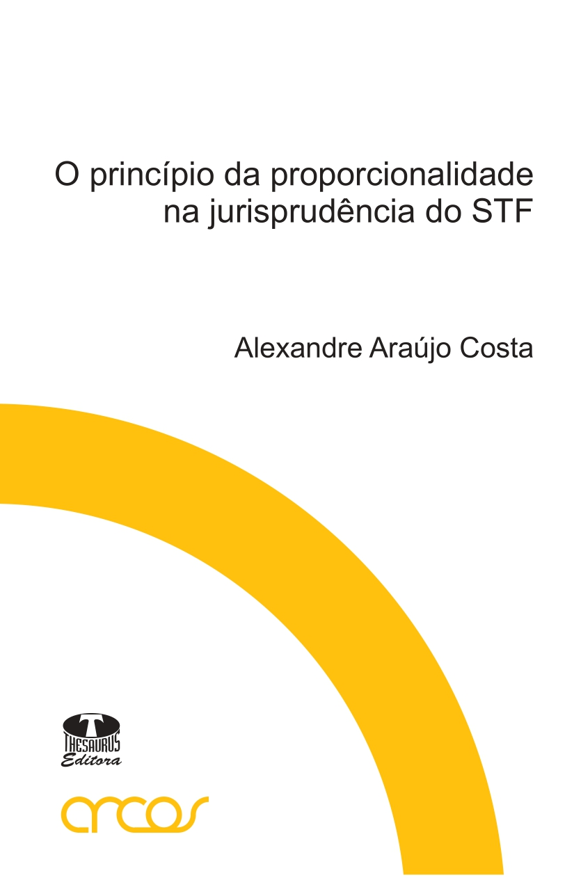{.margin}

Enquanto o Projeto Arcos estava ativo, ocorreu uma já referida alteração do mercado editorial, permitindo a publicação de textos com baixa tiragem. Em 2008, aproveitando esta oportunidade, estabelecemos uma parceria com a Editora Thesaurus, na qual publicamos alguns dos textos que estavam prontos, e que se tornaram viáveis pelo novo modelo de impressão sob demanda: minha dissertação de mestrado e dois livros em coautoria com Henrique.[^thesaurus1][^thesaurus2][^thesaurus3][^thesaurus4]

[^thesaurus1]: Costa, Alexandre. *O Controle de Razoabilidade no Direito Comparado*. Brasília: Thesaurus, 2008.
[^thesaurus2]: Costa, Alexandre. *O princípio da proporcionalidade na jurisprudência do STF*. Brasília: Thesaurus, 2008.
[^thesaurus3]: Costa, Henrique; Costa, Alexandre. *Direito da Publicidade*. Brasília: Thesaurus, 2008.
[^thesaurus4]: Costa, Henrique; Costa, Alexandre. *Erro Médico: a responsabilidade penal e civil de médicos e hospitais*. Brasília: Thesaurus, 2008.

Eu e Henrique viemos de uma casa em que a informática esteve sempre presente, tanto pela formação acadêmica da minha mãe, **Selma Maria Costa Póvoa Araújo**, quanto por sua longa experiência na Secretaria de Informática do STJ. Muito antes de "algoritmo" se tornar uma palavra da moda, ela me ensinava que seu trabalho era o de produzir algoritmos, desenhados em uma folha de papel, na qual planejava as diversas funcionalidades de um sistema de computação. Olhando em perspectiva, parece natural que seus filhos desenvolvessem um interesse especial em tecnologia, mesmo que toda a nossa formação universitária tenha sido em ciências humanas e sociais.

Ainda hoje, trabalho conjuntamente com Henrique nessa interface entre sociedade, direito e tecnologia. Ele continua sendo a pessoa que desbrava os sistemas, descobre as novidades e está sempre prospectando as próximas ondas de mudanças. Foi assim com o portal Arcos original e com a descoberta da plataforma Ghost, sobre a qual construímos o atual site Arcos. Também foi ele que me apresentou os programas de produção de gráficos que uso e toda a base tecnológica que utilizamos em nosso trabalho na graduação e na pós-graduação da UnB: ferramentas como AirTable (ainda hoje usada para a seleção dos candidatos), Vzy (que usamos para construir o site do PMPD), Ghost (que usamos para o site arcos, para as disciplinas e para a revista técnica) e todas as outras que usamos no PMPD (Programa de Pós-Graduação em Direito, Regulação e Políticas Públicas). Sem a sua influência e o seu estímulo, eu não teria me tornado professor das disciplinas de ciência de dados que hoje ministro na Faculdade de Direito, usando as ferramentas que ele me ensinou a manejar.

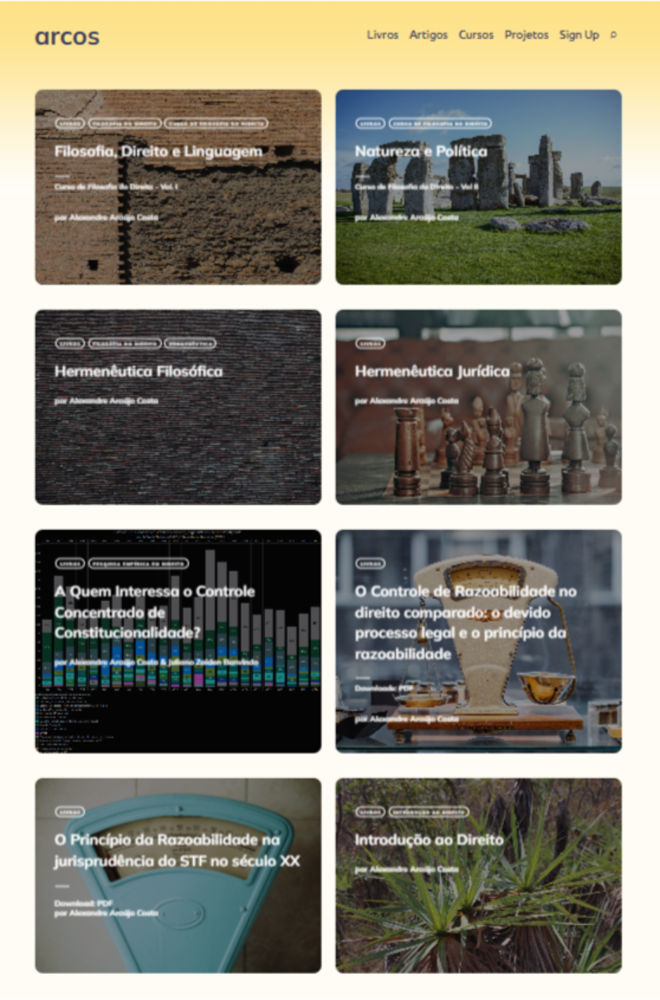{.margin}

Com a descontinuidade do projeto Arcos original, criamos um novo site, menos ambicioso: não mais era um espaço para publicação autônoma de textos, de normas e de comentários, mas um local onde disponibilizamos a nossa produção: https://arcos.org.br/. Atualmente, constam dele 8 livros meus e 12 artigos, meus e de Henrique. Criamos também uma rede de sites, nos quais publicamos nossos cursos e textos, mas essa história contarei no contexto da pandemia, que foi o gatilho que nos fez retomar o fôlego para disponibilizar nossa produção em um formato aberto e acessível.

### 3.3 Grupo de Estudos Direito e Linguagem (GEDLing) (2006-2009)

Em 2006, quando eu ainda estava no Doutorado e atuava como professor voluntário, fui procurado por alguns alunos, com Júlio César Soares à frente, propondo que a gente criasse um grupo para discutir textos do Habermas, a partir de uma perspectiva de filosofia da linguagem. Registrado no CNPq em 2007, este foi um grupo pelo qual passaram tantas pessoas que marcaram profundamente a minha formação que eu não conseguirei ser exaustivo. Algumas pessoas ficaram mais tempo, outras menos, e agradeço a todas elas no nome do Felipe Farias, que me acompanha desde a primeira composição do grupo, em 2006, até os dias de hoje.

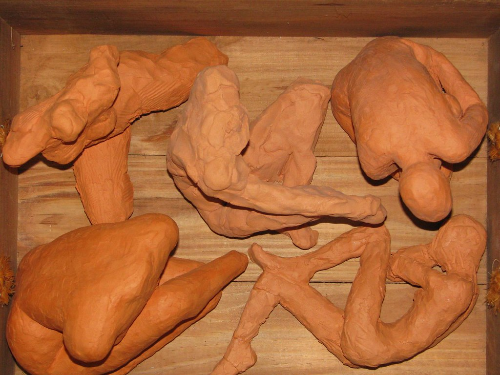{.margin}

Este grupo foi uma das grandes experiências acadêmicas de que eu participei. Durante vários anos, tivemos reuniões semanais (por vezes, na universidade, por vezes, na minha casa) em que líamos e discutíamos textos de filosofia política, de teoria jurídica, de ética, bem como os trabalhos que cada um de nós produzia. O que nos unia era uma sensibilidade filosófica que foi bem resumida pelo Guilherme Sena: éramos aqueles que tinham lido Nietzsche na adolescência e nunca nos recuperamos do seu impacto. Tentei aplicar neste grupo tudo o que eu havia aprendido com Warat e com Miro acerca do que um grupo acadêmico deve ser: aberto, plural e acolhedor. A participação em um coletivo como esse deveria ser capaz de enriquecer a vida, tanto acadêmica como pessoal, de todos os integrantes.

Nem sempre conseguimos realizar esse objetivo, mas sempre nos esforçamos para que a liberdade de discutir todas as nossas ideias viesse junto com um acolhimento das diferenças que nos marcavam, para que todos pudessem se sentir incluídos e incluídas. Uma de nossas discussões recorrentes era a de como o grupo poderia adotar posturas que acolhessem as mulheres de forma mais efetiva, pois havia o sentimento de que as mulheres tendiam a ficar no grupo por menos tempo que os homens.

Adotamos a denominação Grupo de Estudos Direito e Linguagem, com a sigla GEDLing, pela qual nós nos identificamos até que eu ingressei no IPol (em 2009), quando o nome do grupo foi modificado para Política e Direito[^gpd], com o objetivo de poder contemplar melhor a minha atuação na ciência política.

[^gpd]: As atividades do grupo foram descritas na nota: Gomes, Kelton O.; Costa, Alexandre. *Grupo de Pesquisa Política e Direito*. Revista dos Estudantes de Direito da Universidade de Brasília, v.1, p.329-333, 2013.

Um grupo longevo tende a passar por várias fases, por ter uma composição cambiante e por ter períodos de maior e menor atividade. Tivemos reuniões constantes de 2006 a 2013. Depois desta época, passamos algum tempo com reuniões esparsas, mais afetivas que de trabalho. De tempos em tempos, planejamos sem sucesso uma "ressurreição" do grupo, mas ele tem de fato se resumido a um espaço de diálogos com alguns membros antigos e alguns orientandos meus mais novos, sem leituras conjuntas e sem encontros periódicos.

Consultando centenas de e-mails que as pessoas do grupo trocaram ao longo do tempo, identifiquei algumas das que participaram com especial intensidade de várias reuniões e debates[^gedling]. Neste grupo, vários dos seus integrantes apresentaram os projetos que os levaram para a pós-graduação. Até hoje, muitos de nós têm uma relação tanto intelectual como afetiva.

[^gedling]: Sem ser exaustivo, cito os nomes dos membros do grupo que participaram constantemente de reuniões e debates, ao menos em alguma fase do grupo, ao longo desses vários anos: Amanda Lima, André Gomes, Bruno Garrote, Bruno Vial, Carlos Cavasin, Douglas Zaidan, Eduardo Rocha, Fábio Portela, Fabrício Noronha, Felipe Farias, Fernando Gomes, Flávio Carvalho, Guilherme Sena, Gustavo Capela, Hanna Xavier, Jaqueline Silva, João Gabriel, João Telésforo, Julio Cesar Soares, Kelton Gomes, Laís Maranhão, Leonardo Amorim, Letícia Lengruber, Liana Issa, Luciana Freire, Marcio Freitas, Maria Gutenara, Paulo Rená, Ricardo Horta, Rodrigo Vasconcelos, Roger Rex, Talitha Selvati e Thiago Maciel.

### 3.4 Extensão

#### 3.4.1 Direito e arte: Cabaré Macunaíma

Warat atuou no doutorado em direito da UnB desde a sua criação, em 2005. A atividade de Luis se deu no momento final de sua obra, quando ele estava concentrado nas relações entre direito e arte. A fase em que Warat se debruçou sobre a mediação trouxe para o centro de suas preocupações a questão da subjetividade: para ele, a transformação do direito exigia uma transformação da subjetividade dos juristas, daquilo que mobiliza e conforma suas sensibilidades.

Essa busca de uma "razão sensível" levou Luis a propor, no doutorado, o retorno a seu Manifesto do Surrealismo Jurídico, que começa dizendo: "juntar o direito à poesia já é uma provocação surrealista"[^surrealismo]. Há décadas Warat trabalhava as conexões entre direito e arte, como testemunha o diálogo com Cortázar e Jorge Amado, que ele realizou no "A ciência jurídica e seus dois maridos". Todavia, sua particular forma de fecundar as abordagens teóricas com metáforas literárias e artísticas lhe pareceu uma abordagem insuficiente, que era preciso radicalizar. Como resumiram Marta Gama e Mariana Veras, duas das protagonistas deste movimento:

> Warat pretendia por em andamento a proposta formulada no seu Manifesto do Surrealismo Jurídico, reinventar o ensino jurídico a partir dos aportes do surrealismo e da carnavalização. O re-encantamento do mundo através do amor, da magia, da poesia e da loucura, além dos desvios instaurados pelo inconsciente atravessados pelo desejo. Formas de conhecimento abortadas pela modernidade em sua cruzada de “desencantamento” do mundo, pela promessa de submeter os domínios da vida humana a uma racionalidade puramente instrumental.[^gama]

[^surrealismo]: Warat, L. A. *Manifestos para uma ecologia do desejo*. Em: Warat, L. A. Territórios Desconhecidos: a procura surrealista pelos lugares do abandono do sentido e da reconstrução da subjetividade. Florianópolis: Boiteux, 2004.
[^gama]: Gama, Marta, Veras, Mariana. O Cabaret Macunaíma: Cartografia da epistemologia carnavalizada.

O retorno ao surrealismo não deveria se dar por meio de uma teoria surrealista, mas de uma prática surrealista: a encenação de uma adaptação antropofágica do Cabaret Voltaire, sarau artístico dos dadaístas. Luis nomeou esta versão carnavalizada do Cabaret Voltaire como Cabaré Macunaíma: um sarau aberto à participação de todos, no qual Warat era o mestre de cerimônias e os juristas (e não-juristas) eram chamados a mostrar a sua própria produção artística. Suas aulas de *Arqueologia Crítica das Teorias Jurídicas*, ministradas no início de 2005, passaram a ser dedicadas à preparação do sarau, a exercícios de dança e de teatro, que teciam um ambiente amoroso, dentro do qual a subjetividade dos estudantes poderia aflorar de forma criativa.

Warat se contrapunha ao processo de pinguinização que as faculdades de direito operavam, transformando jovens criativos por meio da castração de sua originalidade subjetiva. Uma educação jurídica que reproduz as hierarquias sociais, como dizia Duncan Kennedy[^kennedy], precisa colonizar os desejos e produzir subjetividades anódinas, capazes de banalizar a opressão e a violência inscritas nas relações de poder que o direito opera. Para desorganizar o conformismo e provocar as subjetividades, Luis propôs uma prática que resgatasse a criatividade dos juristas em formação, sob a intuição de que uma pessoa capaz de se abrir ao mundo em um sarau surrealista seria também mais capaz da escuta sensível e da abertura para o outro que a prática do direito exige.

[^kennedy]: Kennedy, Duncan. *Legal Education and the Reproduction of Hierarchy: A Polemic Against the System*. New York: NYU Press, 2004.

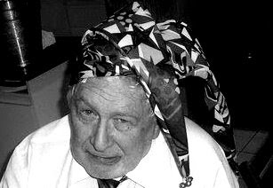{.margin}

A proposta de Warat era a de que, ao final de cada semestre letivo de preparação, fosse realizado um encontro público. O primeiro ocorreu no mezanino do Café Rayuella, na Asa Sul. O segundo encheu de poesia os jardins e o espelho d'água sem água da Faculdade de Direito da UnB, com apresentações de dança, poesia, circo e música. Imagino que a FD nunca tenha sido tão poética quanto naquela noite.[^waratianos]

[^waratianos]: Muitas foram as pessoas que se integraram na experiência dos cabarés, em suas diversas edições, mas queria destacar as pessoas que participavam do Grupo Direito e Arte e estiveram na base da organização e das apresentações dessas duas edições: Adriana Miranda, Ariadne Barreto, Bruno Vial, Carolina Pinheiro, Carolina Tokarski, Daniela Diniz, Hanna Xavier, Mariana Veras, Marta Gama, Maurício Araújo, Eduardo Rocha, Eneida Dultra, Fábio de Sá e Silva, Luciana Ramos, Jorge Medeiros, José Geraldo, Márcio Luis, Paula Ravanelli, Pedro Diamantino, Rosane Lacerda e Thaís Dumêt.

Inicialmente, Warat não queria que escrevêssemos sobre a experiência do Cabaré, com o receio de que a racionalização imposta pela narrativa colocasse a perder a rede de sensibilidades construída. Luis não queria textos sobre o Cabaré, mas vivências efetivamente sensíveis, experiências que somente faziam sentido enquanto vividas, e não enquanto descritas. Por esse motivo, escrever sobre o Cabaré é uma espécie de traição ao que Warat dizia, mas já em pleno paradoxo, tendo em vista que não era possível expandir a experiência sem tematizá-la.

Olhando em perspectiva, creio que o principal legado dos cabarés surrealistas waratianos não é teórico, como ele próprio desejava. A experiência artística compartilhada cria laços entre os participantes, especialmente entre aqueles que não têm formação artística e enfrentam conjuntamente o desafio de prepararem obras e habilidades que permitam que o espetáculo aconteça. Olhado de fora, pode ser uma expressão artística amadora, feita por pessoas com mais paixão do que talento. Mas, visto de dentro, que é o que importa para Luis, trata-se de uma experiência que nos arremessava coletivamente em uma arena de insegurança, desencadeando um exercício de abertura subjetiva do qual emergiam conexões afetivas profundas, que ligam até hoje todos os seus participantes.

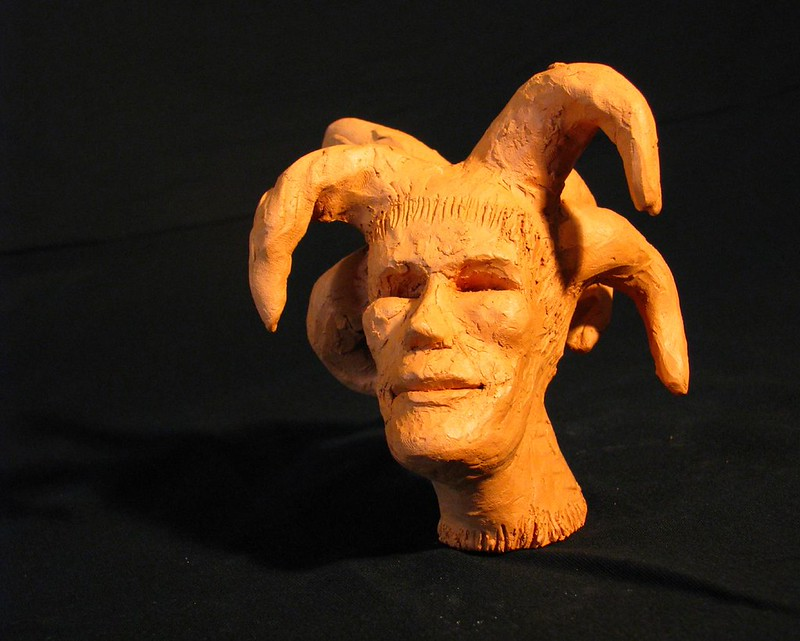{.margin}

Um grupo de pessoas que se reconhecem como capazes de um arriscado exercício de exposição de sensibilidades. Saímos dessa experiência mais sensíveis e mais seguros, com uma sensação de pertencimento e com a consciência de que nossas ousadias epistêmicas não são um desatino individual, mas parte de um projeto coletivo de ampliação de horizontes intersubjetivos.

O fato de que vivemos tudo isso dentro do prédio da faculdade de direito modifica profundamente a nossa relação poética com o ambiente físico. Quem viveu o Cabaré Macunaíma atravessa os corredores e jardins sempre com a lembrança de que eles podem ser lugares de encantamento e de surpresa, de que existem camadas poéticas estruturando as nossas vivências pedagógicas, de modo que nossos elementos apolíneos e dionisíacos podem conviver em um equilíbrio dinâmico.

Lecionar onde se dança. Pesquisar onde se recita. Pensar atravessado pelos desejos do corpo que somos. Temos de fazer nossas investigações pegarem delírio, para que elas possam transbordar poesia. Tudo isso aprendemos uns com os outros, sob a desorientação amorosa de um Luis que tateava caminhos que nos ajudassem a encontrar uma vida mais plena e a realizar as utopias pedagógicas que ele traçou no Manifesto do Surrealismo Jurídico, propondo "corroer o monopólio de uma razão que propaga a submissão: saberes feitos de lugares comuns e falsos tesouros com os quais, por esquecimento de nossa singularidade, naturalmente concordamos."[^law]

[^law]: Warat, Luis. *Manifestos para uma ecologia do desejo*, p. 188.

Voltei a tratar longamente de Luis, neste memorial, porque ele é a minha maior influência. Minhas aulas são uma tentativa de corporificar os princípios que aprendi com ele. As ideias que concebo são testadas em uma conversa com o meu Luis interior, na qual imagino de que forma ele me ajudaria a escapar das armadilhas que armo e a trilhar caminhos mais inovadores e ousados. Os grupos que eu coordeno se voltam a tentar construir uma rede de afetos como as que Luis conseguia engendrar em torno de si, permitindo que nós conseguíssemos nos arriscar a inventar coisas novas.

Luis disse que "a ousadia é um privilégio dos que têm coragem"[^law2], mas essa coragem não é inata: aprendemos a lidar com o medo dentro de coletividades que acolhem nossas individualidades e nos servem ao mesmo tempo de trampolim e de rede de segurança. A confiança que Luis depositou em mim, e que constitui um dos pilares da minha coragem, eu tento transmitir também a meus amigos, alunos e orientandos.

[^law2]: Warat, Luis. *Manifestos para uma ecologia do desejo*, p. 191.

#### 3.4.2 Consultoria MEC

Em 2007, fui selecionado em edital do PNUD para prestar consultoria para a área normativa do MEC, sob a supervisão de Daniel Avelino, então Coordenador Geral de Legislação e Normas da Educação Superior. Em função das definições do edital, produzi um relatório sobre a possibilidade de Instituições de Ensino Superior utilizarem ações judiciais com o objetivo de obter provimento que autorize o funcionamento de curso superior. 

Como ocorre normalmente com os contratos realizados pelo PNUD e outros ligados à cooperação internacional, os meus trabalhos não se resumiram à elaboração do produto definido no edital, mas também envolveram a realização de outras tarefas, entre as quais a assessoria jurídica ao Grupo de Trabalho constituído pela Portaria MEC n. 172/2007, que instituiu o Banco de Professores-Equivalentes, formato então criado para desburocratizar a contratação de docentes pelas universidades públicas. Para essa função, eu elaborei um estudo sobre a sugestão de criação do referido banco, bem como a preparação de minutas dos instrumentos normativos necessários para a sua instituição.

### 3.5 Ensino e inovações pedagógicas

Entre 2001 e 2003, tive uma grande carga horária de aulas, pois era professor substituto. Em 2003, passei à condição de pesquisador colaborador e, de 2004 a 2008, quando se encerrou o meu doutorado, fui professor voluntário. Deixei essa condição apenas quando fui reprovado no concurso de 2008, para Direito Público, e decidi buscar outras inserções.

Como os pesquisadores e voluntários dão apenas uma disciplina por semestre, minha carga horária de sala de aula diminuiu bastante, o que era compatível com o caráter gratuito do meu trabalho e com o tempo dedicado ao planejamento e à redação da tese.

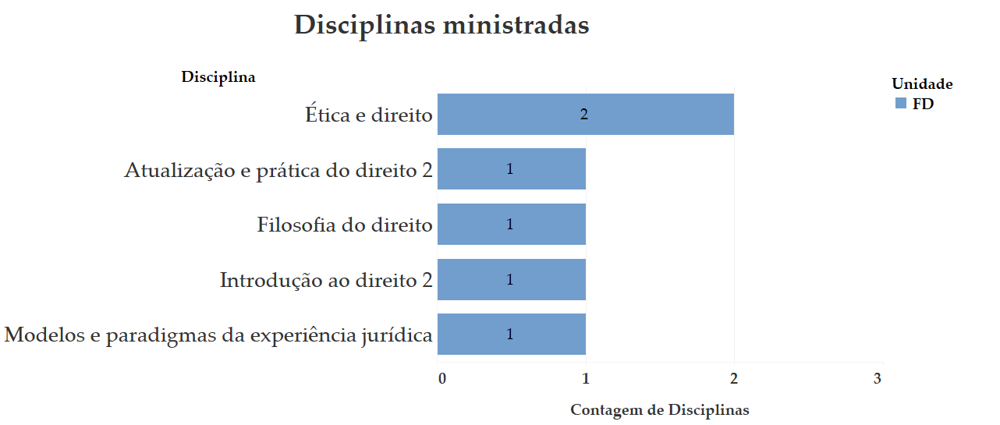

Uma inovação cujas raízes identifiquei neste momento foi o uso da dinâmica de os estudantes escolherem palavras e escreverem no quadro, como forma de avaliar quais são as percepções dominantes na turma. Redescobri que, em 2006, usei uma dinâmica semelhante em uma turma de Modelos e Paradigmas da Experiência Jurídica, dividindo a sala em grupos e pedindo que cada um deles selecionasse um conjunto de palavras. Depois disso, fui evoluindo para começar cada turma com essa dinâmica em que os estudantes escrevem no quadro em branco as palavras que lhes vêm à mente, em torno das categorias básicas de cada disciplina: Direito, Filosofia, Política, Pesquisa, Ética, etc.

Penso hoje que essa dinâmica é uma mistura de jogo de tarô com teste de Rorschach. As palavras no quadro são definidas por espécies de atos-falhos, nos quais o estudante mistura algo que ele gostaria de dizer, mas filtra essa escolha a partir de uma projeção acerca do que a turma gostaria de ouvir. Colocadas as cartas na mesa (ou as palavras no quadro...), resta interpretá-las, e os estudantes logo percebem que que o resultado da atividade expressava mais as inseguranças dos alunos do que a subjetividade individual de cada pessoa. Isso ocorre porque o quadro tipicamente fica preenchido por uma sequência de palavras conservadoras, que refletem o senso comum compartilhado e, por isso mesmo, parecem suficientemente "seguras" para que sejam escritas no quadro sem gerar atritos nem dúvidas sobre a sua pertinência.

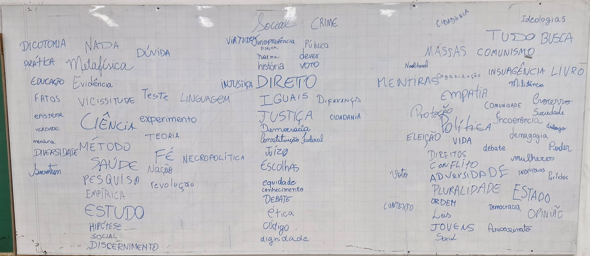{.margin}

Ao contribuir para que os estudantes entendam que o espaço jurídico parece solicitar delas a expressão de uma conformidade, a dinâmica abre espaço para a tentativa de identificar conceitos que descrevam mais adequadamente as dúvidas e anseios dos estudantes e que contribuam para que as aulas se constituam como um espaço de exploração e aprendizado, e não de reprodução de ideias prontas.

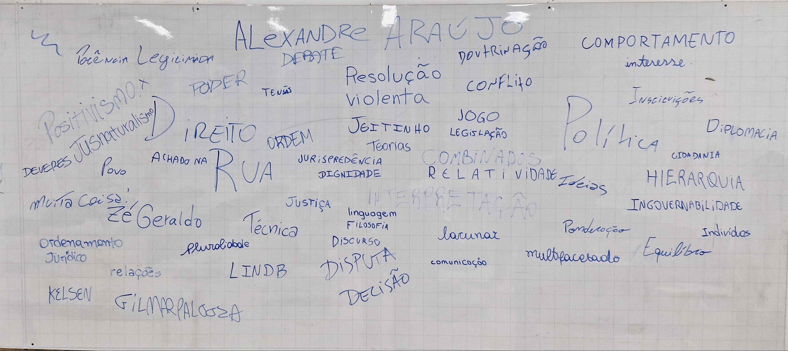{.margin}

### 3.6 Orientações

A limitada carga didática desse período reduziu minhas orientações de monografia. Todos os orientandos que tive nessa época foram meus alunos durante meu período de professor voluntário e eram bastante próximos de mim, fosse por amizade ou por participação conjunta em grupos de pesquisa.

Em 2006, orientei a monografia de **Ana Paula Villas Boas**,[^grad-anapaula] discutindo uma questão que estava na ordem do dia: os argumentos referentes à ADPF 54, que estava em curso no Supremo e versava sobre a possibilidade do aborto de fetos anencefálicos. O trabalho contestava a viabilidade de argumentos que afirmam que o feto anencefálico não seria vida, como forma de contornar artificialmente a tensão entre a vida do feto e a dignidade da mãe. Enquadrando a questão como um efetivo conflito entre direitos, Ana Paula afirmava que essa questão deveria ser resolvida por meio de uma ponderação de valores, superando o mito do valor intrínseco da vida e viabilizando um tratamento do tema adequado à dogmática dos direitos fundamentais.

O mesmo tema foi abordado também, já em 2008, pelo TCC de **Hanna Xavier Ferreira**,[^grad-hannaxavier] que integrou o primeiro grupo de literatura (em 2003) e participou ativamente do GEDLing durante vários anos. Hanna efetuou uma análise minuciosa dos votos que decidiram a referida ADPF 54, numa abordagem hermenêutica que revelava a influência dos estudos realizados no grupo de pesquisa.

[^grad-anapaula]: Villas Boas, Ana Paula. *ADPF n. 54: a propósito da vida*. TCC, Direito/UnB, 2006.
[^grad-hannaxavier]: Ferreira, Hanna Xavier. *A travessia argumentativa na ADPF 54-08/DF: uma reflexão sobre a judicialização do aborto*. TCC, Direito/UnB, 2008.

Também em 2006, orientei o TCC de **Carolina de Martins Pinheiro**,[^grad-carolina] no qual se cruzavam as experiências do Grupo de Pesquisa Pensamento Social e do Grupo Direito e Arte, dos quais ela participava. Em um texto que abordava a escuta criativa como forma de possibilitar que as pessoas envolvidas em um processo judicial se sentissem efetivamente ouvidas, ampliando a legitimidade democrática do judiciário, Carolina realizou uma síntese das influências de Warat e de Miro, cuja qualidade fez com que esse trabalho obtivesse primeiro lugar no 1º Prêmio Novas Ideias para a Justiça, do Sindjus/DF, na modalidade monografia. Já em 2007, orientei o TCC de **Guilherme Lucio de Moraes**,[^grad-guilhermemoraes] que dialogava diretamente com as questões que eu abordava no meu doutorado, avaliando criticamente o discurso fundacionista moderno, a partir do pano de fundo das abordagens heideggerianas e hermenêuticas.

[^grad-carolina]: Pinheiro, Carolina de Martins. *Escuta criativa: micropolítica e democratização do sistema de justiça*. TCC, Direito/UnB, 2006.
[^grad-guilhermemoraes]: Moraes, Guilherme Lucio de. *Entre sujeitos e objetos: uma análise hermenêutica da fundação do direito moderno*. TCC, Direito/UnB, 2007.

A última monografia de graduação que orientei na condição de professor voluntário foi a de **Bruno Garrote Marques**,[^grad-brunogarrote] que se dedicou a fazer uma ponte entre direito e filosofia. Com a autonomia e originalidade que lhe são peculiares, Garrote escreveu um TCC no formato de cartas. Trata-se de um texto que dialoga diretamente com a obra de Julio Cabrera, docente do curso de Filosofia que foi professor de filosofia da linguagem tanto meu como de Bruno. Depois disso, Garrote mudou-se para São Paulo, onde fez mestrado e doutorado no Largo do São Francisco, tendo eu participado de ambas as bancas.

[^grad-brunogarrote]: Marques, Bruno Garrote. *Do livre-arbítrio e da justiça: cartas a um amigo distante*. TCC, Direito/UnB, 2009.

Nessa época, também começou a minha carreira de professor de metodologia científica, que ministrei em dois cursos de especialização da UnB: Especialização em Direito Financeiro e Especialização em Direito Internacional dos Conflitos Armados. Dos TCCs que orientei nessas minhas primeiras experiências como professor de pós-graduação, destaco o trabalho de **Rafael Bezerra Ximenes de Vasconcelos**,[^esp-rafael] que utilizou o conceito de justiça distributiva em Aristóteles para mapear e analisar os desafios enfrentados pela regulação financeira, realizando um incomum acoplamento entre filosofia moral e direito administrativo.

[^esp-rafael]: Vasconcelos, Rafael Bezerra Ximenes de. *A justiça distributiva e seus desafios conceituais para a disciplina jurídica da regulação financeira*. Especialização em Direito Financeiro, 2006.

## 4 Instituto de Ciência Política (2009-2014)

### 4.1 Aprovação no Concurso

Os caminhos que levam uma pessoa ao cargo de professor do magistério superior são tipicamente tortuosos, mesmo para as pessoas vocacionadas. Como eu caminhava à margem dos principais grupos, minhas chances de ingresso na Universidade eram pouco expressivas. Em 2009, minha situação na Faculdade de Direito era peculiar: eu era professor há quase dez anos, lecionando várias disciplinas filosóficas, mas nem essa experiência nem o reconhecimento que eu tinha pelos discentes tendia a me tornar um candidato competitivo para as vagas que eram abertas. De certa forma, lecionar voluntariamente disciplinas de ética e filosofia nas noites de sexta-feira terminava por reduzir a própria demanda para que uma vaga de concurso fosse destinada a alguém com o meu perfil.

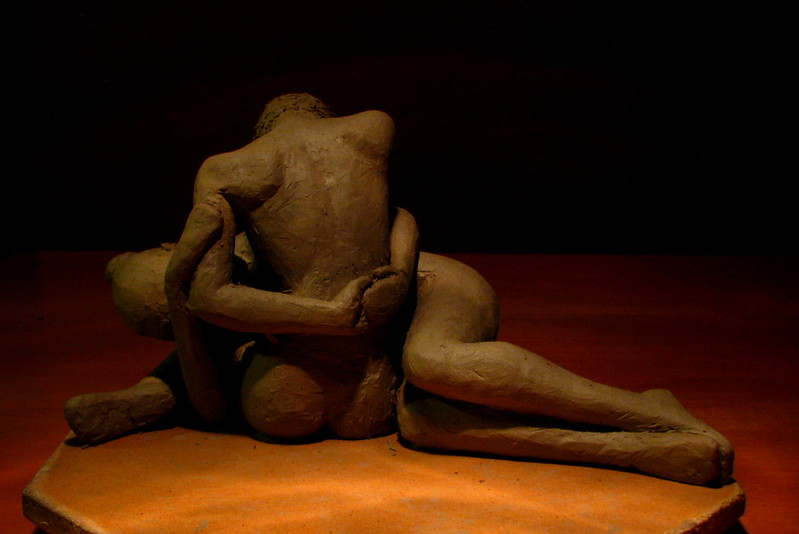{.margin}

No primeiro concurso que fiz para a Faculdade de Direito, ainda como mestre, fiquei em segundo lugar de forma merecida, pois o primeiro colocado era mais experiente e mais capacitado do que eu. Em 2008, eu havia acelerado o término do doutorado para poder concorrer a duas vagas que haviam sido abertas. Eu queria ter escrito mais coisas, mas Luis me disse com acerto: o doutorado é um título, não é uma qualificação. Defenda o que você tem e concorra. Competi com candidatos bem formados, mas tive um resultado aquém do esperado, o que me fez imaginar que seria mais produtivo buscar inserção em outros espaços acadêmicos.

Dediquei-me, então, a prestar concursos para outras universidades. Em 2009, passei para a UniRio e cheguei a ajustar o aluguel de um apartamento em Botafogo, para onde não cheguei a me mudar porque a minha nomeação ficou pendente muito tempo e não me pareceu razoável deslocar-me para o Rio antes de tomar posse no cargo, como me tinha sido sugerido.

Nesse meio tempo, surgiu um concurso que chamou a minha atenção: tratava-se de uma vaga voltada para Ética e Política, no Instituto de Ciência Política da UnB (IPol). Eu tinha sido professor por vários anos de Ética e Direito, o que me parecia basicamente a mesma coisa, pois o meu curso envolvia uma discussão acerca de como as abordagens éticas antigas, modernas e contemporâneas poderiam nos ajudar a compreender as formas pelas quais enfrentamos os desafios éticos atuais. Na esteira de Miro, eu tentava pensar contemporaneamente a vida ética e política contemporânea, sendo que o direito me dava apenas um repertório de exemplos e situações a analisar. Como os parâmetros definidos no edital estavam todos ancorados na filosofia, bastava um ligeiro trânsito de contexto para eu concorrer a uma vaga para a qual eu intuía que não havia muitas pessoas capacitadas.

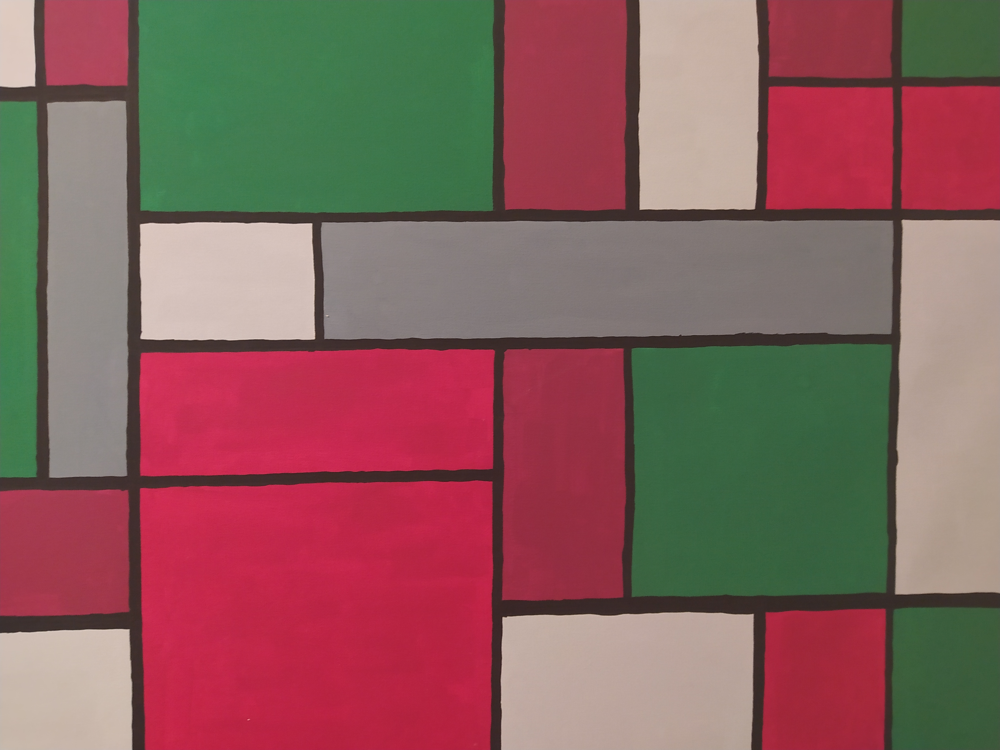{.margin}

Fiz a inscrição, sem muita esperança, pois eu não sabia se o concurso era direcionado para alguém que trabalhasse no IPol nessa área. Para a minha surpresa, as indicações que recebi foram de que não se tratava de um concurso homologatório, mas de uma seleção realmente voltada para identificar alguém capacitado para assumir uma disciplina nessa área. Não estudei nada para este certame, pois dominava todos os temas previstos. Na hora da prova, me disseram que eu podia excluir do sorteio dois dos temas previstos e eu sequer tinha planejado o que fazer... disse que podiam sortear qualquer um, mas acabei tendo de escolher dois pontos para retirar naquela hora, visto que esta era uma determinação do edital.

Tive também a sorte de que um dos membros da banca era Gerson Bréa, professor de filosofia e profundo conhecedor da hermenêutica filosófica. Eu nunca tinha tido contato com ele antes da prova, mas as perguntas mais complexas que ele fazia eu conseguia enfrentar a partir de uma combinação da literatura de ética e de hermenêutica, que eram os temas que eu tinha estudado mais longamente na década anterior. A fortuna às vezes nos favorece e aquele foi um momento peculiar para mim, que era a pessoa certa, no lugar certo, concorrendo para uma vaga que não foi modelada para mim, mas é como se tivesse sido. Terminei sendo o único aprovado neste concurso, cuja existência decorria do Reuni, programa do governo federal que promovia a expansão das vagas da universidade pública.

Depois de mais de uma década de vagas distribuídas a conta-gotas, repondo as poucas aposentadorias, houve este momento de inédita ampliação da universidade, que alterou profundamente a organização das unidades acadêmicas: houve espaço para uma grande oxigenação, com entrada de quadros muito diversos. No curso de direito, essa ampliação abriu espaço para muitas pessoas que não estavam nos grupos hegemônicos e que eram, em sua maioria, doutores titulados há pouco tempo. Essa janela de oportunidade logo se fechou e, infelizmente, não foi reaberta nesses últimos 15 anos, durante os quais mesmo os doutores mais capacitados têm poucas chances de ingresso na carreira do ensino superior.

Fui rapidamente aprovado e nomeado no IPol, para ministrar uma disciplina que me agradava imensamente, em um curso de excelência, com uma pós-graduação sólida e pesquisadores de influência nacional. Embora a ida para o Rio de Janeiro fosse uma oportunidade ímpar para uma pessoa que, como eu, havia nascido e estudado sempre em Brasília, entendi que as perspectivas que eu tinha no IPol eram mais interessantes e desafiadoras. Resolvi ficar na cidade, cancelei o contrato de locação no Rio e, no segundo semestre de 2009, comecei a lecionar Ética e Política na UnB.

### 4.2 Ensino e inovações pedagógicas

A minha vaga no IPol era vinculada à criação de um curso consorciado de Gestão de Políticas Públicas (GPP), que envolvia os departamentos de Administração, de Economia e o Instituto de Ciência Política. A disciplina de Ética e Política era optativa para os alunos do IPol, mas obrigatória para os do GPP, que coordenei entre 2011 e 2013. Fui o segundo coordenador do curso, em um momento decisivo para a consolidação da sua estrutura curricular e das estratégias de um TCC adequado para esse bacharelado. Logo depois da minha coordenação, o GPP deixou de ser um curso consorciado e foi assumido pela FACE, até que, em 2015, fosse criado o Departamento de Gestão de Políticas Públicas.

Na graduação do IPol, lecionei repetidas vezes as disciplinas de Ética e Política (voltada sobretudo ao GPP) e de Teoria Política Moderna. Naquele momento, meu maior desafio foi desenvolver um curso de Teoria Política Moderna, que eu ofertava normalmente para a turma de ciências sociais. Foi quando entendi que a filosofia política da modernidade era, basicamente, uma filosofia jurídica, visto que a sociedade era apresentada como uma relação contratual celebrada por sujeitos autônomos.

Raras vezes tive salas tão diversas quanto minhas turmas voltadas para a sociologia e a antropologia, mas com muitos alunos também da ciência política e alguns do direito. Foi um momento no qual eu me sentia, de fato, professor da Universidade de Brasília, e não de uma unidade em particular, porque as minhas salas envolviam um diálogo constante com outros campos, explorando muitas conexões da filosofia que eu ainda não tinha analisado devidamente.

Ainda em 2009, ingressei no Programa de Pós-Graduação em Ciência Política (PPGCP). Meus primeiros orientandos de pós-graduação foram nesse Programa. Pouco depois, também me credenciei como orientador no PPG em Direito, onde passei a lecionar anualmente uma turma da disciplina obrigatória deste programa: Filosofia Política e Direito Constitucional. Eu dava uma turma que envolvia 10 alunos do PPGD e outros 10 alunos do PPGCP, experiência cujos diálogos foram modelando a minha forma atual de apresentar o direito como uma parte da política.

O curso que desenvolvi naquela época (entre 2010 e 2014) foi a base das disciplinas de filosofia do direito que passei a lecionar na graduação da Faculdade de Direito, que eram uma versão um pouco simplificada do curso modelado para a pós-graduação. Mas ainda hoje essas disciplinas mantêm a abordagem multidisciplinar que as caracterizou desde o início.

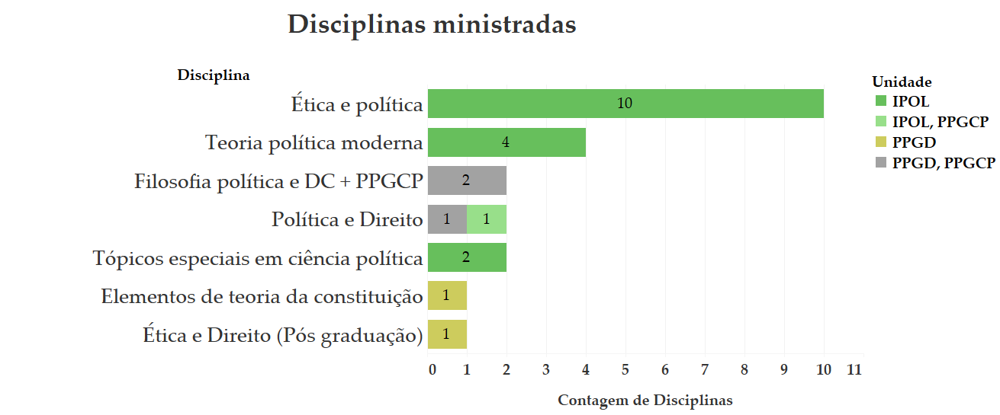

Nesta época, a matéria que ministrei mais frequentemente foi a de Ética e Política, cursada principalmente pelos estudantes de Gestão de Políticas Públicas, mas também por alunos do IPol e da FD. Desde o início de minha experiência com a disciplina de Ética e Direito, minhas inspirações waratianas me faziam explorar as relações entre arte e filosofia, principalmente porque muitas obras artísticas serviam como elementos privilegiados para a exploração das correntes filosóficas que estudávamos na disciplina.

Quando eu comecei minhas atividades no IPol, as referências ao cinema deixaram de ser apenas elementos de apoio e se tornaram um dos núcleos centrais da disciplina. Para cada módulo semanal, eu indicava filmes como material complementar e estimulava que os relatórios fossem feitos em diálogo com eles. Os trabalhos finais das disciplinas costumavam ser análises de obras artísticas, feitas em diálogo com as teorias filosóficas.

Com o tempo, o número de filmes referidos foi se acumulando ao ponto de construir uma lista com 99 filmes, de diversas épocas, diretores e estilos. Essa quantidade de obras possibilitou sortear para cada aluno, no primeiro dia de aula, um filme que ele deveria ver e sobre o qual deveria realizar o seu trabalho final. Essa abordagem possibilitava que os estudantes assistissem ao filme logo no começo da disciplina e tivessem um ponto a partir do qual poderiam estabelecer relações e comparações ao longo do curso.

### 4.3 Grupos de Pesquisa

#### 4.3.1 Política e Direito (P&D)

Nunca tinha me atentado para quão intensos foram para minha vida acadêmica os anos que passei no IPol. Logo que entrei no instituto, dediquei-me a manter constante o ritmo de reuniões do meu Grupo de Pesquisa, que foi rebatizado como Política e Direito, para acomodar a minha nova função de professor concursado do Instituto de Ciência Política.

Sob esta nova denominação, o grupo teve reuniões constantes entre 2010 e 2013. Foi uma época em que coloquei em prática o que aprendi com Miro e Warat: que os grupos precisam ser lugares de circulação de afetos, o que fazia com que as portas da minha casa estivessem sempre abertas aos seus integrantes e que compartilhássemos não apenas encontros na universidade, mas também em bares, sambas, churrascos e outros eventos nos quais convivíamos, debatíamos e sonhávamos juntos. Se a vida é a arte do encontro, como dizia Vinícius, nós exercemos com intensidade esta arte, durante vários anos.

Foi em meio a esse ambiente afetivo que nasceu Mathias Lengruber Costa, em 2012, meu primeiro filho com Letícia Lengruber, que é minha companheira até hoje e integrou o Grupo de Pesquisa quando ele se chamava GEDLing, em sua primeira formação.

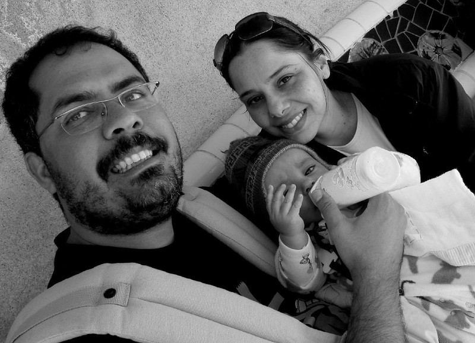{.margin}

No confuso ano de 2013, os variados compromissos dos seus integrantes inviabilizaram a continuidade dos encontros regulares, embora as conversas e as amizades permanecessem constantes. Vários dos membros estavam imersos nas suas pesquisas de mestrado e doutorado, o que dificultava sobremaneira encontrar textos comuns e tempo para discuti-los. Em 2014, tentamos retomar as reuniões do grupo, mas já não foi possível encontrar um denominador comum e uma agenda compartilhada.

#### 4.3.2 Filosofia da Biologia

Em 2011 também, a convite de Fábio Portela, integrei-me ao Grupo de Pesquisa em Filosofia da Biologia, coordenado pelo professor **Paulo Abrantes** e composto por alguns dos membros do Política e Direito: além de Fábio (que construiu neste grupo o projeto do seu doutorado), também Thiago Oliveira, Ricardo Horta e Roger Valério de Vargas Rex. Quando o grupo de Política e Direito deixou de ter reuniões semanais, a participação no Filosofia da Biologia me deu a possibilidade de fazer um constante exercício de leitura e exploração de novos horizontes de compreensão.

Permaneci neste grupo por vários anos, e ele foi muito importante para a minha formação, pois nele ampliei meus estudos sobre teorias biológicas e de ciências sociais, que me permitiram desenvolver um novo olhar sobre o desenvolvimento da política em nossa espécie. A participação no grupo fez com que eu passasse a entender a humanidade a partir da categoria de "espécie" e também que sempre observasse os processos históricos a partir de uma combinação de evolução e desenvolvimento. A bibliografia que discutíamos em reuniões semanais, além de proporcionar debates riquíssimos com pesquisadores como **Claudio Araújo Reis** e **Frederico Gonçalves**, marcou profundamente os meus cursos de Filosofia Política, que passaram a adotar uma visão histórica centrada no modo como a espécie humana desenvolve suas relações políticas.

### 4.4 Orientações

#### 4.4.1 Orientações de Mestrado

No final de 2009 eu ingressei no PPG em Ciência Política, onde passei a lecionar, mas não tive orientandos durante algum tempo. No ano seguinte, eu ingressei no PPGD e, nos anos que se seguiram, vários dos integrantes mais constantes do P&D fizeram seus processos seletivos para o mestrado em direito e posteriormente se tornaram meus orientandos neste programa.

**Guilherme Sena de Assunção** concluiu sua graduação em 2010 e ingressou em seguida no P&D, onde desenvolveu o projeto que apresentou na seleção do PPGD, tornando-se em 2011 o meu primeiro orientando de mestrado. Durante anos, o Sena foi um dos pilares do grupo, com suas abordagens *camusianas*, seu humor ácido e suas histórias maravilhosas. Ele defendeu sua dissertação em 2014,[^diss-sena] tratando de forma inovadora de uma temática que viria a se tornar central nos debates políticos: o fato de que as utopias libertárias que orientavam os primeiros pensadores da Internet começavam a se mostrar pouco compatíveis com a crescente concentração de poderes operada na rede e com os usos realizados durante a primavera árabe.

[^diss-sena]: Assunção, Guilherme S. *Internet e democratização da representação política: desencontros de um casamento arranjado*. Mestrado, PPGD, 2014.

Foi Guilherme Sena que me apresentou, pela primeira vez, ao conceito de "bolha" (*filter bubble*), que acabara de ser cunhado por Eli Pariser, bem como aos textos do bielorrusso Evgeny Morozov e sua radical interpretação das potencialidades autocráticas da estrutura da internet. Sena ingressou no doutorado do PPGD em 2017, novamente sob minha orientação, mas infelizmente não conseguiu concluir a sua tese antes de ter partido para os Estados Unidos, onde cursa doutorado na UC San Diego. Essa é uma dissertação que marca a minha trajetória porque foi com ela que iniciei uma compreensão mais refinada das relações entre internet e democracia e dos potenciais autoritários das redes, temática que se tornou central para a compreensão dos processos contemporâneos de erosão democrática.

No IPol, eu continuava sem orientandos de pós-graduação, até que, em 2012, fui procurado por duas estudantes que já faziam parte do Programa, tinham sido minhas alunas e pretendiam mudar de orientador. Foi então que eu assumi as orientações de **Marina Cruz Villela**, que realizou ainda neste ano a primeira defesa de uma dissertação que eu orientei, ainda que somente na fase final. Seu trabalho[^diss-marina] fez uma cartografia do universo de blogs ativistas daquele momento, que eram a forma pela qual as pessoas organizavam sua participação na internet, antes da era de domínio das redes sociais.

Nesta mesma época, assumi também a orientação do mestrado de **Érika Neves Oliveira**, que defendeu em 2013 um dos primeiros trabalhos que observava o CNJ a partir das lentes da ciência política. A maior contribuição da dissertação de Érika foi o desenvolvimento de uma classificação acerca dos atos do CNJ, que permitia avaliar o sentido político e administrativo de suas atividades, modelo teórico que veio a ser utilizado, com algumas adaptações, pelo mestrado de Leonardo Sanches Ferreira, em 2024.[^diss-erika]

[^diss-marina]: Villela, Marina C. V. *Ativismo Digital: um estudo sobre blogs ativistas*. Mestrado, IPol, 2012.
[^diss-erika]: Oliveira, Érika N. *Atuação do CNJ à luz dos modelos da administração pública: análise do período de 2005 a 2012*. Mestrado, IPol, 2013.

Em 2012, também me tornei orientador de **Maria Gutenara Araújo**, que integrou o Grupo de Pesquisa e defendeu, em 2014, uma dissertação sobre a temática do feminismo, que atravessou minhas preocupações e diálogos ao longo do tempo.[^diss-gutenara] Maria Gutenara fez uma análise das atas das reuniões do Conselho Nacional dos Direitos da Mulher, para entender como era a interação das conselheiras representantes da sociedade civil feminista e das conselheiras representantes do Estado (em particular, da Secretaria de Políticas para as Mulheres - SPM).

[^diss-gutenara]: Araújo, Maria G. M. *Feminismo e o Estado: relações possíveis a partir do Conselho Nacional dos Direitos da Mulher*. Mestrado, IPol, 2014.

Em 2013, ingressaram também no mestrado do PPGD quatro mestrandos que orientei e que defenderam em 2015 dissertações de temas variados. São dissertações que envolveram um diálogo intenso e cujos resultados dialogam diretamente com as agendas de pesquisa do nosso grupo.

**Kelton Gomes**, além de ter uma carreira musical destacada em Brasília, é servidor do Ministério Público e dedicou o mestrado à atuação do MP no controle concentrado de constitucionalidade.[^diss-kelton] Conheci Kelton anos antes, quando ele era da graduação e integrava o grupo de pesquisa do meu amigo Jairo Bisol, que me apresentou a Warat em uma das múltiplas vezes que Luis veio à cidade e se hospedou em sua casa. Jairo é uma dessas pessoas agregadoras e inquietas, que se nutre do diálogo e que, por isso, mobilizou inúmeros encontros nos quais nos servia uma combinação refinada de críticas filosóficas e culinária afetiva.

[^diss-kelton]: Gomes, Kelton O. *[Em defesa da sociedade? Perfil de atuação da PGR no controle concentrado de constitucionalidade](https://repositorio.unb.br/handle/10482/18021)*. Mestrado, PPGD, 2015.

As influências foucaultianas de Kelton o fizeram realizar uma arqueologia da atuação do Ministério Público no controle da administração pública. O trabalho contribuiu para a construção de uma narrativa mais justa do modo pelo qual o MP assume parte de uma função de advocacia de governo e se torna um órgão de defesa da sociedade. Kelton integrava também a equipe que realizou o projeto *A quem interessa o controle concentrado de constitucionalidade?* e, no seu mestrado, deu sequência a essa linha investigativa por meio de um levantamento exaustivo das ADIs movidas pelo MP, para compreender a forma como essa instituição contribui para o controle de constitucionalidade, concluindo de forma original que essa atuação "representa certa continuidade da atuação dessa instituição antes do processo de redemocratização, sugerindo que o sistema de controle concentrado de constitucionalidade reproduz as assimetrias do pacto federativo brasileiro de forma relativamente independente do regime político no qual ele funciona".

**Henrique Figueiredo Fulgêncio** tornou-se o principal especialista que conheço no controle de constitucionalidade por omissão. Ele é advogado da União e trabalhava na parte de controle concentrado da AGU, o que lhe proporcionava um horizonte singular para compreender o comportamento judicial do Supremo. Sua dissertação de mestrado, defendida em 2015, aplicou nossa agenda às Ações de Inconstitucionalidade por Omissão (ADOs).[^diss-henrique] Trata-se de um trabalho que desafiou a tese de que as ADOs não tinham efetividade porque lhes faltava a possibilidade de sanar a omissão por meio de uma normatização imposta pelo Judiciário, mostrando que essa interpretação divergia do cenário evidenciado por uma análise empírica cuidadosa das repercussões das decisões de ADOs, visto que havia indícios de que os legisladores tendiam a suprir as omissões declaradas pelo STF.

[^diss-henrique]: Fulgêncio, Henrique A. F. *[A quem interessa o controle concentrado da omissão inconstitucional?: exame crítico acerca dos resultados produzidos pela Ação Direta de Inconstitucionalidade por Omissão](https://repositorio.unb.br/handle/10482/18578)*. Mestrado, PPGD, 2015.

**Fabrício Sales Noronha**, desenvolvendo a agenda de pesquisa do nosso grupo sobre o controle de constitucionalidade, analisou um dos pontos centrais levantados em nossas investigações: o papel das entidades corporativas no controle de constitucionalidade. Fabrício[^diss-fabricio] realizou uma análise do processo constituinte, para compreender como se deu a consolidação do rol de legitimados para a proposição de ADIs e para "resgatar os sentidos da legitimação dessas entidades, a fim de elaborar uma crítica ao seu atual modelo e contribuir com os debates acerca da efetividade do Controle Concentrado de constitucionalidade, no que diz respeito a sua capacidade para efetivar Direitos Fundamentais de interesse público em detrimento da sua atual inclinação à defesa de interesses corporativos".

[^diss-fabricio]: Noronha, Fabrício S. [A legitimidade das entidades corporativas no controle de constitucionalidade brasileiro](https://repositorio.unb.br/handle/10482/20389). Mestrado, PPGD, 2015.

**João Gabriel Pimentel Lopes** desenvolveu, sob minha orientação, uma dissertação.[^diss-joaogabriel] Esse é um trabalho que evidencia como as investigações se nutrem do encontro de horizontes, pois João Gabriel tinha um interesse nas dívidas soberanas movido por uma perspectiva crítica das relações entre direito e economia, e nossos diálogos permitiram enquadrar essa questão a partir das categorias de filosofia política que mobilizam as minhas reflexões, com destaque para a noção de soberania. Com isso, uma análise empírica e histórica sobre "dívida soberana" da Argentina permitiu o desenvolvimento de um debate sobre o sentido dessa soberania frente a contextos políticos que envolviam a vinculação de Estados nacionais e entidades financeiras privadas, submetendo entes que se diziam soberanos à jurisdição dos países centrais de um mundo globalizado.

[^diss-joaogabriel]: Lopes, João Gabriel P. *[Direito, soberania e vassalagem: as políticas do endividamento nas cortes constitucionais](https://repositorio.unb.br/handle/10482/20082)*. Mestrado, PPGD, 2015.

Incluo também neste ponto o trabalho de **Otávio Ventura**[^diss-otavio], que ingressou no mestrado enquanto eu era professor do IPol, embora tenha defendido sua dissertação em 2016, quando eu já estava na FD. Otávio estudou uma forma de contratação pública que buscava flexibilizar os formatos usuais do direito brasileiro (contratos com orçamento sigiloso), explorando as tensões existentes entre os elementos de garantia de eficiência e garantia de controle contra a corrupção.

Um dos pontos-chave do trabalho foi a mobilização de um marco teórico pouco usual na Ciência Política, mas que se alinhava com a minha formação hermenêutica: o institucionalismo discursivo. Otávio usou essa abordagem para analisar "uma variedade de discursos de políticos governistas, políticos oposicionistas e agentes de órgãos de controle" e chegou a uma conclusão sofisticada sobre os limites dessa abordagem, tendo em vista que a referida tensão não se mostrava explicitamente nos discursos. "Aquele que prioriza uma ideia específica como a rigidez de regras pode estar comprometendo a eficiência, ainda que se declare favorável a ela. Do mesmo modo, aquele que enfatiza uma ideia específica como a flexibilidade pode estar dificultando o combate à corrupção, ainda que discursivamente defenda este combate."

[^diss-otavio]: Ventura, Otávio. *Rigidez ou flexibilidade governamental? Discursos anti-corrupção e pró-eficiência sobre contratações com orçamento sigiloso*. Mestrado, IPol, 2016.

#### 4.4.2 Especialização

Durante meu período no IPol, lecionei algumas vezes no curso de especialização em Estado, Governo e Políticas Públicas, cujo perfil multidisciplinar de estudantes me permitiu trabalhar várias facetas das relações entre política e direito.

Em 2012, orientei duas monografias bem inseridas na minha agenda de pesquisa. **Igor Rech Luciano de Oliveira** fez uma investigação empírica sobre o STF[^esp-igor], enquanto **Heloísa Cristaldo**[^esp-heloisa] analisou a questão da ADPF do aborto de anencéfalos a partir do olhar da imprensa, e não dos discursos jurídicos, tal como havia sido feito pelas monografias de Ana Paula e de Hanna Xavier.

[^esp-heloisa]: Cristaldo, Heloísa. *A judicialização da política: análise da ADPF 54 por meio da imprensa brasileira*. Especialização em Estado, Governo e Políticas Públicas, 2012.
[^esp-igor]: Oliveira, Igor R. L. *Impunidade: uma análise das denúncias apresentadas junto ao STF*. Especialização em Estado, Governo e Políticas Públicas, 2012.

#### 4.4.3 Iniciação científica

No período em que estive no IPol, tive o maior número de orientandos de PIBIC da minha carreira, sendo vários deles ligados ao Grupo de Pesquisa Política e Direito.

Em 2011, orientei o trabalho de **Leonardo José Borges de Amorim**.[^ic-leonardo] Este trabalho inaugurou minha longa vivência acadêmica com Leonardo, que integra desde então o Grupo de Pesquisa. De 2019 a 2025, coorientei Leonardo em seu doutorado, realizado em cotutela com a Sorbonne, investigando o potencial da teoria realista de matriz francesa para subsidiar pesquisas empíricas em direito ("*Les modèles épistémologiques des réalismes juridiques et l'observation empirique de l'activité juridictionnelle*"). Quando estive na França pela primeira vez como pesquisador visitante, em 2017, foi Leonardo que mediou os meus contatos com a academia francesa, pois eu fui visitante sob orientação de seu ex-orientador de mestrado (Eric Millard) e do seu então orientador de doutorado (Pierre Brunet). Infelizmente, Leonardo Amorim não terminou sua tese de doutoramento antes que se encerrasse o prazo da cotutela, o que fez com que ele esteja atualmente matriculado apenas na Sorbonne.

[^ic-leonardo]: Amorim, Leonardo J. B. *Política, direito e linguagem: Dworkin e Gadamer sobre o papel da pré-compreensão na interpretação*. Iniciação Científica em Direito, 2011.

Ainda em 2011, orientei dois outros trabalhos. Já **Talitha Selvati Nobre Mendonça** analisou o discurso judicial que emerge da aplicação da Lei Maria da Penha e que "insiste em tratar a mulher como um objeto de proteção e não como sujeito de direitos"[^ic-talitha], enquanto **André Gomes Alves** fez uma análise empírica sobre a atuação dos governadores de Estado no controle concentrado[^ic-andre].

[^ic-andre]: Alves, André G. *Ações Diretas de Inconstitucionalidade manejadas por Governadores de Estado e Direitos Fundamentais*. Iniciação Científica em Direito, 2011.

[^ic-talitha]: Mendonça, Talitha S. N. *Discurso judiciário e direitos da mulher: a não consideração das mulheres enquanto sujeitos de direito*. Iniciação Científica em Direito, 2011.

Em 2012, orientei também o Pibic de **Gabriela Rondon Rossi Louzada**.[^ic-gabriela1] Gabriela permaneceu sob minha orientação em 2013, quando desenvolveu um segundo projeto,[^ic-gabriela2] trabalho que ganhou Menção Honrosa no Prêmio Destaque - Ciências Humanas, no 19º Congresso de Iniciação Científica da UnB e 10º Congresso de Iniciação Científica do DF, realizados conjuntamente em 2013.

[^ic-gabriela1]: Louzada, Gabriela R. R. *Arqueologia crítica dos direitos autorais: a construção política do conceito de autoria no direito brasileiro*. Iniciação Científica em Ciência Política, 2012.
[^ic-gabriela2]: Louzada, Gabriela R. R. *A experiência transexual no judiciário: análise política dos limites do reconhecimento identitário nos discursos judiciais*. Iniciação Científica em Ciência Política, 2013.

Também em 2012, orientei dois estudantes de ciência política. **Bruna Wieczorek Lobo**, em seu trabalho,[^ic-bruna] analisou como o cinema documental de Coutinho encena a alteridade e a escuta do outro, articulando estética e política de um modo que dialoga com as minhas preocupações sobre subjetividade e diferença. **Carlos Cavasin Neto**, em sua iniciação científica,[^ic-carlos] problematizou a presença de símbolos religiosos em espaços públicos como uma questão de fundamentação democrática da laicidade estatal. Já entre 2014 e 2015, orientei a iniciação científica de **Pedro Leite**,[^ic-pedroleite] que refletiu sobre o caráter democrático das estruturas políticas internas da universidade pública, fazendo um levantamento sobre as formas de organização universitárias, especialmente dos mecanismos de eleição para reitores. Depois disso, passei dez anos sem orientar novos trabalhos de iniciação científica.

[^ic-bruna]: Lobo, Bruna W. *Arte, política e contemporaneidade: o lugar do outro na obra de Eduardo Coutinho*. Iniciação Científica em Ciência Política, 2012.
[^ic-carlos]: Cavasin Neto, Carlos. *Laicidade do Estado: símbolos religiosos em repartições públicas e democracia*. Iniciação Científica em Ciência Política, 2012.
[^ic-pedroleite]: Leite, Pedro. *Democracia e Universidade*. Iniciação Científica em Direito, 2015.

#### 4.4.4 Graduação

Durante meu período no IPol, orientei também um conjunto expressivo de monografias de conclusão de curso, tanto no Bacharelado em Direito como no curso de Ciência Política.

A primeira delas foi o trabalho de **Bruno Amâncio Vial**, que integrava o grupo Direito e Arte, com Warat, e que investigou a noção de força de lei a partir de *Grande Sertão: Veredas*,[^tcc-bruno] uma incursão que cruzava direito e literatura. A graduação de Bruno (2004 a 2010) acompanhou todo o meu doutorado, de modo que fui seu professor antes de meu ingresso no doutorado e seu orientador já quando eu era professor adjunto. A sensibilidade artística de Bruno é uma marca de sua atuação acadêmica e não causa surpresa o fato de ele ter se tornado escritor.

[^tcc-bruno]: Vial, Bruno A. *Força de Lei em Grande Sertão: Veredas*. Graduação em Direito, 2010.

Em 2011, orientei no IPol um conjunto de monografias que explorou várias facetas das conexões entre direito, filosofia e política. Na linha da hermenêutica e dos estudos sobre o STF, **Hércules Cezário do Nascimento** analisou o caso das células-tronco embrionárias no STF, buscando elucidar como se deu o desdobramento de questões jurídicas e sociais que orientaram a votação da ADI que questionava a liberalização do uso de células-tronco embrionárias em pesquisa. Ele fez uma análise dos votos, identificando que cerca de um terço dos argumentos tinha a presença de elementos científicos, o que apontava para uma relevância das interfaces com a ciência para a justificação dessa decisão.[^tcc-hercules] Já com foco em filosofia, **Henrique Braun Eum** trabalhou a relação entre teoria dos sistemas e ciência política, explorando "o fenômeno da transferência de poder do indivíduo para a coletividade na formação de um Estado",[^tcc-henriquebraun] e **Catarina Corrêa von Sperling** dedicou-se, com base nas teorias sobre a democracia, ao reconhecimento de identidades no discurso, realizando uma análise da participação de diversos grupos sociais no Conselho Nacional de Saúde.[^tcc-catarina] No plano institucional, **Marconi Edson Borges Machado** investigou a influência dos partidos pequenos no sistema de comissões temáticas do Congresso Nacional.[^tcc-marconi]

[^tcc-hercules]: Nascimento, Hércules C. S. *Células-tronco embrionárias e o STF: política, ciência e discurso*. Graduação em Ciência Política, 2011.
[^tcc-henriquebraun]: Eum, Henrique B. *Por que os indivíduos não são arquitetos de seus sistemas políticos*. Graduação em Ciência Política, 2011.
[^tcc-catarina]: Sperling, Catarina C. von. *O reconhecimento de identidades no discurso: uma perspectiva de transformação da democracia para um novo paradigma de participação e para a inclusão da diversidade*. Graduação em Ciência Política, 2011.
[^tcc-marconi]: Machado, Marconi E. B. *O sistema de comissões e os partidos políticos: a influência dos partidos pequenos*. Graduação em Ciência Política, 2011.

Já na Faculdade de Direito, orientei a monografia de André Gomes[^tcc-andre], que havia também feito PIBIC comigo: seu TCC analisou as potencialidades de uma estratégia então inovadora de segurança pública implantada na cidade do Rio de Janeiro, que eram as Unidades de Polícia Pacificadora (UPPs). O trabalho concluiu, com muita propriedade, que a política das UPPs "não foi devidamente articulada quanto às prestações estatais necessárias ao desenvolvimento e social e econômico das comunidades" e que, por isso, "corre-se o risco de realizar uma 'pacificação' que não promova adequadamente a cidadania".

[^tcc-andre]: Alves, André G. *Segurança Pública e Polícia Pacificadora*. Graduação em Direito, 2011.

Em 2012, orientei três monografias de graduação. Carlos Cavasin Neto, continuando seu PIBIC, trabalhou sobre a questão da laicidade e do uso de símbolos religiosos em repartições públicas. **Miguel Egler**, que foi meu aluno e monitor nas disciplinas de Política e Direito, investigou o consumo político, tema então emergente nos estudos de comportamento político.[^tcc-miguel] A sensibilidade analítica de Miguel o levou a fazer mestrado e doutorado em filosofia e, hoje, ele é professor na Tilburg University, na Holanda. Já **Eduarda Camara Pessoa de Faria**[^tcc-eduarda] explorou o esvaziamento de um discurso "do direito alternativo", frente às abordagens constitucionalistas que se fortaleceram nos anos que se seguiram à promulgação da Constituição de 1988, tema este que dialogava com as minhas pesquisas sobre a obra de Roberto Lyra Filho. Nesse novo contexto, a percepção de que os direitos humanos poderiam ser defendidos a partir da exigência de concretização dos direitos fundamentais contidos no texto constitucional parecia deixar pouco espaço para juristas defenderem a existência de um direito alternativo ao direito estatal (inclusive, à própria Constituição).

[^tcc-miguel]: Egler, Miguel. *Consumo Político: Uma perspectiva da Filosofia da Linguagem*. Graduação em Ciência Política, 2012.
[^tcc-eduarda]: Faria, Eduarda C. P. de. *O esvaziamento do direito alternativo frente à CF/1988 e a hermenêutica*. Graduação em Ciência Política, 2012.

Em 2013, orientei três trabalhos mais ligados à ciência política: **Guilherme Sampaio Gonçalves** estudou as Comissões Parlamentares de Inquérito, acentuando que embora a existência dessas comissões fosse ancorado nos direitos de minorias parlamentares, seus resultados normalmente estavam atrelados às maiorias, que ocupavam os postos-chave de relatoria e presidência e determinavam as conclusões das CPIs[^tcc-guilhermesampaio].

Já **Ana Luíza Vilar** tratou das então recentes decisões do STF acerca das questões de fidelidade partidária, mapeando em tempo real o movimento que colocava o Supremo como um protagonista de grandes decisões políticas[^tcc-analuiza]. Em especial, Ana Luíza mostrou como a apreciação de certas questões concretas como se fossem ações abstratas (no caso, tratava-se de um Mandado de Segurança) contribuía para que o STF se posicionasse como um ator relevante no plano político nacional.

Por fim, **Dimitri Oliveira** analisou o projeto de extensão *E eu com isso?*, iniciativa de educação política realizada por estudantes do IPol Centro Educacional São Francisco, em São Sebastião (XIV Região Administrativa do Distrito Federal), tematizando os desafios de promover espaços de produção coletiva que operem de forma horizontal e sejam efetivamente participativos.[^tcc-salles]

[^tcc-guilhermesampaio]: Gonçalves, Guilherme S. *Comissões Parlamentares de Inquérito e Direito de Minoria*. Graduação em Ciência Política, 2013.
[^tcc-analuiza]: Vilar, Ana Luíza. *O Supremo Tribunal Federal como Arena de Decisão Política*. Graduação em Ciência Política, 2013.
[^tcc-salles]: Oliveira, Salles D. M. *E eu com isso? Reflexões sobre educação e política*. Graduação em Ciência Política, 2013.

Em 2014, orientei o TCC de **Michel Baltazar**, que explorou as tensões entre a autonomia individual kantiana e a noção de autocriação, elaborada por Nietzsche e apropriada por Rorty. Segundo Michel, Rorty adota o perspectivismo de Nietzsche, mas o deliga da metafísica da vontade de poder, onde estava ancorado, movimento que termina por cindir o campo público do privado, único em que o indivíduo tem espaço para forjar os próprios valores. Por fim, em 2015,[^tcc-michel] **Pedro Gomes da Silva** encerrou esse período de orientações no IPol com uma monografia voltada a analisar ideias de um filósofo que ele me apresentou: Jacques Rancière,[^tcc-pedrogomes] que se dedica a investigar a dimensão estética da política e a dimensão política da estética.

[^tcc-michel]: Baltazar, Michel. *A tensão entre o público e o privado na autocriação de Richard Rorty*. Graduação em Ciência Política, 2014.
[^tcc-pedrogomes]: Silva, Pedro G. *Política, estética e democracia: fenomenologia do pensamento moderno e a gênese da crise contemporânea*. Graduação em Ciência Política, 2015.

### 4.5 Gestão

Minha primeira responsabilidade significativa de gestão foi a **coordenação do Bacharelado em Gestão de Políticas Públicas, entre 2011 e 2013**. O GPP havia sido criado poucos anos antes, no contexto da expansão promovida pelo REUNI, e tinha uma coordenação que deveria circular entre as unidades consorciadas. Fui o segundo coordenador do curso e o primeiro do IPol, em um momento no qual o GPP enfrentava os desafios típicos de um curso em consolidação: firmar uma identidade curricular, articular docentes de diferentes unidades, estruturar atividades de extensão e estágio. Fui convidado também a ser paraninfo da primeira turma formada, em 2013.

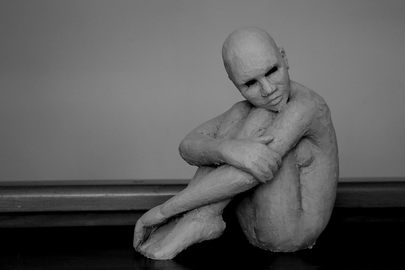{.margin}

Entre as ações nas quais estive envolvido destaco a *Proposta de Reestruturação das Atividades com Orientação: Residência, Monografia e Estágio em PP* (2012), o *Projeto de regulação das Atividades Complementares do GPP* (2012) e o fortalecimento, em conjunto com a professora Suylan Midlej, do projeto Residência em Políticas Públicas, que publicizamos em um artigo na Revista Eletrônica da Residência Social.[^nau]

[^nau]: Midlej, Suylan; Costa, Alexandre e outros. *Projeto Residência em Políticas Públicas da UnB*. *NAU — Revista Eletrônica da Residência Social*, 2012.

Também atuei como **representante do IPol na Câmara de Pesquisa e Pós-Graduação - CPP** durante cerca de um ano letivo (março a dezembro de 2014), participando semanalmente das reuniões que discutiam a estruturação da Pós-Graduação, bem como a revalidação de diplomas.

No final de 2014, tive intensa participação na Comissão que, sob a coordenação da professora Loussia Félix, criou a estrutura para a introdução de políticas de ações afirmativas, em particular de cotas para negros, no PPGD. Esta comissão antecedeu as regras gerais da UnB sobre cotas para a pós-graduação, tendo sido uma das primeiras iniciativas voltadas a implementar, em uma pós-graduação em Direito, cotas para negros e vagas reservadas para indígenas e quilombolas.

## 5 Faculdade de Direito (2015-)

### 5.1 Do IPol à FD

Após 5 anos no IPol, soube de um movimento na Faculdade de Direito para preencher as últimas 4 vagas decorrentes da ampliação do curso realizada no contexto do REUNI. Naquele momento, apesar de eu ter tido muitas experiências importantes e enriquecedoras na Ciência Política, estava claro que a minha produção acadêmica não se encaixava adequadamente nas métricas típicas do campo, especialmente na pós-graduação. Embora eu tenha orientado vários alunos de graduação em ciência política, meus orientandos de doutorado eram quase todos do direito, área onde se concentravam as minhas investigações.

Apesar de eu ter uma produção que se alinhava com a média dos outros docentes do curso, ela não tinha aceitação razoável nas revistas do estrato superior de Ciência Política, que eram pouco abertas para a publicação de investigações interdisciplinares com a área jurídica. Essa percepção veio a se confirmar pelo fato de que eu terminei sendo descredenciado do PPG em Ciência Política, justamente pela falta do requisito de publicação de artigos no estrato superior do Qualis (A1 a B2).

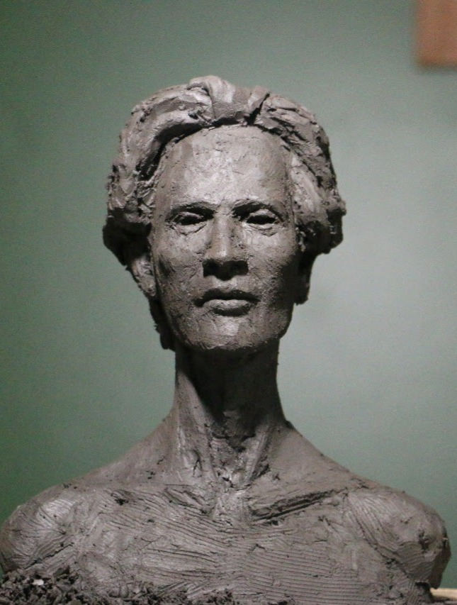{.margin}

A transferência para a Faculdade de Direito também se mostrava interessante porque se tratava de uma época em que a vida acadêmica da FD estava bastante intensa, porque o ingresso dos novos docentes havia possibilitado o cruzamento de diversas redes de pesquisa, que resultavam em uma profusão de seminários, encontros e acolhimento de visitantes, que tornaram a experiência acadêmica da Faculdade extremamente rica naquele período. Como eu atuava nos PPGs em Direito e em Ciência Política, eu acompanhava a programação acadêmica das duas unidades e a inserção na Faculdade de Direito se mostrava mais promissora, inclusive porque a minha produção acadêmica se dava mais pelos meus laços com o direito, tanto pelas minhas orientações no PPGD como pelos projetos que eu tinha conjuntamente com docentes como Henrique Araújo Costa e Juliano Zaiden Benvindo.

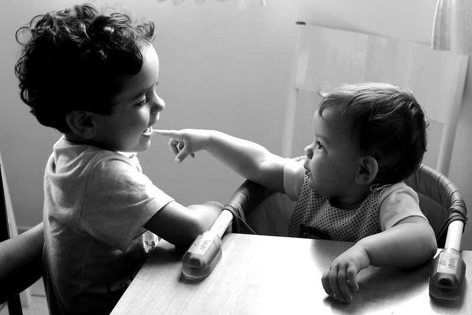{.margin}

2015 foi para mim um ano com vários desafios recompensadores. Primeiro, retornei efetivamente à Faculdade de Direito, pois a minha redistribuição foi autorizada em dezembro de 2014. Então, Letícia estava grávida de nossa filha **Ana Luísa Lengruber Costa**, que nasceu três meses depois, quando começava o semestre letivo em que eu reassumia as disciplinas de Introdução ao Direito que me eram muito caras, mas que eu não lecionava há uma década. Como se já não fosse trabalho suficiente, eu orientava simultaneamente cinco doutorandos, algo que nunca mais se repetiu em minha trajetória.

### 5.2 A pandemia e suas repercussões

#### 5.2.1 Os desafios pandêmicos

A Pandemia de Covid-19 foi o evento mais marcante desta geração. Ela instituiu uma descontinuidade na vida de todos nós, deixando marcas indeléveis, não apenas pelos amigos que faleceram (como Miroslav Milovic, que foi o amigo mais próximo que perdi para a Covid), mas pelos impactos duradouros que ela infligiu em nossos modos de vida.

A pandemia nos alcançou na primeira semana de aulas de 2020. Eu estava voltando da Europa, onde passei com a família férias na Espanha e Portugal. Pensei muito antes de embarcar, mas parecia um exagero abandonar uma viagem tão complexa em função de uma doença que atingia o outro lado do mundo e que tinha acabado de aportar na Itália, com alguns casos que pareciam isolados. Enquanto passeávamos pelo sul da Espanha, eu acompanhava minuciosamente o avanço da COVID, quando cada grande cidade contava ainda nas mãos o número de pessoas infectadas.

Em certo momento, cheguei a imaginar que poderíamos ficar presos em Sevilha, caso os aeroportos fossem fechados. Já estava fazendo os cálculos para saber quanto custaria alugar um carro ali para devolvê-lo em Lisboa, pois havia pouquíssimos casos em Portugal e a suspensão dos voos para o Brasil não parecia estar no horizonte próximo. Acabamos conseguindo comprar algumas máscaras em Sevilha (quando ainda diziam que máscaras não serviam para prevenir doenças respiratórias...), embarcar para Lisboa e de lá voltar para o Brasil (quando ainda se achava que o SARS-CoV-2 era um vírus de países frios, que não se espalharia nos trópicos).

Quando cheguei aqui, parecia que estávamos em uma realidade paralela, como se fôssemos imunes à contaminação por aquele estranho vírus de outras terras. Ainda consegui dar a primeira aula daquele semestre, no qual disse aos alunos que não parecia provável que nós teríamos um semestre regular, mas que provavelmente tudo estaria bem dali a três meses de quarentena, embora fôssemos nos lembrar daquele ano por causa da Covid. Na mesma semana, as atividades universitárias foram suspensas e eu nunca teria imaginado que demoraríamos tanto tempo até entrar novamente em uma sala de aula.

Embora nas primeiras semanas todo mundo estivesse ainda explorando esse novo mundo de *webinars*, *lives* e outros eventos remotos, logo passou nosso ânimo para esses encontros virtuais. Os grupos de pesquisa se afastaram das rotinas de encontros e o meu grupo se converteu em um espaço para conversarmos sobre casos, mortalidade e vacinas.

A rotina de aulas pelo Zoom e pelo Teams, com suas câmeras fechadas e baixa interatividade, possibilitou que as atividades não se encerrassem totalmente. Na pós-graduação, com pessoas mais maduras e engajadas, os resultados foram bastante razoáveis. As experiências que tive no PMPD e no PPGD não mostraram uma queda tão sensível de qualidade como a que ocorreu na graduação, com suas turmas grandes e heterogêneas. Foram tempos duros e tristes, de muito medo e ansiedade. Mas era preciso fazer um esforço para mitigar os danos inevitáveis à formação de pessoas que, como as turmas de mestrado que ingressaram em 2020, tiveram uma formação somente com aulas remotas.

#### 5.2.2 Os desafios pós-pandêmicos

Entendo que a Universidade sofre de um caso especial de covid longa. Muito do que perdemos durante a pandemia, em práticas pedagógicas e em cultura acadêmica, não foi ainda recuperado. Vários dos meus esforços no período pós-pandêmico estão ligados a tentar recuperar algumas das boas coisas que perdemos e de reinventar caminhos que possam incorporar de modo produtivo algumas das inovações que precisamos construir naquele período.

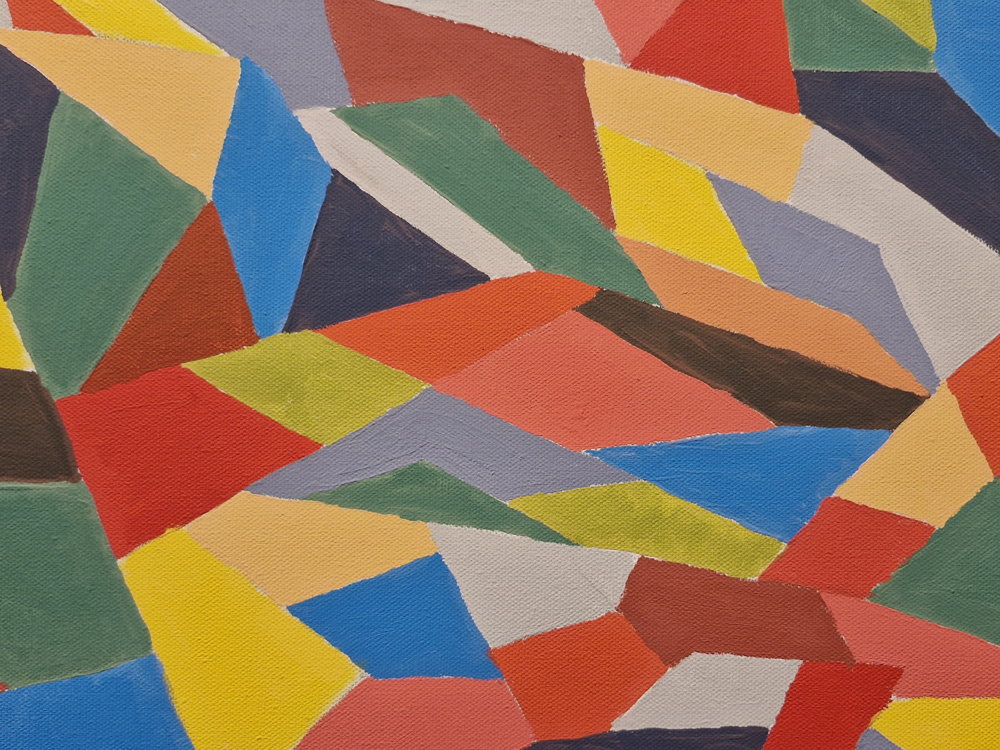{.margin}

O abalo sísmico que a pandemia representou em nossas dinâmicas pedagógicas ainda está muito presente e os caminhos para uma universidade adaptada aos novos tempos, que vieram na esteira da pandemia, estão sendo construídos de forma mais lenta e menos refletida do que seria desejável. Penso que um aparente retorno ao estado anterior das aulas presenciais e dos contatos sem máscara oculta descontinuidades persistentes, mudanças culturais que se consolidaram, mesmo que sob a aparência de uma nova normalidade.

Eu confesso não ter compreendido totalmente os motivos que levaram uma universidade tão cheia de vida a não recuperar o seu dinamismo anterior à COVID: estacionamentos vazios, muitos alunos pouco engajados nas atividades acadêmicas e que não valorizam o ambiente universitário. Por um lado, parece-me que a universidade deixou de ser o centro social e afetivo de boa parte dos seus estudantes, imagino que acostumados a viver nas bolhas em que a pandemia nos encerrou. Por outro, a urgência em viver o presente pode ter mitigado o interesse de vários alunos em dedicar muito de seu tempo a uma formação que somente dará seus frutos em um futuro cada vez mais incerto, com os riscos ambientais, políticos e também os trazidos pela IA.

Foi com a curiosidade de saber o que está ocorrendo que, em 2024, eu saí das turmas de Filosofia do Direito e voltei a lecionar regularmente Introdução ao Direito 1. Eu queria estar ali no começo do curso, tanto para entender quem eram esses alunos que a Universidade recebia quanto para dizer a eles que uma outra universidade é possível. Minhas atenções ficaram cada vez mais voltadas à graduação e aos desafios de acolher os estudantes e estimular neles um desejo pelas vivências que a universidade proporciona, nesse encontro de pluralidades variadas.

Meu espírito waratiano se ressentia pelo distanciamento visível entre professores e alunos, mas a recuperação de uma proximidade perdida é um desafio ainda mais duro nesses dias pós-pandêmicos, em que as barreiras entre docentes e discentes se ergueram de modo mais forte. Talvez não seja mais possível o nível de abertura que tínhamos vinte anos atrás, quando era percebido como natural que os professores abrissem suas casas para os seus alunos e grupos de pesquisa e que tivessem uma convivência mais próxima com os estudantes.

Embora esse distanciamento sirva como proteção a certas situações de abuso, ele também constitui um ambiente no qual a aguçada percepção de risco, tanto do lado dos estudantes como dos professores, dificulta a circulação dos afetos e a constituição de vínculos mais próximos. Talvez a prática pedagógica de Warat fosse impossível nos dias de hoje, com sua insistência no caráter amoroso da docência e a acentuação de que tanto professores como estudantes são seus corpos, atravessados por desejos e por sonhos. Mas, como dizia Warat, "a democracia é o direito de se sonhar o que se quer" e o que eu desejo é justamente uma universidade que proporcione vivências mais ricas e significativas do que aquelas que têm sido proporcionadas nesses anos pós-pandêmicos.

Nesse novo e incerto contexto, mudei novamente o nome do Grupo de Pesquisas, que passou a se chamar *Cartografias Jurídicas*, para poder acomodar tanto as novas perspectivas metodológicas que eu tenho investigado e praticado quanto o retorno à filosofia do direito, entendida como uma política conceitual. A metáfora cartográfica designa a aposta metodológica central das perspectivas em que aposto hoje em dia: tratar o direito como um território a ser mapeado, e não como um sistema a ser deduzido. Mapear exige escolher escalas, delimitar objetos, explicitar critérios de representação: é esse trabalho de explicitação que busco realizar, seja por pesquisas empíricas, seja por reflexões filosóficas ou pela construção de bússolas metodológicas.

."){.margin}


### 5.3 Extensão: cursos de acesso aberto

No contexto da pandemia, o esforço que mais me mobilizou foi o de produzir estruturas digitais adequadas para transferir todo o conteúdo dos meus cursos para ambientes abertos, em que pudessem circular livremente (ao contrário da maioria de nós, que estávamos circunscritos a nossos lares).

Até 2019, meus cursos na UnB eram construídos na plataforma Aprender (Moodle), disponibilizada pelo CEAD/UnB. Antes da pandemia, eu já estava migrando para a plataforma Ghost[^ghost], seguindo (para variar) as escolhas tecnológicas feitas por Henrique, que já usava o Ghost extensamente há cinco anos. Henrique sempre buscava introduzir nas suas atividades as ferramentas tecnológicas mais atuais e já usava o Ghost desde 2014, para fazer o blog da coordenação de graduação, que ele exercia naquele período. Em 2016, ele criou também um blog para o meu Grupo de Pesquisa, que nós mantivemos durante algum tempo, mas sempre com esse sentido de um blog, ou seja, de um conjunto de posts ordenados temporalmente e que podiam ser também organizados por *tags*.

[^ghost]: **Ghost** (ghost.org) é uma plataforma de código aberto, voltada inicialmente à criação de blogs. O código aberto significa que o programa pode ser baixado e usado de forma gratuita, bastando que a pessoa interessada contrate um servidor que hospede seu conteúdo, trabalho este que Henrique tem feito desde o início da pandemia, pelo qual eu sou imensamente agradecido. Criado em 2013, o Ghost se voltava a ser uma alternativa minimalista ao dominante WordPress, com foco específico no formato de blog, ou seja, uma coleção de posts ordenados do mais novo para o mais antigo. Nós conseguimos criar configurações que possibilitavam usá-lo como uma plataforma de "gestão de conteúdo", hospedando nela conteúdos em uma estrutura previamente definida (como um site e não como um blog).

Quando vi as experiências que Henrique Costa estava fazendo com um curso de Processo Civil, resolvi aprender a construir minhas disciplinas de filosofia em um site dedicado a eles. Quando a pandemia nos forçou a migrar todas as nossas relações para o campo virtual, os limites do Aprender se tornaram muito evidentes: esse ambiente adotava uma perspectiva de fechamento, pois os materiais somente eram disponíveis para os alunos matriculados na própria universidade. Mais do que isso: só eram disponíveis para os alunos matriculados na própria disciplina.

Essa clausura me parece mais acoplada a cursos privados, nos quais a instituição comercializa justamente a oportunidade de fazer parte de uma classe. No caso de uma universidade pública, creio que o princípio deveria ser o de deixar os cursos o mais abertos possível, para que o conhecimento possa circular para além das turmas. O fechamento propiciado pelo Aprender me parecia contrastante com as exigências do ensino público, sobretudo no contexto de uma pandemia, na qual a disponibilização de materiais de qualidade em meio digital configurava um objetivo prioritário.

A Universidade demorou a se curvar à necessidade de aulas remotas, que somente começaram em agosto de 2020, depois de meses de interstício. Nesse tempo de reclusão, eu consegui aprender melhor a dominar o Ghost e comecei a transferir a totalidade dos cursos para as páginas onde eles se encontram até hoje. Enquanto eu gastava os dias pandêmicos cuidando da casa e auxiliando minhas crianças pequenas em suas atividades, minhas noites e madrugadas eram dedicadas a formatar páginas na internet, rever conteúdos, planejar cursos e transferir para a rede tudo o que eu podia.

Certamente todos nós temos algumas histórias dramáticas sobre esta época de afastamento social, na qual todo pequeno encontro passou a ser considerado uma "aglomeração", palavra que saiu de nosso uso comum depois da Pandemia. Para mim, foi uma época de pouco sono e muito trabalho, com exaustão ao ponto de ter vertigens, principalmente no mês que se passou entre a decisão da retomada das aulas no formato remoto (em 9 de julho) e o início dessas atividades (em 17 de agosto).

O primeiro esforço foi o de reorganizar o site Arcos e publicar nele todos os textos meus e de Henrique que não estavam divulgados em páginas de livre acesso. Assim, publiquei os textos da minha tese de doutorado, meu livro de introdução ao direito, o relatório de pesquisa "A quem interessa o controle concentrado de constitucionalidade?" e outros dos vários livros e artigos que compõem atualmente o site Arcos.[^arcos_site]

[^arcos_site]: [Link para a página Arcos](https://arcos.org.br/)

Apesar das dificuldades, consegui passar para o mundo virtual as minhas disciplinas, nos sites em que se encontram até os dias atuais. As matérias filosóficas, inclusive Introdução ao Direito, podem ser encontradas no site Filosofia.Arcos, disponível no link: https://filosofia.arcos.org.br/. Lá estão, de forma gratuita e livre na internet, toda a estrutura e todos os materiais envolvidos nessas disciplinas.[^fd][^fpdc][^ied]

[^fd]: [Curso de Filosofia do Direito](https://filosofia.arcos.org.br/filosofiadodireito/)
[^fpdc]: [Curso de Filosofia Política e Direito Constitucional](https://filosofia.arcos.org.br/filosofiapolitica/)

[^ied]: [Curso de Introdução ao Direito ](https://filosofia.arcos.org.br/ied/)

No site https://metodologia.arcos.org.br/, agreguei as minhas disciplinas de caráter metodológico, tanto na FD como na EAGU, na graduação e na pós.[^met1][^met2][^met3][^met4]

[^met1]: [Curso de Metodologia de Pesquisa](https://metodologia.arcos.org.br/pmpd/)
[^met2]: [Curso de Ciência de Dados Aplicada (PMPD)](https://metodologia.arcos.org.br/cad/)
[^met3]: [Curso de Pesquisa Empírica em Direito](https://metodologia.arcos.org.br/ppgd/)
[^met4]: [Curso de Pesquisa Jurídica](https://metodologia.arcos.org.br/pj/)

Aprendi a publicar os materiais e comecei a ensinar os alunos a fazerem a mesma coisa: no primeiro semestre da pandemia, a avaliação das minhas turmas era feita por meio da publicação de posts no próprio site da disciplina, o que exigia deles que aprendessem a lidar com o Ghost (e exigia de mim produzir tutoriais que os orientassem, além de dar o devido apoio).

Desde 2020, tenho mantido os sites no ar, com o apoio constante de Henrique, que cuida da manutenção do servidor e da solução de todos os problemas técnicos. Entendo que esse trabalho pode ser classificado como uma forma de extensão universitária, pois trata-se de levar para a sociedade, na forma de cursos e materiais abertos, a produção que desenvolvo para os estudantes da UnB.

Em 2026, esse trabalho ganhou forma institucional no Portal de Cursos do PMPD,[^cursospmpd] construído sobre o Canvas e organizado em dois catálogos, o dos cursos abertos à comunidade e o das disciplinas oferecidas a estudantes da UnB. Os sites em Ghost são páginas de conteúdo, e quem chega a elas precisa organizar sozinho o próprio percurso. O Canvas permite montar cursos autoguiados, com sequência de atividades e registro do progresso de quem estuda, o que torna o material utilizável por quem não está matriculado em nenhuma turma. O portal também associa esse acervo à marca da Universidade, e não apenas ao meu nome e ao do Arcos. Minhas disciplinas já constam do catálogo: Introdução ao Direito 1, na graduação, Ciência de Dados Aplicada à Pesquisa Empírica em Direito, compartilhada entre a graduação e o PPGD, e Ciência de Dados Aplicada à Regulação e Políticas Públicas, no PMPD.

[^cursospmpd]: [Portal de Cursos do PMPD](https://cursos.pmpd.unb.br/)

### 5.4 PMPD: PPG em Direito, Regulação e Políticas Públicas

Em 2020, fui convidado para ministrar uma disciplina de Metodologia da Pesquisa, no Curso de Mestrado Profissional que havia sido recentemente implantado na UnB. Eu sequer tinha ouvido falar da criação deste curso, que foi discutido e aprovado no Conselho da FD em 2017, quando eu estava em licença na França. Como a maioria dos meus colegas, não sabia bem o que era um mestrado profissional (desconhecimento que permanece comum até hoje), mas o convite para ministrar essa disciplina se encaixava perfeitamente na minha trajetória, pois vinha na esteira de minha experiência na Escola da AGU, onde eu e Ricardo havíamos desenvolvido um material robusto para ministrar essa disciplina.

Eu desejava conquistar um espaço maior na área de metodologia de pesquisa da UnB e esta pareceu a oportunidade perfeita para aplicar, na UnB, as minhas convicções sobre a pesquisa em direito. Aceitei o convite e, nos anos de 2020 a 2024, participei de todas as turmas de Metodologia que foram ministradas no Programa.

Quando eu ingressei no PMPD, enfrentávamos o desafio de lecionar durante a pandemia, com suas aulas remotas e distanciamento social. Usando as mesmas estratégias que eu aplicava na graduação e no PPGD, criei no Ghost uma página para a disciplina, disponível publicamente para qualquer interessado.

No segundo semestre de 2020, comecei a lecionar também a disciplina que continuo a ministrar no Programa: *Ciência de dados aplicada ao direito regulatório e políticas públicas*. A disciplina de Ciência de Dados consolidava as minhas experiências nos anos anteriores, na graduação e no PPGD, com disciplinas que eram chamadas de DSD (*Data Science e Direito*), voltadas a preparar os alunos para o uso de ferramentas tecnológicas em suas pesquisas empíricas. Inicialmente, o tema inusual atraiu poucos estudantes (apenas 6), mas o número de inscritos foi se expandindo (passou para 8 no ano seguinte), até que ela se tornasse capaz de preencher todas as vagas disponibilizadas (22, em 2024).

Em 2022, quando meu irmão Henrique Araújo Costa assumiu a Coordenação do Programa, eu fui assumindo funções de maior protagonismo no curso, auxiliando Henrique na construção de uma estrutura acadêmica adequada, que permitisse superar algumas fragilidades que havíamos diagnosticado. Nesse período, trabalhamos para cumprir todas as metas necessárias a alcançar uma avaliação adequada na Quadrienal de 2021-2024.

O primeiro problema era de insegurança. Um curso com apenas uma turma de 20 pessoas, todas vinculadas a uma mesma parceria, criava um risco demasiado de que qualquer dificuldade nessa relação de colaboração terminasse por inviabilizar o ingresso anual de estudantes, colocando em risco a nota do Programa na CAPES. Como éramos um curso Nota 3, qualquer queda avaliativa nos levaria a um 2, que poderia gerar a própria dissolução do Programa.

O segundo problema era de escala. Um curso com ingresso anual de 20 pessoas não tinha uma dimensão demográfica capaz de gerar demanda para turmas mais especializadas, o que fazia com que a lista de oferta fosse demasiadamente repetitiva, concentrando-se em poucas matérias. Também verificamos que todos os Programas com melhor avaliação, na área de direito, são relativamente grandes, tendo centenas de estudantes. Restou claro que programas muito pequenos, como o nosso (que tinha 40 estudantes simultâneos apenas) não conseguiam gerar a massa crítica docente e discente necessária para produzir os impactos que se espera atualmente de um Programa de Pós-Graduação.

Ambas as dificuldades apontavam para a necessidade de ampliar o curso, viabilizando que um número maior de estudantes e de parcerias simultâneas nos desse garantias mais robustas de continuidade para o financiamento, para o ingresso de estudantes e também para a diversificação da lista de oferta. A primeira expansão ocorreu em 2023, quando tivemos a entrada de 40 estudantes do STF, que elevariam nosso corpo discente para cerca de 80 alunos (porque os mestrados são cursos de 2 anos).

Essa expansão também permitiu que construíssemos uma equipe de coordenação ampliada: em vez de um coordenador e um vice, criamos uma estrutura com 4 coordenadores, sem a qual seria impossível realizar todas as atividades necessárias para um Programa de excelência: **Henrique Costa** ficou com a coordenação administrativa, **Ana Claudia Farranha** com a coordenação acadêmica (cuidando dos professores e da oferta), **Maria Pia Guerra** com a coordenação de pesquisa (cuidando das orientações e as relações com os estudantes) e eu com a coordenação de planejamento (responsável pelo projeto pedagógico e também pelo Coleta e pela Quadrienal). A expansão do número de alunos também exigiu uma ampliação da Secretaria, bem como o estabelecimento de modos de trabalho adequados para a complexidade administrativa que o curso atingiu.

Também foi necessária uma ampliação do corpo docente, para dar conta desses novos desafios, a começar pela orientação de todos os estudantes, que é o gargalo de todo Programa de Pós-Graduação. Como Metodologia de Pesquisa é a matéria que todos os alunos precisam fazer de modo obrigatório, foi imperativa a ampliação da equipe de Metodologia, que organicamente cresceu pela incorporação de Ricardo Horta e de Henrique Fulgêncio, com quem eu já trabalhava há anos na pós-graduação da AGU e que eram coautores da maior parte dos textos que eu utilizava em classe. Com a entrada deles, em 2024, eu pude me concentrar no oferecimento da disciplina de Ciência de Dados, na qual eu (ainda) não tenho um substituto dentro do PMPD. Então, neste momento, temos uma equipe que trabalha de forma coesa, no planejamento e na execução de todas as disciplinas metodológicas do Programa.

Em 2025, quando acabaram os mandatos de Henrique e Ana Claudia, eu assumi a Coordenação do PMPD, tendo Maria Pia como vice. Lampedusianamente, nada mudou, pois continuamos sendo uma coordenação a oito mãos e não imagino como seria possível conduzir a gestão do curso de outra forma. Ao longo dos últimos 4 anos, nós trabalhamos coletivamente para reorganizar a estrutura pedagógica do PMPD, atualizar o regimento e todas as resoluções, planejar a necessária expansão do curso e também para elaborar o relatório que apresentamos, em 2025, e que viabilizou a elevação da nota do curso para 4, na última avaliação.

### 5.5 Ensino

As minhas atividades de ensino no período em que eu tenho sido docente da Faculdade de Direito estão resumidas no seguinte quadro:

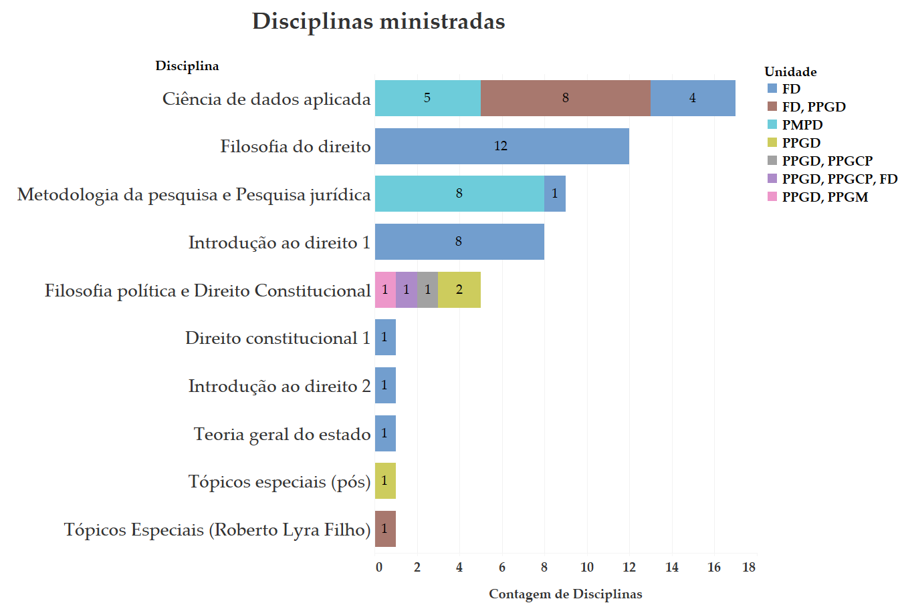

No meu regresso à graduação da FD, fiz também um retorno às disciplinas que havia ministrado com frequência no início dos anos 2000 (Introdução ao Direito 1 e 2) e à única disciplina do curso que faz uma interface direta com a filosofia política (Teoria do Estado). Continuei ministrando ID1 com alguma frequência, até que ela se tornou a minha disciplina obrigatória regularmente oferecida, a partir de 2024.

No PPGD, continuei lecionando a disciplina que ministrava neste programa quando eu era professor do IPol: *Filosofia Política e Direito Constitucional*, que até hoje é a única disciplina obrigatória desse PPG. Foi nessa disciplina que desenvolvi, aos poucos, abordagens que buscaram integrar as pesquisas contemporâneas de arqueologia política e estabeleci interfaces com a cultura jurídica clássica da Índia, da China e do Islã. Trata-se de uma disciplina que evoluiu muito ao longo do tempo, permitindo a gradual introdução de novas abordagens, que desafiavam os estudantes e a mim mesmo, na medida em que exploravam territórios conceituais distantes dos terrenos que nos eram conhecidos. Esta matéria, em suas várias edições, foi o meu principal laboratório de exploração de novas abordagens teóricas e de escrita de materiais didáticos.

O quadro abaixo mostra as disciplinas que ministrei por quatro vezes ou mais, ao longo de todo o meu período na UnB (2001 a 2026), o que destaca a presença constante de Filosofia do Direito, das disciplinas de Ciência de Dados aplicada (nome sob o qual unifiquei as disciplinas dadas com este conteúdo na graduação e nos programas de pós-graduação) e também de Ética e Política, ministrada no IPol para o curso de Gestão de Políticas Públicas.

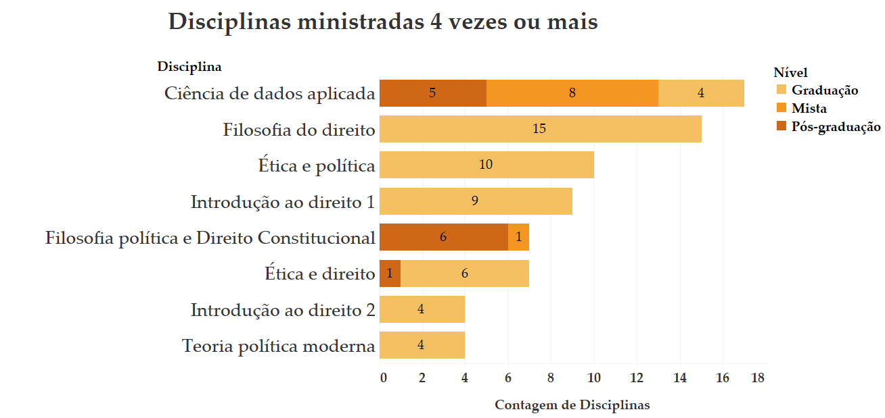

Filosofia do Direito se tornou a disciplina que, durante vários anos, foi o núcleo estável da minha atuação na graduação. Tratava-se de uma versão simplificada da minha disciplina de Filosofia Política na pós-graduação, incorporando a riqueza que foi fornecida a esta disciplina pela minha participação tanto no IPol quanto no grupo de pesquisa Filosofia da Biologia. Vários dos materiais que produzi para essa disciplina compõem o site Arcos (arcos.org.br) e o livro *Filosofia, Direito e Linguagem*[^fdl-20242] (UnB, 2024).

[^fdl-20242]: Costa, Alexandre. *Filosofia, Direito e Linguagem*. Editora da Faculdade de Direito - UnB, 2024. Acesso aberto.

Nesse período, passei a ministrar disciplinas de metodologia de pesquisa, tanto na graduação em direito como no PPGD e na pós-graduação da Escola Superior da Advocacia Geral da União. Também ingressei, em 2021, no Programa de Pós-Graduação em Direito, Regulação e Políticas Públicas, que oferece o curso de Mestrado Profissional no qual atuo desde então. Na década de 2020, a matéria que lecionei com mais frequência foi justamente a de metodologia de pesquisa, com foco no planejamento e na execução de pesquisas empíricas em Direito. Nos cursos da AGU, desenvolvi uma parceria estreita com os professores Henrique Fulgêncio e Ricardo Horta, que foram meus orientandos no PPGD, e que atualmente integram a equipe de metodologia do PMPD, que utiliza os materiais que produzimos conjuntamente e estão disponibilizados na página [Metodologia da Pesquisa em Direito](https://metodologia.arcos.org.br/).[^metodologia-arcos]

[^metodologia-arcos]: [Metodologia.arcos.com.br](https://metodologia.arcos.org.br/) é o site em que estão publicados os vários cursos de metodologia que ministro, individualmente ou em parceria com Henrique Fulgêncio e Ricardo Horta.

No PMPD, tenho sido responsável pelas turmas de Ciência de Dados Aplicada ao Direito Regulatório e Políticas Públicas. Ela nasce da convicção de que a formação de pesquisadores em direito precisa incorporar, de modo sistemático, instrumental quantitativo e computacional que há muito integra o repertório de outras ciências sociais. Os materiais didáticos desenvolvidos para o curso foram gestados nas disciplinas que ministrei como PAD de *Data Science e Direito* (DSD), incluindo a biblioteca Python dsd-br, composta por várias funções que desenvolvi e publiquei para facilitar a construção de códigos que utilizem os dados disponíveis nas páginas jurídicas, como o site do STF[^software-dsd-pmpd].

[^software-dsd-pmpd]: A biblioteca dsd-br está publicada no site Pypi (https://pypi.org/project/dsd-br/), que disponibiliza módulos de funções desenvolvidos pela comunidade de programadores em Python.

Passados os desafios pandêmicos, retornei à disciplina na qual iniciei a minha experiência docente: Introdução ao Direito. Não retornei ao meu livro de Introdução ao Direito, de 2001, pois as abordagens que aprendi a explorar nos 25 anos seguintes exigiam a construção de novos materiais, que fiz adotando uma perspectiva ainda mais ligada à filosofia da linguagem, que já era uma influência importante para mim desde a graduação, mas que se tornou o centro de minhas perspectivas sobre o direito, como decorrência direta dos meus estudos sobre hermenêutica.

Nesse período, ministrei uma turma de PAD sobre a obra de Roberto Lyra Filho, que permitiu a consolidação e a publicação, em coautoria com o professor Inocêncio Mártires Coêlho (que foi meu professor de Introdução ao Direito 1), de uma obra em que discutimos a produção filosófica de Roberto Lyra Filho.[^Lyra]

[^Lyra]: Costa, Alexandre, Coêlho, Inocêncio Mártires. *Teoria Dialética do Direito: A filosofia jurídica de Roberto Lyra Filho*, ed.1. Brasília: Faculdade de Direito, 2017.

Em 2026, comecei a construir instrumentos que usam inteligência artificial no ensino e na orientação. Na graduação, são assistentes feitos como prompts portáteis: um único bloco de texto que o estudante copia e cola em qualquer serviço gratuito de inteligência artificial, sem depender de site, de aplicativo ou de licença institucional. O Quim conduz a reescrita contemporânea da *Teoria do Medalhão*, no primeiro módulo de Introdução ao Direito 1,[^quim] e a Ana conduz a redação de um voto de desempate no Caso dos Exploradores de Cavernas, no segundo módulo.[^ana] Nas disciplinas de metodologia, o Miro acompanha o planejamento da pesquisa, da formulação da lacuna até a escolha do referencial.[^miro]

[^quim]: [Quim: assistente para a reescrita da Teoria do Medalhão](https://claude.ai/code/artifact/fc8e116b-428e-450e-b5e4-413bf76fdf9f). Código em <https://github.com/AlexandreAraujoCosta/quim>.

[^ana]: [Ana: assistente para o voto de desempate no Caso dos Exploradores de Cavernas](https://claude.ai/code/artifact/6950456d-fc9c-4cc1-8d4f-f7fa3923fe2d). Código em <https://github.com/AlexandreAraujoCosta/ana>.

[^miro]: [Miro: assistente para o planejamento de pesquisa](https://claude.ai/code/artifact/6912df2d-dc98-40b3-beb8-172219b077bb). Código em <https://github.com/AlexandreAraujoCosta/miro>.

Os três compartilham a mesma conduta, que é maiêutica: uma pergunta por vez, devolução declaradamente falível e nenhuma linha escrita no lugar do estudante. O que o aluno entrega não é o diálogo inteiro, e sim a avaliação que o próprio assistente redige ao final, com transcrição do trecho que sustenta cada juízo. É isso que torna a correção viável em turma grande sem nenhum sistema por trás. A premissa também é declarada: usar inteligência artificial é tratado como prática normal, e o que se cobra do estudante não é abstinência, e sim que ele esteja à altura do próprio texto.

Na orientação, reuni na Oficina LAW cinco instrumentos de leitura automática de trabalhos acadêmicos, do analisador de consistência, que confere o trabalho contra ele mesmo e roda sem custo, até a banca simulada.[^oficinalaw] Todos seguem uma regra que considero a parte mais importante do desenho: nenhum instrumento digita trecho do trabalho analisado. O modelo indica o número do parágrafo e um programa busca o texto e o insere no relatório, de modo que não existe citação com uma palavra trocada, que é o defeito mais difícil de perceber e o mais grave numa análise que se pretende conferível. Cada instrumento declara também o que não conferiu. O nome é homenagem a Luis Alberto Warat.

[^oficinalaw]: [Oficina LAW: cinco instrumentos de leitura automática de trabalhos acadêmicos](https://claude.ai/code/artifact/57a0317d-5d0d-48fd-b571-4d7dfb1fe916). Código dos instrumentos em <https://github.com/AlexandreAraujoCosta/analisador-dissertacoes>, <https://github.com/AlexandreAraujoCosta/corretor>, <https://github.com/AlexandreAraujoCosta/pre-banca> e <https://github.com/AlexandreAraujoCosta/simulador-banca>.

### 5.6 Orientações

#### 5.6.1 Doutorado

Logo que eu entrei para a Faculdade de Direito, em 2015, ingressaram na minha orientação várias pessoas que me acompanhavam antes e que até hoje seguem comigo de maneira muito próxima, tanto pessoal como profissionalmente.

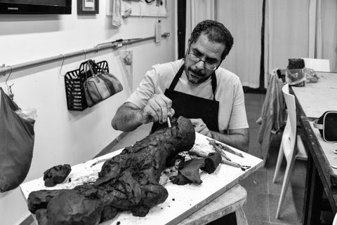{.margin}

Quando **Kelton Gomes** e **Henrique Fulgêncio** entraram no mestrado, em 2013, **Alexandre Douglas Zaidan de Carvalho** já cursava o doutorado do PPGD, sob minha orientação. Os três faziam parte do Grupo de Pesquisa Política e Direito, na época em que ele teve suas atividades mais intensas. Henrique e Kelton terminaram seus mestrados em 2015, mas foram selecionados para o doutorado neste mesmo ano. Em 2015 também ingressou na UnB **Fernando dos Santos Modelli**, o único doutorando que orientei nos sete anos em que permaneci credenciado no PPG em Ciência Política. Neste mesmo ano, **Ricardo de Lins e Horta** foi aprovado para o doutorado em Direito, de modo que, durante certo período, estiveram sob minha supervisão estes cinco pesquisadores de primeira linha, que logo vieram a se tornar professores de excelência.

Douglas Zaidan foi o primeiro a defender o seu doutorado, em 2016, sobre um tema que desde aquela época não saiu mais de cena: a falta de uma institucionalidade adequada para lidar com a parcialidade dos ministros do Supremo Tribunal Federal.[^dout-douglas] Em sua tese, Douglas fez uma análise empírica de todos os pedidos de exceção e de impedimento, diagnosticou "que a instrumentalização das garantias constitucionais do exercício independente da jurisdição tem bloqueado a confiança na atuação imparcial do Judiciário" e propôs a "construção de instrumentos protetivos da imparcialidade que sejam imunes às práticas dos próprios juízes".

[^dout-douglas]: Carvalho, Alexandre Douglas Zaidan de. *Imagens da Imparcialidade: entre o discurso constitucional e a prática judicial*. Tese de doutorado, PPGD/UnB, 2016.

Sempre uso o trabalho de Douglas como exemplo de como um pesquisador deve definir o tema de seu doutorado. Definimos esta temática ainda em 2011, anos antes dos protestos de 2013, do impeachment de Dilma e da tentativa de golpe de Estado de Bolsonaro. Não tínhamos como saber desses desenvolvimentos quando o principal acontecimento do mundo era a Primavera Árabe. Porém, a escolha do tema de um trabalho que demoraria ao menos 5 anos para ser elaborado não deveria priorizar questões candentes da política, mas problemas estruturais, que tinham a potencialidade de despertar interesse vários anos depois da sua redação. Douglas defendeu suas conclusões em 2016 e, desde então, elas somente se tornaram mais atuais. A relevância e o impacto deste trabalho não decorreram de sorte, mas de uma escolha consciente na seleção de temas que tivessem relevância estrutural e que, por isso, deveriam despertar interesse durante um período de vários anos.

Em 2018, Henrique Fulgêncio defendeu o seu doutorado, em pleno respeito aos prazos regimentais.[^dout-fulgencio] Ele continuou suas pesquisas sobre a omissão inconstitucional, desafiando novamente o senso comum teórico dos juristas, que tendiam a afirmar que os mandados de injunção (MIs) eram pouco efetivos porque lhes faltava a possibilidade de suprimento judicial da omissão, posicionamento que se modificou em 2007. Após cuidadosa análise empírica, Henrique descortinou os perigos de criar instrumentos processuais politicamente interventivos, que podem ter efeitos contrários àqueles que os inspiraram, como era o caso dos MIs.

> Criado para ser um instrumento simplificado e célere de concretização generalizada dos direitos constitucionais, inclusive em benefício dos grupos sociais marginalizados, o MI acabou se tornando uma via de acesso restrito e pouco proveito para quem não integra determinadas categorias de servidores públicos e de trabalhadores detentores de empregos formais. Diante desse quadro de expectativas frustradas, o trabalho apresenta propostas no sentido do desenvolvimento, pelo STF, de uma prática jurisdicional caracterizada pela transparência, consistência e abertura, ou seja, que supere os problemas identificados na pesquisa empírica, de modo a priorizar a ampliação do objeto do MI a outros direitos, em benefício de outras pessoas e grupos sociais. (Fulgêncio, 2018)

[^dout-fulgencio]: Fulgêncio, Henrique Augusto Figueiredo. *[O mandado de injunção na constituinte e no Supremo Tribunal Federal: expectativas, resultados, críticas e perspectivas](https://repositorio.unb.br/handle/10482/44322)*. Tese de doutorado, PPGD/UnB, 2018.

Também em 2018 Fernando Modelli concluiu seu doutorado.[^dout-modelli] Fernando queria trabalhar a noção de demofobia e, como base empírica, decidiu investigar os debates parlamentares na constituinte de 1823. Fernando mostra que as utilizações do conceito de povo são ambíguas, por vezes se ligando à noção de *populus* (como conjunto idealizado dos atores políticos), por vezes se vinculando à ideia de *plebe*, categoria que se opõe à ideia de senado, para designar a população mais pobre, que compõe a fatia majoritária de uma unidade política. Esse uso inconstante permitia que as referências ao povo se mantivessem em uma zona de indefinição, que dificultava a exata compreensão dos debates sobre temas centrais, como é o caso da escravidão.

[^dout-modelli]: Modelli, Fernando dos Santos. *[O conceito de povo no Brasil: Populus e Plebs na Constituinte de 1823](https://repositorio.unb.br/handle/10482/32243)*. Tese de doutorado, Ciência Política/UnB, 2018.

Já Kelton Gomes se utilizou de todas as prorrogações possíveis, o que permitiu que ele defendesse seu doutorado somente em 2019. A espera valeu a pena porque sua tese[^dout-kelton] foi um dos primeiros trabalhos a contribuir para a compreensão do fenômeno mais marcante da jurisdição constitucional daquela época: o avanço das decisões monocráticas, como forma de lidar com os desafios de uma pauta cujas dimensões pareciam fora de controle (e só vieram a ser efetivamente mitigados com a universalização do Plenário Virtual, em 2022).

[^dout-kelton]: Gomes, Kelton de Oliveira. *[A monocratização das liminares em controle concentrado de constitucionalidade no âmbito do Supremo Tribunal Federal (1988-2018)](https://repositorio.unb.br/handle/10482/47727)*. Tese de doutorado, PPGD/UnB, 2019.

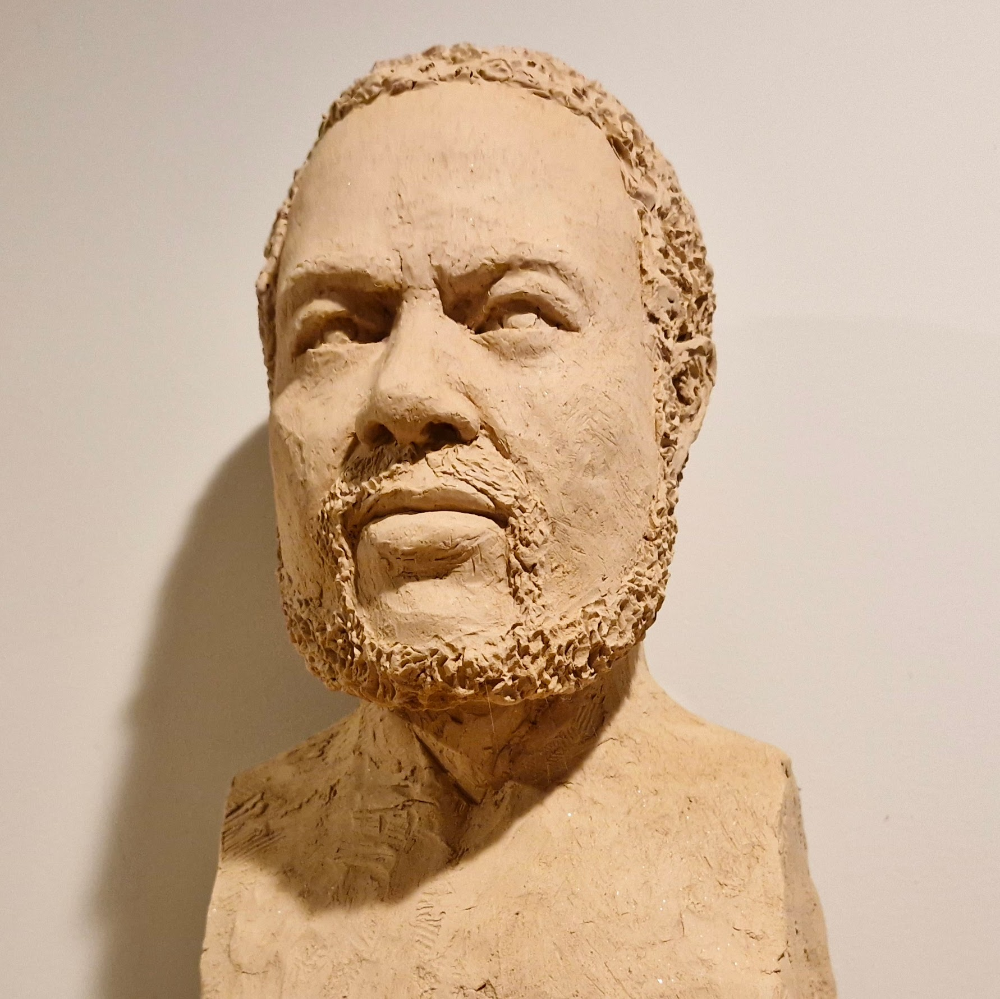{.margin}

Por fim, em 2019, Ricardo Horta defendeu uma tese inovadora.[^dout-horta] Partindo da formação de seu mestrado em neurociência, Ricardo traçou um "panorama de como variáveis extrajurídicas ou extradogmáticas importam na decisão judicial", com foco nos achados recentes das Ciências Comportamentais. Como inovação teórica, ele sugeriu "uma releitura do conceito de Racionalidade na Teoria do Direito, trazendo à cena questões como a influência dos vieses cognitivos e o desenho institucional de arquiteturas de decisão". Desde então, Ricardo se tornou um dos principais nomes brasileiros na questão de vieses comportamentais e de sua aplicação à formulação e gestão de políticas públicas, com vários trabalhos publicados acerca desta temática.

[^dout-horta]: Horta, Ricardo de Lins e. *Direito e tomada de decisão: elementos para uma Teoria da Decisão Jurídica*. Tese de doutorado, PPGD/UnB, 2019.

Em 2019, eu me tornei supervisor em cotutela do trabalho de Leonardo Amorim, que permaneceu como meu orientando até 2025, quando chegamos ao termo final da cotutela, sem que ele tivesse encerrado o seu trabalho de doutoramento. Foram vários anos de rico diálogo, dos quais resultou a tese que ele deve defender em breve na Sorbonne, sob a orientação de Pierre Brunet.

Em 2022, logo após ter defendido seu mestrado, **Maria Helena Rocha Pedrosa** ingressou no doutorado, onde ainda é minha orientanda. Esta orientação tem um peso particular para mim, não apenas porque Maria Helena é uma pesquisadora excepcional, mas também porque publicamos juntos vários textos sobre o Plenário Virtual, decorrentes de suas pesquisas de mestrado e de doutorado, que avançam a agenda de pesquisa sobre Controle Concentrado de Constitucionalidade, na qual estou envolvido há mais de quinze anos.

Em 2023, fui procurado por **Paulo Jorge Silva Santos**, que pediu a minha orientação em um doutorado cursado no PPGD, no contexto de um Dinter. Paulo estava pesquisando a questão da arbitrariedade judicial, a partir de um enfoque dogmático e teórico. Depois de muitos debates, em que ele demonstrou grande abertura para novas ideias, convertemos o seu trabalho em uma análise empírica das estratégias argumentativas do STF nos julgamentos que o próprio tribunal considerou como "julgados de grande relevância" no ano de 2023.[^dout-paulojorge] Foi um ótimo exercício da criação de parâmetros para avaliar as estruturas hermenêuticas que Paulo Jorge queria mapear, para poder avaliar adequadamente as estratégias argumentativas do STF.

[^dout-paulojorge]: Silva Santos, Paulo Jorge. *Entre o ideal teórico e a efetiva prática judicial: análise empírica das estratégias argumentativas nos julgados do STF*. Tese de doutorado, PPGD/UnB, 2025.

Em 2026, defendeu também sua tese **Helen Rose Carlos Rodrigues Guimarães**, que abordou uma das dimensões menos estudadas do constitucionalismo brasileiro: o papel do Senado Federal na apreciação das indicações presidenciais ao STF.[^dout-helen] Seu trabalho mapeou empiricamente os processos de seleção ocorridos ao longo de mais de três décadas, buscando identificar padrões no comportamento dos senadores diante de um ritual que a literatura tende a descrever como meramente homologatório. O trabalho se contrapõe à tese de que as sabatinas são meramente homologatórias. Quando o texto já estava pronto e enviado à banca, houve a rejeição do nome de Jorge Messias, o que forçou um adiamento na defesa, para que Helen pudesse incorporar esta nova sabatina e avaliar o seu impacto nas abordagens teóricas sobre essa temática. Diversamente da imprensa e do senso comum, que trataram essa rejeição como uma descontinuidade histórica, o trabalho de Helen já antevia que a gradual acumulação de divergências e a constante diminuição das margens de aprovação já apontavam para a ocorrência de uma rejeição.

[^dout-helen]: Guimarães, Helen Rose Carlos Rodrigues. *A dois passos do Supremo: sabatinas e padrões de atuação do Senado na apreciação das indicações ao Supremo Tribunal Federal (1988-2026)*. Tese de doutorado, PPGD/UnB, 2026.

#### 5.6.2 Mestrado

##### 5.6.2.1 PPGD

Em 2019, três mestrandos defenderam dissertações que, cada uma a seu modo, aprofundaram a agenda de pesquisa empírica sobre o comportamento institucional do STF.

**Felipe Justino de Farias** é o membro do Grupo de Pesquisa que eu acompanho há mais tempo. Ele foi meu aluno no começo dos anos 2000, integrou o primeiro Grupo de Literatura, depois o GEDLing em todas as suas formações e denominações, bem como integrou a equipe responsável pela pesquisa "A quem interessa o controle concentrado de constitucionalidade?". Seguindo uma das sendas abertas por aquela pesquisa, Felipe construiu uma arqueologia da prejudicialidade,[^mest-felipe] trabalho em que se dedicou a descortinar o significado político de um conceito que a dogmática processual tende a tratar como trivial. Ao escavar as camadas de sentido sedimentadas na categoria da prejudicialidade, Felipe revelou como uma noção aparentemente burocrática (pois leva a uma extinção sem julgamento de mérito) carrega uma história de disputas interpretativas e reflete as estratégias de manejo intencional do tempo pelo STF.

[^mest-felipe]: Farias, Felipe Justino de. *Arqueologia da Prejudicialidade*. Dissertação de mestrado, PPGD/UnB, 2019.

**Ildegard Hevelyn Alencar**, que foi minha aluna na Graduação, dedicou sua dissertação a um balanço da ADPF, nos quando se completavam vinte anos de vigência da Lei nº 9.882/1999, que a regulamentou.[^mest-hevelyn] O recorte temporal é revelador: duas décadas são tempo suficiente para que um instrumento processual revele suas potencialidades e seus limites reais, e o trabalho realizou exatamente esse esforço de mapeamento empírico, examinando como a ADPF foi sendo progressivamente apropriada pelos atores do sistema de justiça como via de acesso ao Supremo em situações que escapavam ao cabimento das tradicionais ADIs.

[^mest-hevelyn]: Alencar, Ildegard Hevelyn. *A ADPF vinte anos depois da Lei nº 9.882/1999*. Dissertação de mestrado, PPGD/UnB, 2019.

**Adelmar Miranda Tôrres** avançou nossa agenda de pesquisa empírica sobre o STF em uma direção diferente: o estudo do controle difuso, explorando Recursos Extraordinários com repercussão geral.[^mest-torres] Sua dissertação examinou se e em que medida as preferências ideológicas dos ministros explicam os padrões de votação nas decisões tributárias com repercussão geral, campo em que a tensão entre posições mais garantistas dos direitos dos contribuintes e posições mais favoráveis à capacidade arrecadatória do Estado torna o componente ideológico particularmente saliente. Uma das conclusões mais interessantes de Tôrres foi a de que os modelos atitudinais se mostravam inadequados para analisar as repercussões gerais, pois a única correlação estatisticamente relevante que emergiu da investigação foi entre as decisões favoráveis aos contribuintes e a existência de um parecer do Ministério Público também favorável. Paradoxal e inesperadamente, o trabalho de Tôrres aponta que os modelos legalistas são mais ajustados para a explicação desse fenômeno: visto não ser razoável inferir existência causal entre o parecer do MP e a decisão favorável, ganha peso a hipótese de que a convergência entre as posições do MP e do STF estaria ligada à existência de uma interpretação comum, decorrente de modos convergentes de aplicar o direito, e não de preferências ideológicas.

[^mest-torres]: Tôrres, Adelmar Miranda. *Ideologia no Supremo Tribunal Federal: análise empírica das decisões em Direito Tributário com repercussão geral no período 2007-2018*. Dissertação de mestrado, PPGD/UnB, 2019.

Em 2022, dois trabalhos retomaram linhas já presentes na trajetória do grupo, sendo trabalhos defendidos por mestrandos que enfrentaram um especial desafio: seu curso de mestrado havia sido integralmente realizado de maneira remota, em função da pandemia.

**Matheus Tormen Fornara** revisitou a questão das entidades corporativas no controle de constitucionalidade,[^mest-fornara] tema que Fabrício Noronha havia explorado em 2015. O retorno ao mesmo objeto não foi uma repetição, pois o trabalho tem um foco distinto: enquanto Fabrício enfocou a questão da legitimidade ativa das entidades, Matheus realizou uma coleta de dados empíricos e avaliou se esses padrões tinham se mantido ou não, a partir da pesquisa original de 2013. A dissertação de Matheus representa um aprofundamento de seu TCC, que foi orientado por Douglas Zaidan e tinha por objeto a atuação das entidades representativas de magistrados, no controle concentrado. Um dos pontos fortes do trabalho foi que Fornara proporcionou uma descrição mais detalhada dos dados sobre autoria de ações de controle concentrado porque os trabalhos anteriores do grupo se concentraram apenas no primeiro autor, enquanto Fornara avaliou todos os atores envolvidos no processo.

[^mest-fornara]: Fornara, Matheus Tormen. *A atuação das associações brasileiras no controle concentrado de constitucionalidade*. Dissertação de mestrado, PPGD/UnB, 2022.

**Maria Helena Pedrosa** analisou o controle concentrado de constitucionalidade no plenário virtual do STF,[^mest-pedrosa] ambiente que havia se consolidado como mecanismo central de funcionamento do Tribunal, centralidade que a pandemia acentuou. O trabalho, que deu origem a dois artigos publicados em coautoria, na Revista Estudos Institucionais e na Suprema, realizou um mapeamento empírico das ADIs, ADCs, ADOs e ADPFs pautadas no plenário virtual com foco no segundo semestre de 2021, permitindo traçar um perfil dos processos pautados naquele período e avaliar a perspectiva de permanência do formato após o fim das restrições sanitárias. As questões que o trabalho levanta vão além da descrição procedimental: o plenário virtual reconfigura as dinâmicas de deliberação, de formação de maioria e de publicidade das decisões, com consequências ainda não inteiramente compreendidas para a legitimidade do processo decisório. Maria Helena, posteriormente, tornou-se minha orientanda de doutorado e coautora em vários trabalhos sobre o Plenário Virtual.

[^mest-pedrosa]: Pedrosa, Maria Helena Rocha. *Virtualização e colegialidade: análise da atuação do STF nas ações de controle concentrado pautadas no Plenário Virtual*. Dissertação de mestrado, PPGD/UnB, 2022.

**Aislan Arley Pereira de Alvarenga** defendeu em 2024 uma dissertação[^mest-aislan] que se insere em uma agenda de pesquisa sobre litígios estruturais que o grupo vinha acompanhando há algum tempo. Ao mapear empiricamente as ADPFs de natureza estrutural, o trabalho permite identificar padrões no modo como o STF tem manejado esse tipo de demanda, que impõe à Corte uma postura muito distinta da que caracteriza o controle abstrato tradicional: em vez de simplesmente declarar a (in)constitucionalidade de uma norma, o Tribunal é chamado a supervisionar a implementação de políticas públicas em situações de violação massiva e sistemática de direitos. A dissertação de Aislan dialoga naturalmente com o trabalho que Anthair Valente e Gonçalves defenderia no PMPD no ano seguinte, sobre a atuação da Defensoria Pública nesses mesmos processos, o que evidencia como determinadas questões, quando amadurecem em um programa, tendem a se ramificar em direções complementares. Ao mapear e analisar o sentido das ações estruturais no STF, o trabalho de Aislan tem sido utilizado como ponto de partida por vários estudantes que trabalham a questão do processo estrutural, que continua sendo um dos principais focos de análise das investigações sobre inovações na jurisdição constitucional.

[^mest-aislan]: Alvarenga, Aislan Arley Pereira de. *Mapeamento das arguições de descumprimento de preceitos fundamentais estruturais no Supremo Tribunal Federal*. Dissertação de mestrado, PPGD/UnB, 2024.

##### 5.6.2.2 PMPD

O Mestrado Profissional em Direito, Regulação e Políticas Públicas está vinculado à produção de investigações de caráter aplicado, sendo que os mestres que defenderam até agora são servidores do STJ e do STF. Todavia, não devemos exagerar as distinções, até porque, no programa acadêmico da Faculdade de Direito (PPGD), metade das dissertações que orientei neste período foi realizada por servidores do STF, onde trabalham tanto Felipe como Hevelyn e Aislan. Entendo que boa parte da atividade dos mestrados acadêmicos em direito tem um caráter profissional, visto que os discentes tipicamente desejam se aperfeiçoar para exercício de sua profissão, sem pretensões imediatas de se qualificarem como docentes.

Em 2022, **João Paulo Rodrigues de Castro**[^mest-joaopaulo] investigou se decisões demasiadamente genéricas, tomadas sobre casos específicos, cumpriam a exigência constitucional de fundamentação das decisões judiciais. Para tanto, João Paulo partiu do conceito de "contextualidade", desenvolvido na linguística, para avaliar em que medida decisões monocráticas de habeas corpus do STJ referentes a tráfico de drogas estavam devidamente calcadas na análise do contexto fático envolvido em demandas. Os resultados da análise empírica foram paradoxais. De um lado, o trabalho identificou uma altíssima generalidade dos argumentos, o que gerava um alto grau de opacidade, no sentido de que não era possível identificar adequadamente os parâmetros decisórios efetivamente utilizados pelos julgadores. Apesar disso, identificou-se que a falta de uma fundamentação adequada era acompanhada por uma baixa impugnação via embargos de declaração, combinação que permitiu sugerir a ineficácia dos instrumentos existentes para controlar a omissão argumentativa nos julgados do STJ.

[^mest-joaopaulo]: Castro, João Paulo Rodrigues de. *Opacidade nas decisões em Habeas Corpus do STJ*. Dissertação de mestrado, PMPD/UnB, 2022.

Em 2022, **Guilherme Figueiredo** realizou um estudo de caso sobre o Projeto Athos, iniciativa do STJ de incorporação da inteligência artificial ao processo judicial.[^mest-figueiredo] A ferramenta, apresentada em 2019 e voltada principalmente para o monitoramento e agrupamento de processos com vistas à criação de novos temas repetitivos, vinha sendo descrita pelo próprio Tribunal em chave essencialmente celebratória. O valor da dissertação está justamente em submeter essa experiência a uma análise empírica rigorosa, confrontando as promessas institucionais com os dados efetivos de desempenho, e em colocar as questões regulatórias e processuais que a adoção dessas ferramentas necessariamente acarreta, muito além do que os relatórios oficiais estavam dispostos a discutir. Esta dissertação foi publicada na forma de livro, no ano seguinte.

[^mest-figueiredo]: Figueiredo, Guilherme. *[Projeto Athos: um estudo de caso sobre a inserção do Superior Tribunal de Justiça na era da inteligência artificial](https://repositorio.unb.br/handle/10482/44557)*. Dissertação de mestrado, PMPD/UnB, 2022.

Em 2023, **Érica Barbosa Moreira** reconstruiu o histórico das formas como o STJ estabeleceu critérios para construir as bases de dados que documentam sua própria jurisprudência.[^mest-erica] Trata-se de uma pesquisa que descreveu a evolução das estratégias utilizadas, bem como o estado atual dos sistemas classificatórios, contribuindo para que os metadados existentes na base de jurisprudência sejam devidamente compreendidos, o que é fundamental para que pesquisadores empíricos possam desenvolver metodologias de investigação adequadas e evitem conclusões que não estejam lastreadas nos conteúdos efetivamente disponibilizados na jurisprudência.

[^mest-erica]: Moreira, Érica Barbosa Sousa. *[A base de dados de jurisprudência do STJ: histórico, estrutura e critérios de catalogação](https://repositorio.unb.br/handle/10482/49110)*. Dissertação de mestrado, PMPD/UnB, 2023.

**José Anderson da Silva Reis** adotou uma abordagem pragmática para avaliar a questão do habeas corpus coletivo no direito brasileiro.[^mest-joseanderson] A dissertação enfrentou esse problema a partir de uma perspectiva que dialoga com as questões de hermenêutica que percorrem minha própria trajetória de pesquisa e teve como foco um caso que colocava em questão a possibilidade do ajuizamento de *habeas corpus* coletivos e os parâmetros existentes para sua admissão e julgamento.

[^mest-joseanderson]: Reis, José Anderson da Silva. *[A interseção entre os postulados do pragmatismo jurídico e a prestação jurisdicional do Superior Tribunal de Justiça no habeas corpus n. 435.937](https://repositorio.unb.br/handle/10482/49118)*. Dissertação de mestrado, PMPD/UnB, 2023.

Em 2024, **Leonardo Sanches Ferreira** analisou as resoluções do CNJ como instrumento regulatório, mapeando sistematicamente a atuação normativa do Conselho entre 2005 e 2023.[^mest-sanches] O trabalho preenche uma lacuna empírica importante: o CNJ acumulou ao longo de quase vinte anos um volume considerável de produção normativa que raramente é examinado em sua totalidade e em suas tendências, e a dissertação oferece os instrumentos para compreender o papel efetivo que o Conselho desempenha na governança do Judiciário brasileiro. Este trabalho tem uma linha de continuidade com uma das primeiras dissertações que orientei: o trabalho de Érika Oliveira sobre o CNJ, realizado no PPGCP, cerca de dez anos antes.

[^mest-sanches]: Ferreira, Leonardo Sanches. *As resoluções do CNJ como instrumento regulatório: panorama da atuação normativa de 2005 a 2023*. Dissertação de mestrado, PMPD/UnB, 2024.

**Karine Anselmo Bonfim** voltou-se para as políticas públicas de promoção da igualdade de gênero no Poder Judiciário,[^mest-karine] tema que articula duas linhas de interesse que percorrem minha trajetória intelectual: a análise institucional do sistema de justiça e a perspectiva feminista sobre o direito e as organizações. O trabalho examina em que medida as políticas adotadas pelas instituições do sistema de justiça efetivamente transformam estruturas que historicamente produziram exclusão, ou se funcionam mais como dispositivos de visibilidade sem consequências práticas sobre a distribuição interna de poder. Junto ao mestrado de Maria Gutenara e ao PIBIC de Talitha Selvati, formam o conjunto de trabalhos que orientei sob uma perspectiva do feminismo.

[^mest-karine]: Bonfim, Karine Anselmo. *Participação feminina no judiciário e a atuação do CNJ na implementação de políticas para o seu incremento*. Dissertação de mestrado, PMPD/UnB, 2024.

Em 2025, **Euro Sabino de Azevedo** trabalhou com modulação de efeitos em matéria tributária no STF,[^mest-euro] tema que combina duas dimensões analíticas raramente tratadas em conjunto: os padrões com que o Tribunal decide modular os efeitos de suas decisões em casos tributários e as consequências dessas escolhas para a distribuição dos processos que tramitam no primeiro grau e aguardam a definição da tese em repercussão geral. O trabalho tem consequência prática, dado o volume de processos suspensos que dependem dessas decisões e o impacto fiscal que a modulação produz tanto para contribuintes quanto para o erário, mas sua contribuição vai além do diagnóstico: ao identificar padrões, o trabalho permite avaliar a coerência e a previsibilidade da jurisprudência do STF nessa matéria, que não raro é acusada de responder mais a pressões conjunturais do que a critérios estáveis.

[^mest-euro]: Azevedo, Euro Sabino de. *Modulação de efeitos em matéria tributária no STF: padrões decisórios da corte e distribuições de processos vinculados a temas de repercussão geral no primeiro grau*. Dissertação de mestrado, PMPD/UnB, 2025.

**Rodrigo Sorrenti Hauer Vieira** examinou empiricamente uma prática que vem se consolidando no Tribunal sem que exista ainda um enquadramento teórico e normativo claro para ela:[^mest-hauer] a institucionalização dos acordos no controle concentrado de constitucionalidade. Sua análise mostrou haver "expansão gradual da consensualidade na Corte, que passa a exercer papel de coordenação institucional, além de sua função jurisdicional clássica", conclusão que é importante na medida em que esclarece que os processos consensuais não têm sido usados para resolver questões abstratas, mas para viabilizar a coordenação concreta de certas partes. Por isso, ele indica que "essa transformação revela tensões entre o discurso das vantagens da justiça consensual e uma prática ainda incipiente, marcada por abordagens assimétricas e fragilidade regulatória".

[^mest-hauer]: Hauer Vieira, Rodrigo Sorrenti. *O Supremo Tribunal Federal e a institucionalização dos acordos no controle concentrado de constitucionalidade: análise empírica e crítica da justiça consensual no STF*. Dissertação de mestrado, PMPD/UnB, 2025.

**Anthair Edgard de Azevedo Valente e Gonçalves** analisou a atuação da Defensoria Pública em processos estruturais no STF,[^mest-anthair] trabalho que se situa na interseção entre dois debates de grande vitalidade no constitucionalismo contemporâneo: o papel das cortes em litígios que envolvem políticas públicas de larga escala e a afirmação institucional da Defensoria como voz dos grupos mais vulneráveis nesses processos. A dissertação enfrentou os desafios processuais e institucionais que essa atuação coloca, contribuindo para uma compreensão mais precisa do que significa, na prática, o acesso à justiça constitucional para quem historicamente foi excluído dela e explorando, de forma original, as implicações do reconhecimento de uma função de *custos vulnerabilis* para a Defensoria. A trajetória de Anthair, que foi recentemente admitido no doutorado do PPGD, mostra também que existe uma grande convergência de abordagens entre o programa profissional e o acadêmico da Faculdade de Direito.

[^mest-anthair]: Valente e Gonçalves, Anthair Edgard de Azevedo. *A atuação da Defensoria Pública em processos estruturais no STF: desafios processuais e institucionais*. Dissertação de mestrado, PMPD/UnB, 2025.

Já em 2026, **Mário Lucas Prado Santos** defendeu uma dissertação que dialoga de forma direta com o trabalho de Rodrigo Hauer Vieira sobre a institucionalização dos acordos no controle concentrado: enquanto aquele trabalho examinou a consensualidade no controle abstrato de constitucionalidade, Mário Lucas voltou-se para as Ações Cíveis Originárias e para o papel do NUSOL.[^mest-mariolucas] Um dos elementos mais interessantes da dissertação é o produto técnico que dela resultou: ao constatar a falta de correspondência entre os registros do Painel do NUSOL e os dados reais dos processos, Mário Lucas elaborou um protocolo de inserção e governança de dados para o Núcleo, o que transforma o trabalho acadêmico em intervenção institucional concreta, algo que o mestrado profissional tem condições de produzir de um modo que o mestrado acadêmico raramente alcança.

[^mest-mariolucas]: Prado Santos, Mário Lucas. *A busca por soluções consensuais em Ações Cíveis Originárias no STF e a experiência do NUSOL*. Dissertação de mestrado, PMPD/UnB, 2026.

Neste ano, também defendeu sua dissertação **Janaína Berno**, que trabalhou juntamente com duas outras orientandas (Maria Helena Pedrosa e Maria Fernanda Teixeira) para elaborar uma base de dados sobre o controle de constitucionalidade no STF, construída a partir de um extrator que eu elaborei e que elas revisaram e validaram.[^mest-janaina] O trabalho de Janaína buscou compreender se a introdução do Plenário Virtual constituiu inovação institucional, o que a levou a mensurar os impactos da adoção dessa estratégia decisória. Um de seus principais achados foi a identificação empírica de que a universalização do PV está correlacionada não apenas a um incremento no número de decisões (o que já estava mapeado), mas também a uma sensível diminuição nos estoques de processos de controle concentrado que tramitam no STF.

[^mest-janaina]: Werneck Lima, Janaína Berno Lopes. *Mesma função, outro mecanismo: o Plenário Virtual do STF no controle concentrado de constitucionalidade (2016-2025)*. Dissertação de mestrado, PMPD/UnB, 2026.

Por fim, **Akeshi Harada** defendeu uma dissertação sobre a soberania digital nas contratações de tecnologia da informação do STF.[^mest-akeshi] Akeshi se valeu de suas formações em direito e em ciência da computação, para avaliar os impactos dos atuais modelos de contratação de serviços de nuvem, propondo um framework capaz de orientar a avaliação dos vários riscos envolvidos nesse tipo de relação contratual, especialmente aqueles que afetam a soberania digital do Poder Judiciário brasileiro.

[^mest-akeshi]: Harada, Akeshi Ricardo. *Soberania digital nas contratações de TI do Supremo Tribunal Federal: avaliação de riscos entre neutralidade tecnológica e autonomia estratégica*. Dissertação de mestrado, PMPD/UnB, 2026.

#### 5.6.3 Especializações e Graduação

Neste período, como previsível, a maioria dos meus orientandos eram estudantes do curso de direito. A exceção, que confirma a regra, foi **Jonatan Pereira dos Santos**, meu único orientando do Bacharelado em Gestão de Políticas Públicas, que defendeu em 2015 uma monografia sobre licitações em obras ligadas ao REUNI.[^grad-jonatan]

[^grad-jonatan]: Santos, Jonatan Pereira dos. *Licitação e variação de preços: uma análise de obras do REUNI*. TCC, Gestão de Políticas Públicas/UnB, 2015.

Os demais trabalhos de graduação desta época normalmente são ligados diretamente às minhas investigações. O TCC de **Tasso Iuri Lopes de Miranda**, defendido em 2019, é um bom exemplo disso:[^grad-tasso] ele fez uma avaliação metodológica das pesquisas empíricas em direito com foco nos estudos sobre processo decisório judicial, trabalho que exigiu do autor uma capacidade de metacrítica sobre o próprio campo que vai além do que se espera habitualmente de um concluinte da graduação.

[^grad-tasso]: Miranda, Tasso Iuri Lopes de. *Avaliação metodológica das pesquisas empíricas em direito: análise dos trabalhos sobre o processo decisório judicial*. TCC, Direito/UnB, 2019.

Em 2021, dois trabalhos de perfis bastante distintos foram defendidos. **Pedro Miranda** analisou a produção legislativa da Câmara dos Deputados durante a pandemia,[^grad-pedromiranda] questão que tinha urgência evidente naquele momento e que permitiu um exercício de análise empírica da atividade parlamentar em condições institucionais excepcionais. Já **Davi C. Castro** escolheu um caminho bem diferente: investigar os antecedentes filosóficos da epistemologia jurídica de Luís Alberto Warat,[^grad-davi] trabalho que me tocou de forma particular porque Warat é uma referência que percorre minha própria trajetória intelectual e o trabalho de Davi contribuía para manter viva a memória de Luis, mais de dez anos após a sua morte.

[^grad-pedromiranda]: Miranda, Pedro. *A produção legislativa da Câmara dos Deputados na pandemia do SARS-CoV-2*. TCC, Direito/UnB, 2021.
[^grad-davi]: Castro, Davi C. *Os antecedentes filosóficos da epistemologia jurídica de Luís Alberto Warat*. TCC, Direito/UnB, 2021.

Também orientei uma especialização na Escola Superior da AGU: **Vanessa Carina Zanin** dedicou-se à aposentadoria programada de pessoas trans,[^esp-vanessa] tema que articula questões previdenciárias com o reconhecimento jurídico de identidades de gênero e que dialoga com as minhas preocupações de longa data sobre a relação entre direito e identidades de gênero. Costumo citar esse trabalho como exemplo de como é possível converter uma questão aparentemente dogmática em um teste empírico: em vez de deduzir a resposta a partir dos conceitos previdenciários, Vanessa realizou um estudo documental que identificou os argumentos legislativos efetivamente mobilizados para justificar a diferenciação dos tempos de aposentadoria entre mulheres e homens, revelando que a razão política dessa distinção não estava ligada a questões referentes ao sexo (como, por exemplo, gravidez ou longevidade), mas aos papéis sociais que definem o gênero.

[^esp-vanessa]: Zanin, Vanessa Carina. *A aposentadoria programada do transgênero*. Especialização em Advocacia Pública (EAGU), 2021.

Em 2023, dois trabalhos igualmente contrastantes. **Fábio de Barros Correia Gomes Filho**[^grad-fabio] analisou os impactos e respectivos riscos decorrentes do uso de tecnologias baseadas em inteligência artificial, avaliando as questões regulatórias envolvidas na normatização de seu uso, tema que ganhava visibilidade porque, no fim do ano anterior, fora disponibilizada a primeira versão do ChatGPT. **João Gomes Ferreira** foi na direção oposta quanto ao método, com uma monografia de filosofia do direito sobre liberdade e comunidade a partir de um improvável diálogo entre Kant e Derrida, cujas afinidades João se dedicou a mapear[^grad-joaogomes].

[^grad-fabio]: Gomes Filho, Fábio de Barros Correia. *Inteligência artificial: impactos jurídicos, riscos e regulação*. TCC, Direito/UnB, 2023.
[^grad-joaogomes]: Ferreira, João Gomes. *Um estrangeiro no reino dos fins: liberdade e comunidade após Kant e Derrida*. TCC, Direito/UnB, 2023.

Em 2024, **Ana Gabriela Nunes Vidal**, que entrou em contato com a obra de Warat nas minhas aulas de filosofia do direito, apresentou uma monografia que analisava o Manifesto do Surrealismo Jurídico,[^grad-anagabriela] buscando mostrar que "a proposta surrealista de Warat não apenas desafia o pensamento jurídico tradicional, mas também oferece uma alternativa concreta para a transformação do ensino e da prática do Direito, integrando criatividade e subjetividade como seus elementos centrais". Já **Luís Felipe Alves Ataídes** desenvolveu uma investigação empírica sobre a atuação do Ministério Público no plenário virtual do STF entre 2016 e 2023, usando o instrumental desenvolvido na disciplina de ciência de dados aplicada.[^grad-luisfelipe] O trabalho de Luís Felipe articula dois temas recorrentes em minhas pesquisas: o estudo do plenário virtual como ambiente decisório (que já realizava junto com Maria Helena Pedrosa) e o mapeamento do comportamento institucional do MP no controle concentrado (que já tinha sido objeto do mestrado de Kelton Gomes).

[^grad-anagabriela]: Vidal, Ana Gabriela Nunes. *Manifesto do surrealismo jurídico: uma análise crítica*. TCC, Direito/UnB, 2024.
[^grad-luisfelipe]: Ataídes, Luís Felipe Alves. *Perfil de atuação do Ministério Público no plenário virtual do STF (2016-2023): estudo empírico-descritivo*. TCC, Direito/UnB, 2024.

Em 2025, três trabalhos foram defendidos, e o conjunto chama atenção pela diversidade de abordagens. **Raiza de Miranda Vasconcelos** trabalhou com a normalização de citações e referências em periódicos jurídicos,[^grad-raiza] realizando uma pesquisa empírica para levantar os modos de referência efetivamente praticados na área. Esse trabalho se articula ao meu tema de metodologia, ao oferecer uma base concreta para a construção de padrões de referência bibliográfica mais robustos e consistentes na produção jurídica. **Luca Vianna Zulato** construiu um programa de extração e análise automatizada de dados judiciais de habeas corpus no STF,[^grad-luca] trabalho de natureza mais técnica que representa uma aposta metodológica em ferramentas computacionais para a pesquisa empírica em direito. **Vitor Neves de Moraes**, por fim, investigou a unanimidade e a influência do relator no CADE, a partir de pesquisa empírica sobre o comportamento dos conselheiros,[^grad-vitor] trabalho que aplica a um órgão do executivo as abordagens sobre comportamento decisório que o grupo de pesquisa vinha desenvolvendo no âmbito do Poder Judiciário.

[^grad-raiza]: Vasconcelos, Raiza de Miranda. *A normalização de citações e referências em periódicos jurídicos*. TCC, Direito/UnB, 2025.
[^grad-luca]: Zulato, Luca Vianna. *Construção de um programa de extração e análise automatizada de dados judiciais de habeas corpus no STF*. TCC, Direito/UnB, 2025.
[^grad-vitor]: Moraes, Vitor Neves de. *Um conselho de uma nota só: a unanimidade e a influência do relator (pesquisa empírica sobre o Cade)*. TCC, Direito/UnB, 2025.

Em 2026, defendera

#### 5.6.4 Orientações atuais

Atualmente, estão sob minha orientação oito estudantes e pesquisadores.

**Fernando dos Santos Modelli**, que foi meu orientando de doutorado no IPol, atualmente é meu primeiro orientando de pós-doutorado, no PMPD, explorando temáticas relativas à teoria política moderna e suas relações com a atuação estatal, bem como seus reflexos nas políticas públicas.

Duas orientandas investigam hoje o Plenário Virtual do STF. **Maria Helena Pedrosa**, doutoranda do PPGD, desenvolve uma teoria da colegialidade assíncrona, capaz de descrever a deliberação no Plenário Virtual, que uma teoria focada no plenário presencial do Supremo não alcança. **Maria Fernanda Teixeira**, mestranda do PPGD, mapeou as críticas ao PV e as testa empiricamente; um de seus principais achados é a identificação de que a proporção de decisões em que o relator é vencido é similar nos plenários virtual e presencial, o que sugere que o plenário virtual tem um potencial dialógico que conduz a resultados semelhantes aos do presencial, em termos de revisão colegiada.

No doutorado do PPGD, supervisiono também a tese de **Artur Antônio Araújo** (que analisa os discursos de afirmação de direitos da população negra e desenvolve uma metodologia capaz de traçar uma cartografia da jurisprudência racial do Supremo).

No PMPD, oriento os trabalhos de **Edileusa Martins** (que foca na compreensão do sentido político e estratégico das decisões que negam a repercussão geral, suprindo uma lacuna acerca dessas práticas decisórias), **Maria Auxiliadora da Rocha** (que analisa o Centro Judiciário de Solução de Conflitos do STJ), **Julio de Castro** (que realiza um estudo empírico sobre as reclamações constitucionais no STF) e **Nilva Siqueira** (que estuda empiricamente as teses firmadas pelo STJ no julgamento de recursos repetitivos).

No PMPD, também supervisiono pesquisa conduzida por **Felipe Recondo**, na qualidade de pesquisador colaborador, que investiga as assessorias no Supremo para compreender a evolução histórica e os impactos do trabalhos dos assessores nas práticas decisórias do Tribunal.

### 5.7 Gestão Acadêmica

Durante meu período na FD, além da participação nos colegiados, relaciono os seguintes trabalhos ligados à gestão.

1. Representação na Câmara de Carreira Docente (2015-2016). No meu primeiro ano na Faculdade de Direito, fui o representante da unidade na Câmara de Carreira docente, órgão incumbido de dar pareceres e decidir sobre a progressão funcional dos docentes da UnB.
2. Comissão de Pós-Graduação do PPGD (2015-2016). Nessa mesma época, fui integrante da Comissão do PPGD, durante a coordenação de Juliano Benvindo, com quem eu trabalhava de forma bastante integrada, especialmente na organização das informações e na elaboração de políticas que contribuíssem para o aprimoramento institucional do Programa.

3. Coordenação de Planejamento Institucional do PMPD. Desde 2023, eu tenho sido o coordenador responsável pelo planejamento estratégico do PMPD, o que envolve a produção e atualização das normas do programa, bem como a gestão continuada dos indicadores, garantindo que o Programa esteja alinhado com as diretrizes da CAPES e os critérios de avaliação da Quadrienal. Um dos resultados práticos dessa atividade foi uma contribuição decisiva para que o curso saísse da nota 3 e alcançasse a nota 4, na Avaliação Quadrienal 2021-2024.
4. Coordenação do PMPD. Desde 2025, assumi a coordenação do Programa de Pós-Graduação em Direito, Regulação e Políticas Públicas, que oferta atualmente um curso de mestrado profissional em Direito.
5. Relatório Quadrienal do PMPD (2025). Na qualidade de Coordenador de Planejamento Institucional do PMPD, fiquei encarregado de gerir o preenchimento do relatório enviado para a CAPES, para a finalidade de avaliação do Programa. Tratou-se de um trabalho extenso, que analisou e descreveu várias das dimensões do PMPD e que se encontra disponibilizado na página do Programa, na aba de [Planejamento Estratégico](https://pmpd.unb.br/#). Neste relatório, utilizei as estratégias de análise e visualização de dados que são exploradas nas disciplinas de ciência de dados aplicadas, o que resultou na produção de uma série de [Painéis Estatísticos](https://pmpd.unb.br/estatistica) que consolidam as diversas informações produzidas sobre o Programa.
6. Consultoria para implantação do PPG da ESAGU (2025-2026). A partir da minha experiência no PMPD e no PPGD, fui selecionado em um edital do PNUD para exercer cargo de consultoria, voltado a contribuir para a institucionalização e organização do PPG em Direito e Advocacia Pública da Escola Superior da AGU.

### 5.8 Para além da UnB

#### 5.8.1 Rede Mare Incognitum
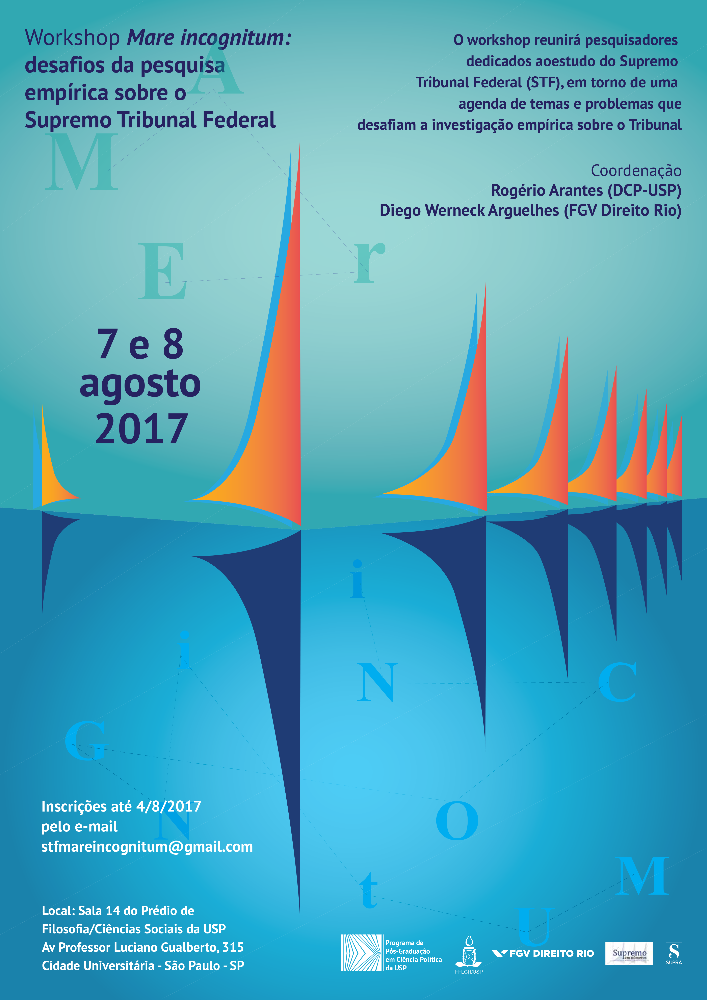{.margin}

Em 2017, fui convidado por **Diego Werneck Arguelhes** e **Rogério Arantes** para apresentar um trabalho em uma rede de pesquisa que eles coordenam e cujo primeiro encontro seria realizado naquele ano. A rede se voltava a reunir os pesquisadores empíricos sobre o STF, entre os quais eu já me incluía, junto com Juliano Benvindo, em função da visibilidade que teve nosso trabalho sobre as ADIs. Tratava-se de uma iniciativa comum entre o direito da FGV (instituição em que Diego atuava na época) e a ciência política da USP (onde até hoje atua Rogério).

O workshop *Mare Incognitum: Desafios da Pesquisa Empírica sobre o STF* foi um dos melhores eventos a que já fui, qualidade decorrente do fato de que todos os participantes eram também expositores. Não se tratava de um evento para o público, mas de uma reunião de pesquisadores, para compartilhar suas agendas e seus resultados, bem como para coordenar as pesquisas em andamento, evitando retrabalhos e fomentando coautorias. Lá, além de Rogério e Diego, tive a oportunidade de rever alguns dos pesquisadores que eu já conhecia (como **Felipe Recondo** e **Mateus Araújo**) e também de conhecer (e reencontrar praticamente a cada ano) boa parte dos autores que são o núcleo da bibliografia sobre o STF[^mare].

[^mare]: Ana Laura Pereira, Andres del Rio, Conrado Hübner Mendes, Damares Medina, Daniel Bogéa, Eloísa Machado, Fabiana Luci Oliveira, Fabio Kerche, Fernando Fontainha, Fernando Leal, Frederico Almeida, Guilherme Duarte, Guilherme Klafke, Ivar Hartmann, Jefferson Mariano, José Luiz Nunes, Juliana Cesário Alvim Gomes, Julio Canello, Leandro Molhano Ribeiro, Lígia Almeida, Lívia Guimarães, Luciana Gross, Luciana Ramos, Luciano da Ros, Marjorie Marona, Rafael Mafei, Rubens Glezer, Shandor Torok, Thomaz Pereira, Vanessa de Oliveira e Virgílio Afonso da Silva e vários outros.

Este é um grupo do qual vale muito a pena participar, tanto para acompanhar os trabalhos que estão sendo feitos quanto para poder dialogar com cada um desses pesquisadores excepcionais. Fico sempre feliz em lê-los e também em ouvi-los, pois são vozes constantes na mídia quando é preciso comentar as decisões do STF e debater sobre os rumos da jurisdição constitucional.

Se eu tivesse de escolher um evento para eu poder ir a cada ano, seria o encontro do Mare (cada vez menos *incognitum*, em grande parte pelos trabalhos das pessoas envolvidas nessa rede).

#### 5.8.2 Primeira palestra internacional: CECAR, Colômbia

Em agosto de 2015, por indicação da professora Loussia Felix, fui convidado para fazer uma conferência na universidade colombiana Corporación Universitária del Caribe (CECAR). Tratou-se de um evento com vários palestrantes internacionais, I Congreso Internacional de Derecho CECAR, organizado pelo prof. Ronald Cuenca. Na ocasião, apresentei uma palestra em espanhol, que tratou do controle de constitucionalidade no Brasil.

#### 5.8.3 Pesquisador visitante na Université Paris Nanterre

Em 2017, dois anos depois do nascimento de Ana, conseguimos planejar a primeira saída internacional da família: em um afastamento para licença-capacitação, fui recebido por dois meses como pesquisador convidado do *Centre de Théorie et Analyse du Droit* da Université Paris Nanterre, sob a supervisão do prof. Éric Millard, que havia sido orientador do mestrado de Leonardo Amorim, nesta universidade. Também acompanhei as aulas de Pierre Brunet, então orientador de Leonardo na Sorbonne. Essa experiência permitiu contato próximo com a tradição realista francesa, que tem em Michel Troper uma referência central, e que oferece contrapontos tanto à hermenêutica filosófica de matriz alemã quanto ao constitucionalismo norte-americano.

Um dos pontos altos desse período foi a visita que fiz ao professor Troper, já aposentado, que havia sido orientador tanto de Brunet quanto de Millard. Ele me recebeu gentilmente em sua casa, onde conversamos longamente sobre filosofia, direito e arte. Eu queria entender como seria possível articular sua perspectiva realista com o desenvolvimento de pesquisas empíricas, que era justamente o problema do doutorado de Leonardo. Compreendi que a posição central de Troper na teoria francesa decorria tanto de um vasto conhecimento quanto de sua abertura para o diálogo, movida por um interesse genuíno nas ideias de outras pessoas.

Um dos resultados concretos foi que estabelecemos, em 2018, um acordo para que Leonardo Amorim realizasse seu doutorado em cotutela celebrada entre a UnB e a Sorbonne, sendo orientado por mim e por Pierre Brunet. Infelizmente, Leonardo não conseguiu concluir o trabalho dentro do prazo de uma cotutela que foi atravessada pela pandemia e pela reorganização que ela desencadeou na vida de todos nós. Mas essa foi uma experiência muito rica de orientação, porque a necessidade de equilibrar os dois sistemas de ensino e as duas culturas acadêmicas exigia um esforço de diálogo em que aprendi muito.

Academicamente, além de ter participado de algumas conferências e de ter dado a minha primeira palestra em francês (*La théorie de l'interprétation dans le contexte brésilien*), na Universidade de Nanterre, acompanhei turmas de Master de Éric Millard e de Pierre Brunet[^master]: grupos relativamente pequenos de estudantes, com formação correspondente aos últimos anos do bacharelado brasileiro. Eu fui a algumas semanas de curso, que me permitiram compreender melhor a dinâmica das aulas e o perfil dos estudantes. Compreendi que uma das diferenças fundamentais das nossas abordagens era a centralidade, na França, das provas orais. Como os alunos do Master tendiam a ser avaliados por provas orais realizadas no final dos cursos, eles se dedicavam a anotar e memorizar tudo o que os professores diziam e se mostravam pouco propensos a fazer leituras autônomas e abordagens críticas.

Voltei de Paris com renovada confiança nas abordagens de Warat e na necessidade de criar espaços pedagógicos abertos, nos quais os estudantes sejam estimulados a fazer estudos de modo autônomo e a desenvolver o seu senso crítico. Mal sabia que, pouco mais de dois anos depois, enfrentaríamos o desafio mais duro de nossa geração, que reconfigurou as relações sociais e sob cuja sombra atuamos até hoje: a Pandemia.

[^master]: Depois dos três anos iniciais da *licence*, os estudantes franceses passam pelo *master*, que pode ser acadêmico (voltado a preparar para o doutorado) ou profissional (voltado a preparar para o mercado). São dois anos de curso (Master 1 e Master 2), que completam o ciclo de formação dos juristas.

#### 5.8.4 Pós-doutorado na Aix-Marseille Université (AMU)

Minha segunda experiência na França, entre 2022 e 2023, foi bastante diversa da anterior. Em primeiro lugar, ela foi bem mais longa e imersiva, pois nossa família se mudou para a cidade de Aix-en-Provence, onde residimos por seis meses. Ana e Mathias cursaram a escola pública francesa neste período e Letícia fez cursos de extensão na universidade. Vivemos, pela primeira vez, a inteireza de um inverno europeu, algo que impacta bastante nossas subjetividades tropicais, mesmo considerando que estávamos no sul da França e que se tratou de um dos invernos menos intensos das últimas décadas.

Aproveitando a oportunidade de ter sido selecionado em um edital da FAP-DF, de bolsas de pós-doutorado, identifiquei na AMU uma unidade de pesquisa que chamou minha atenção porque tratava dos temas que me interessavam: o *Laboratoire de Théorie du Droit* (Laboratório de Teoria do Direito) - LTD, vinculado à Faculdade de Direito e Ciências Políticas e responsável por um Master em Teoria do Direito. Os eixos de pesquisa desta unidade (Argumentação jurídica, Inteligência Artificial, Conceitos jurídicos e Metodologia) eram tão alinhados com a minha própria agenda que eu enviei uma mensagem para saber se seria possível me receberem como pesquisador convidado. Para minha surpresa, fui aceito de modo quase imediato, o que permitiu que eu conseguisse organizar esse período de pós-doutorado no estreito prazo de dois meses, entre a aprovação do pedido e o início da bolsa.

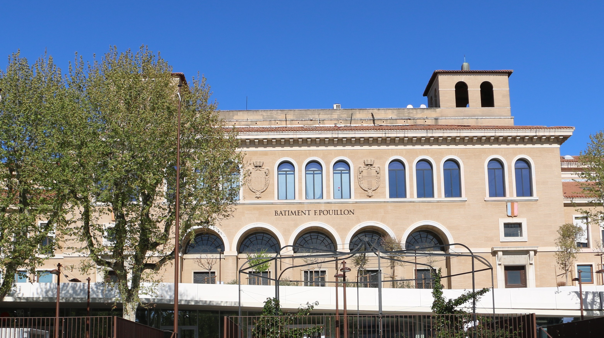{.margin}

Academicamente, a maior influência desse período é a contribuição para que eu compreendesse melhor as peculiaridades do sistema de ensino superior no Brasil e o sentido das minhas práticas docentes, a partir de uma comparação com o modelo francês. Tive várias conversas que me esclareceram sobre a organização da academia jurídica francesa, em particular sobre as percepções que as pessoas têm, mas não escrevem em suas obras: com Jean-Yves Chérot, fundador do *Laboratoire*, com Franck Haid, o professor com quem tive o maior diálogo, e com Frédéric Rouvière, coordenador do Laboratório. Também tive a oportunidade de conhecer melhor a obra de Christian Atias, teórico do direito muito original, mas que tem pouca visibilidade fora da França (e mesmo fora da universidade de Aix-Marseille, onde foi professor). A ousadia teórica de Atias contrastava com o conservadorismo de outros autores que formaram a atual geração de professores da AMU, como Jean-Louis Bergel.

Diferentemente do meu *séjour de recherche* de 2017, em que minha experiência se concentrou nos cursos de Master, em Aix-en-Provence eu segui disciplinas da *licence*, que tem uma abordagem muito diversa daquela existente nos cursos de uma universidade pública brasileira. Meu principal objeto de estranhamento era o fato de que os primeiros anos da graduação em direito eram o verdadeiro processo seletivo, no qual os professores precisavam dedicar uma grande energia a classificar os alunos, definindo quem poderia seguir adiante no curso.

Na França, como em outros lugares, é relativamente fácil entrar nas universidades, mas os estudantes que entram na *licence*[^licence] em direito têm um espaço reduzido para chegar ao segundo e terceiro ano. Por isso, os docentes precisam lecionar turmas imensas (de 300, 500 ou mesmo 1000 alunos), em que há um grande distanciamento e uma baixa possibilidade de diálogo. Por mais que os professores que conheci lá fossem muito capacitados, o trabalho que faziam nos primeiros anos não era apenas o de formar os alunos, mas o de selecionar quem poderia seguir no curso e reprovar uma parcela significativa dos estudantes.

[^licence]: ***Licence***: primeiro período de formação jurídica, composto por três anos de matérias de conteúdo mais geral.

Na França, tive tempo para avançar o desenvolvimento de uma obra que consolidava minhas abordagens sobre as relações entre direito e filosofia: o livro *Filosofia, Direito e Linguagem*[^fdl-2024], que publiquei pela editora da FD. Este foi o terceiro livro que publiquei neste formato, gerando o arquivo em PDF e o disponibilizando gratuitamente pelo [Portal de Livros da UnB](https://livros.unb.br/index.php/portal/catalog/category/fd). Também fiz a tradução deste livro para o francês (*[Philosophie, droit et langage](https://fr.arcos.org.br/content/files/2023/04/Philosophie-Droit-et-Langage.pdf)*)[^fdl-fr] e o deixei em uma página do Arcos.

[^fdl-2024]: Costa, Alexandre. *Filosofia, Direito e Linguagem*. Editora da Faculdade de Direito - UnB, 2024. Acesso aberto.

Desse período também resultou a publicação, em francês, do artigo *"Au-delà de la philosophie acritique des juristes"*[^franc], que analisa a postura dos filósofos do direito acerca do fenômeno jurídico e que foi publicado recentemente em português, no site de *preprints* do PMPD[^fil]: Direito.arxiv. Apresentei também, em Aix, o seminário *La méthode de recherche empirique en droit*[^seminario-aix] no *Laboratoire de Théorie du Droit*, no qual expus as abordagens empíricas que tenho aplicado nos últimos anos. A experiência consolidou uma agenda de pesquisa em cooperação que, recentemente, envolveu a celebração de acordo de cooperação entre a UnB e a AMU.

[^franc]: Costa, Alexandre. *"Au-delà de la philosophie acritique des juristes"*. Les Cahiers Portalis, n. 11, 2023.
[^fil]: Costa, Alexandre. [*Crítica da etnofilosofia jurídica: limites da filosofia domesticada pelos juristas*](https://arxiv.pmpd.unb.br/index.php/cartografias/preprint/view/49). Direito.arxiv, 2025.
[^fdl-fr]: Costa, Alexandre. *[Philosophie, Droit et Langage](https://fr.arcos.org.br/content/files/2023/04/Philosophie-Droit-et-Langage.pdf)*. Disponível em Arcos.fr.

[^seminario-aix]: Costa, Alexandre. *La méthode de recherche empirique en droit.* Seminário realizado no *Laboratoire de Théorie du Droit, Aix-en-Provence*, 2023.

#### 5.8.5 Pós-Graduação da Escola da AGU

Em meados de 2019, a Escola Superior da AGU me convidou para coordenar a disciplina de Metodologia da Pesquisa, no curso de Especialização em Advocacia Pública, que estava sendo lançado. Quem sugeriu o meu nome foi Henrique Fulgêncio, que fazia parte do Grupo de Pesquisa Política e Direito há uma década e que, logo depois de defender seu doutorado, havia ingressado na Escola da AGU.

Eu aceitei o convite e participei do desenvolvimento do curso, principalmente da estruturação dos trabalhos de conclusão de curso (TCC), na qual várias das minhas sugestões foram aceitas, inclusive a de fixar a escrita de um artigo científico como formato padrão de TCC. Como as disciplinas poderiam ser divididas entre mais de um docente, indiquei o prof. Ricardo de Lins e Horta, que concluiu seu doutorado naquele mesmo ano e, além de participar do Grupo de Pesquisa Política e Direito, era um membro atuante da Rede de Pesquisa Empírica em Direito.

Embora as especializações sequer tivessem obrigatoriedade de contar com Trabalhos de Conclusão de Curso, a EAGU adotou uma estrutura metodológica robusta, pois já existia o projeto de criar uma pós-graduação *stricto sensu*, em um formato que estava se expandindo no país, inclusive nas universidades públicas e escolas de governo: o mestrado profissional. Ricardo e eu ministramos conjuntamente esta matéria em 2019 e também em novas edições desse curso de pós-graduação *lato sensu*.

Na especialização da AGU, eu e Ricardo desenvolvemos materiais e abordagens adequados à incorporação de metodologias empíricas às pesquisas em direito. Enquanto os estudantes esperavam uma disciplina centrada em normas da ABNT, como se o objetivo mais importante fosse escrever um trabalho que tivesse uma forma acadêmica, nós centramos nossa disciplina no desenvolvimento de um projeto de pesquisa consistente, voltado à produção de conhecimento aplicado e, de preferência, com uso de pesquisa empírica e ferramentas tecnológicas modernas.

Esse trabalho me permitiu desenvolver materiais adequados para lecionar disciplinas metodológicas em direito com uma abordagem que refletia as nossas convicções sobre a necessidade de construir um conhecimento jurídico aplicado, a partir de teorias robustas e com base em evidências empíricas.

## 6 Atividades de Ensino: balanço geral

### 6.1 Docência

De 2001 a 2026, eu ministrei um total de 99 turmas na UnB, sendo 65 de Graduação, 11 mistas (Graduação + Pós) e 23 de pós-graduação.

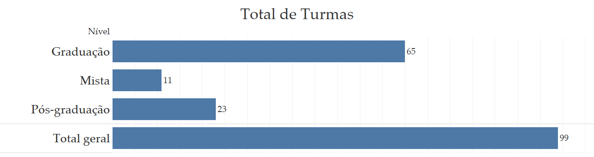

As turmas de graduação foram ministradas nos cursos de Direito, Ciência Política e Gestão de Políticas Públicas. Já as turmas de pós-graduação foram ministradas majoritariamente nos Programas de Direito e Ciência Política, além de uma disciplina no Programa de Metafísica (juntamente com uma do direito).

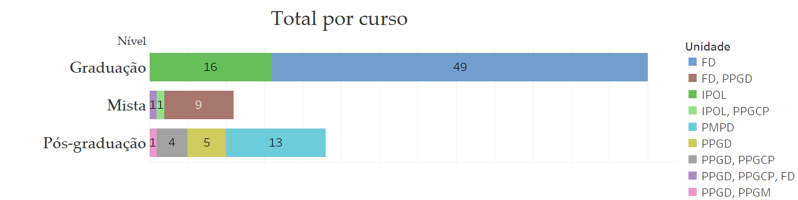

Contabilizando todas as minhas turmas e agrupando as disciplinas de dupla ou tripla entrada, resta evidente que a disciplina que mais ministrei ao longo do tempo foi Filosofia do Direito, para a Graduação. Em segundo lugar, veio a disciplina de Ética e Política, ministrada para o GPP, seguida de perto pelas disciplinas de Introdução ao Direito 1 e de Data Science e Direito.

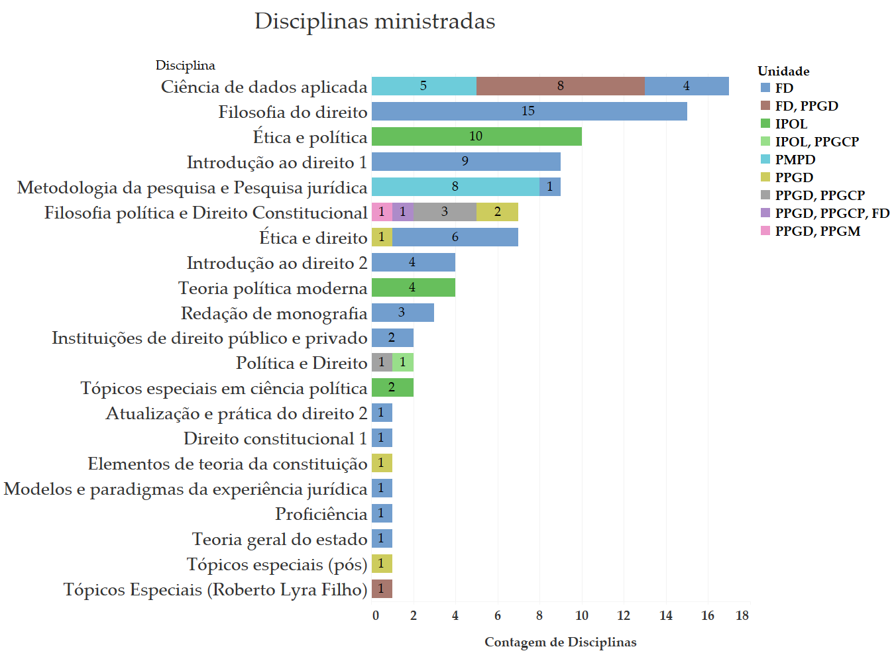

Se agruparmos as disciplinas por tema, as disciplinas de Filosofia Política e Jurídica formam cerca de 1/3 de todas as minhas turmas de graduação e de pós. Se entendermos que Ética, Política e Direito é também uma parte da filosofia, esse conjunto subiria para mais da metade das turmas que lecionei entre 2001 e 2026. Se somarmos a este bloco também as disciplinas de introdução e de hermenêutica, que têm forte interface com a filosofia, chegaríamos a 70% do meu trabalho docente.

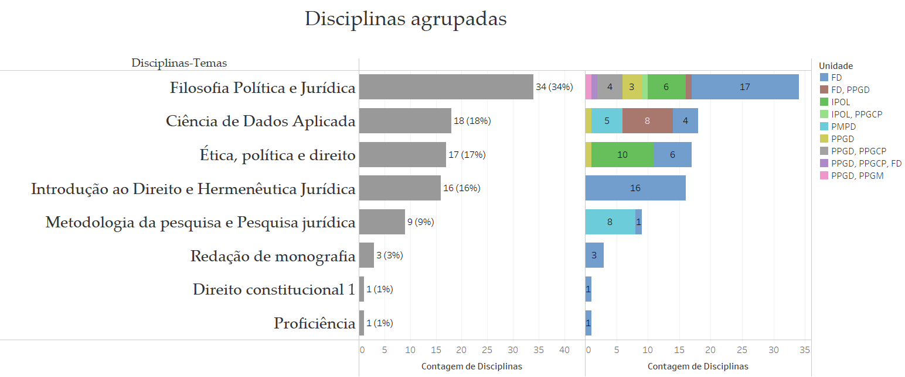

O segundo grupo mais representativo (ou praticamente empatado com o de introdução ao direito, tomado isoladamente) são as disciplinas focadas em Ciência de Dados para Pesquisa empírica, que tenho ministrado com frequência tanto na graduação quanto nos programas de pós-graduação da FD.

Deixei Direito Constitucional 1 à parte para indicar que esta foi a única disciplina dogmática que ministrei ao longo de todo este período. Porém, o fato de que esses estudantes não tiveram efetivamente uma turma de Teoria Geral do Direito Público fez com que a teoria e a filosofia fossem parte relevante mesmo desta matéria. Para completar a experiência descrita, estão as disciplinas de Redação de Monografia e de Proficiência, que não são exatamente experiências de ensino, mas de gestão das defesas de monografia e da formulação e aplicação da prova de Proficiência.

### 6.2 Orientação

#### 6.2.1 Análise geral das orientações

Ao longo da minha trajetória, orientei 96 estudantes, em 103 trabalhos de conclusão, em cursos presenciais.

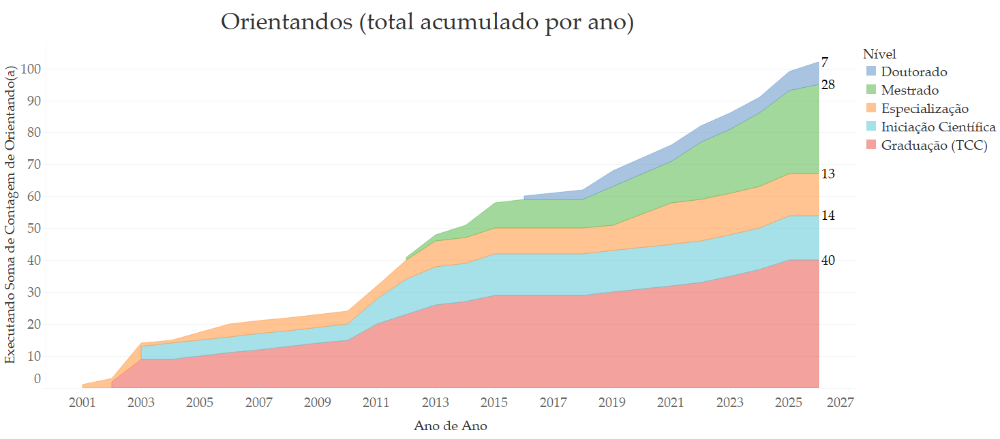

Foram 40 monografias de graduação, 14 iniciações científicas, 13 especializações (somente 2 fora da UnB), 29 mestrados e 7 doutorados. Assim, tive uma média de 4,0 trabalhos orientados por ano, ao longo dos 26 anos desde 2001, distribuídos conforme o gráfico a seguir.

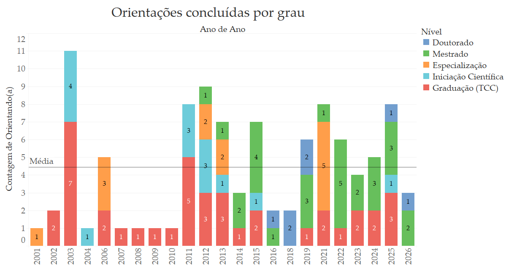

Como esperado, comecei minha carreira orientando mais alunos de graduação (nas monografias e iniciações científicas), que esse número caiu drasticamente durante o meu doutorado e que, aos poucos, foi se deslocando da graduação para a pós-graduação. Quando foco apenas na pós-graduação, vejo que houve uma prevalência de orientações de mestrado, que se acentuou a partir de 2022.

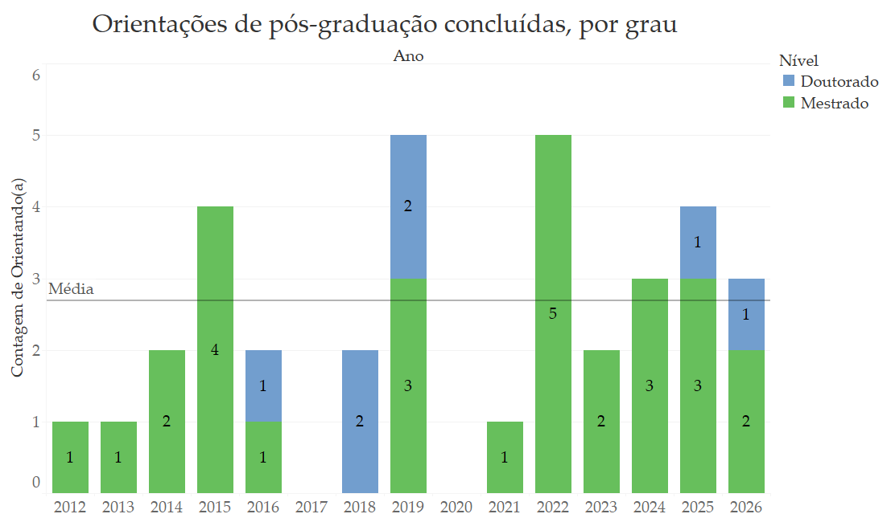

A prevalência de mestrados concluídos remonta a 2022, quando começaram a se titular meus orientandos do PMPD, que só conta atualmente com um curso de mestrado profissional.

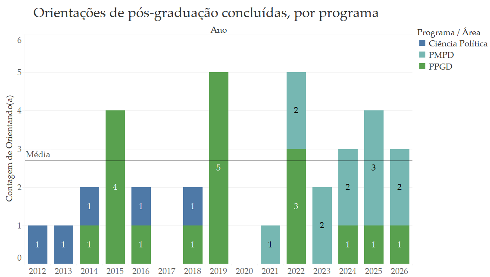

Desde 2023, minhas orientações têm se concentrado predominantemente no PMPD (onde sou credenciado como docente permanente), embora ainda tenha orientado regularmente estudantes do PPGD (onde sou credenciado como colaborador).

Quando segmento esses dados pelos temas que descrevi na apresentação, o resultado é o seguinte.

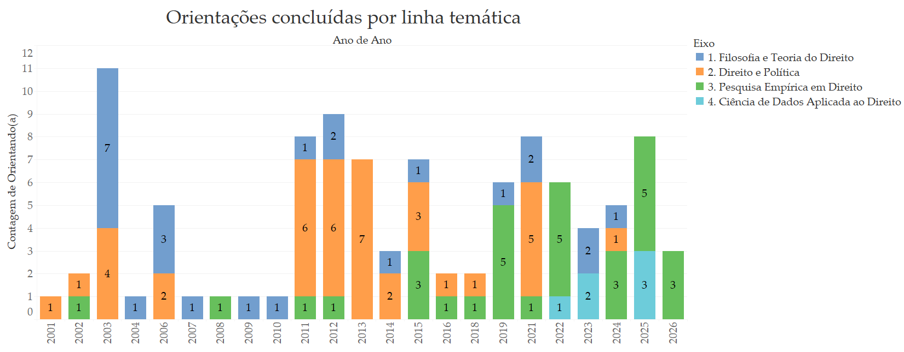

As minhas orientações iniciais eram predominantemente na área de filosofia do direito, mas com alguns casos de Direito e Política. Esta linha de Direito e Política passa a ser a principal quando meus orientandos do IPol começam a defender seus trabalhos, em 2011, e segue assim até que eu saia da Ciência Política e ingresse na Faculdade de Direito, quando passam a predominar trabalhos de Pesquisa Empírica em Direito. Por fim, desde 2022, começam a defender meus orientandos da área de Ciência de Dados aplicada, mas essa linha tende a ser minoritária, por se tratar mais de uma dimensão didático-pedagógica, que apoia as investigações da Pesquisa Empírica, em que estão localizados todos os meus orientandos atuais.

#### 6.2.2 Orientações acerca do STF

Em 2026, assisti a uma palestra do Rogério Arantes, em que ele fez um balanço da produção acadêmica acerca do STF. Ele utilizou uma métrica interessante, contabilizando o número de teses e dissertações que faziam referência a STF ou a Supremo Tribunal Federal, fosse no título ou no resumo. Para a minha surpresa, ele indicou que eu era um dos professores que havia orientado mais trabalhos nesta temática, o que me fez buscar reproduzir aqui o levantamento feito pelo Rogério.

Fiz uma busca na CAPES por todos os trabalhos de pós-graduação que tinham STF ou Supremo Tribunal Federal em três lugares: Título, Palavras-chave e Resumo. Porém, entendi que agregar as ocorrências no resumo trazia algumas distorções, pois havia um número grande de trabalhos que fazia alguma referência ao STF em seu resumo (normalmente a uma decisão), mas cujo objeto específico de análise não era a atuação do Supremo, mas uma questão na qual existiam algumas decisões relevantes: políticas públicas, internet, sistema penitenciário, orçamento público, etc.

Assim, fiz uma diferenciação entre trabalhos que têm o STF como objeto principal (identificados pela presença desses termos no título ou nas palavras-chave) e pesquisas que tratam do STF como elemento secundário. Embora os dados disponíveis na CAPES não englobem as teses e dissertações defendidas a partir de 2025, foi possível construir um gráfico que mostra a crescente produção acerca do STF.

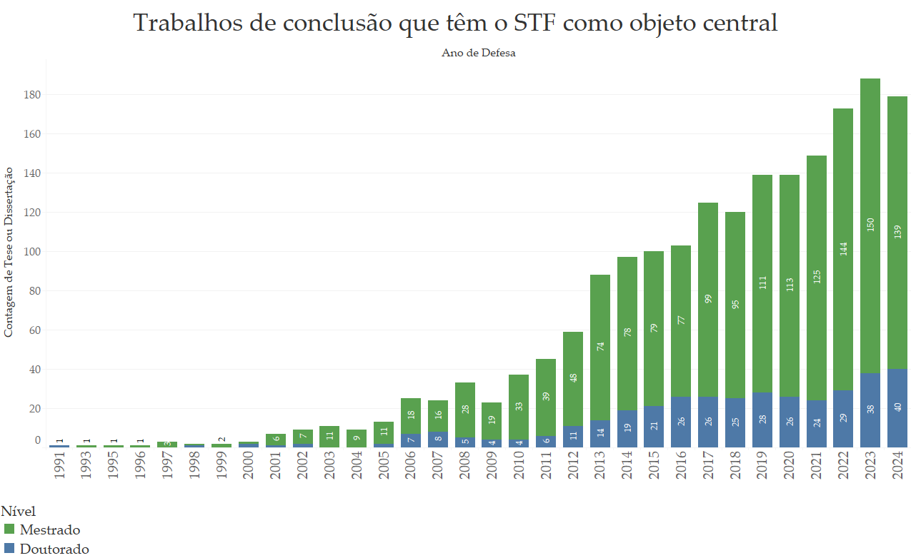

Saímos de menos de 20 trabalhos anuais até 2005 para mais de 100 trabalhos anuais, desde 2015, com um pico de quase 190 trabalhos em 2023. Esse crescimento vertiginoso se deve em grande parte à produção concentrada em 18 instituições, que respondem por 50% de todas as teses e dissertações, sendo visível uma concentração desses trabalhos em SP (com a USP e a PUC) e em Brasília (UnB, IDP e UNICEUB).

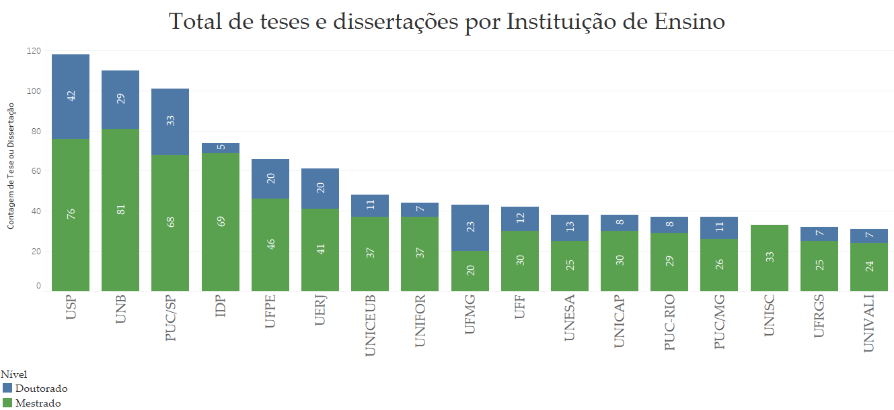

Quando contabilizamos os trabalhos por orientação concluída, temos os seguintes docentes com o maior número de ocorrências. Esta lista mostra que, embora a USP seja a universidade com maior número de trabalhos, eles se encontram também dispersos entre um corpo docente mais amplo, de modo que somente o José Levi tem um número mais expressivo de orientações. Já os trabalhos da UnB são mais concentrados em três docentes: eu e Juliano Benvindo, que estamos ainda na ativa, e Gilmar Mendes, que se aposentou da UnB e continua como orientador ativo apenas no IDP. Porém, a maior concentração de trabalhos nos mesmos orientadores ocorre com Paulo Gonet (no IDP-BSB) e com Monia Leal (que responde por quase metade das 33 orientações da UNISC).

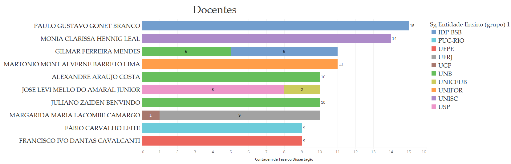

Esses números revelam que a UnB é um dos principais polos de pesquisa sobre o STF e que essa projeção está bastante ligada ao trabalho dos dois docentes que participaram, há mais de dez anos, do projeto de pesquisa "A quem interessa o controle concentrado de constitucionalidade?", que se tornou um dos trabalhos de referência no campo.

Quando focamos esta análise nos dez últimos anos sobre os quais há dados disponíveis, o resultado tem uma ligeira alteração, mantendo-se Paulo Gonet Branco na liderança, e eu fico empatado com Martônio Lima (da UNIFOR) e com Monia Leal (que já tinha algumas orientações anteriores a 2015). Outro ponto a ser destacado é que quatro desses docentes tiveram formação na pós-graduação da UnB: Paulo Gonet, Alexandre Costa, Fabio Quintas, Juliano Zaiden.

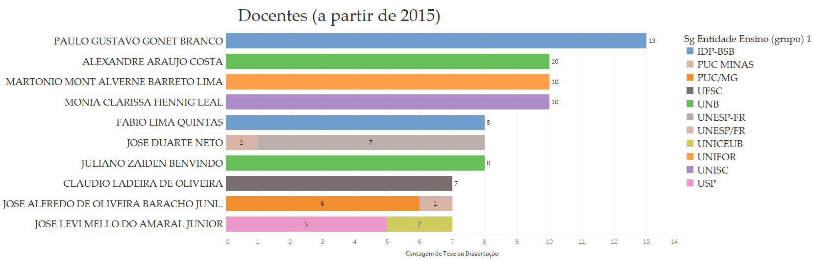

Minha presença substancial no campo de pesquisas acadêmicas sobre o STF se explica tanto pela minha trajetória de investigação sobre o tema (que começa no meu mestrado, em 1997) quanto pelo fato de que o PMPD tem tido parcerias com o STF e é natural que os servidores do Supremo que estudam no Programa realizem pesquisas focadas na atividade do Tribunal.

O gráfico seguinte mostra a distribuição dessas orientações ao longo do tempo.


Nota-se que há uma boa dispersão das orientações (sem que nenhum dos docentes tenha mais do que 4 trabalhos por ano sobre o STF). Há ainda uma boa chance de que a centralidade do papel da UnB se amplifique quando incorporarmos os dados de 2025 e 2026, tendo em vista que 9 orientandos meus defenderam neste período trabalhos focados no STF e há quatro trabalhos em curso com esse perfil.

## 7 Pesquisa e Produção Científica

### 7.1 Introdução geral

Como indicado antes (na Apresentação), minha trajetória de pesquisa se articula em torno de quatro temas principais:

1. Filosofia e Teoria do Direito
2. Direito e Política
3. Pesquisa Empírica em Direito
4. Metodologia da pesquisa e ciência de dados

Tão importante quanto diferenciar esses temas é compreender que eles estão interligados, em um programa de pesquisa que busca compreender o direito como prática social historicamente situada, investigar empiricamente como esse direito efetivamente opera e oferecer à comunidade jurídica instrumentos teóricos e metodológicos que permitam essa investigação.

#### 7.1.1 Indicadores bibliométricos

Antes de descrever a produção que ligo a cada tema, faço aqui um panorama geral, começando pelo registro dos indicadores bibliométricos consolidados pelo Google Scholar[^scholar-profile], nesta data:

| Indicador | Total | Desde 2021 |
|---|---|---|
| Citações | 808 | 303 |
| Índice h | 14 | 10 |
| Índice i10 | 21 | 10 |

O índice i10 indica quantos trabalhos foram citados pelo menos 10 vezes, enquanto o índice h, formulado por Jorge E. Hirsch[^hirsch2005], estima a importância, a significância e o impacto amplo das contribuições acumuladas de um pesquisador. A lógica do indicador é simples: o autor possui índice h igual a *n* quando *n* é o maior número de artigos seus com pelo menos *n* citações cada. O meu índice h total de 14 indica que tenho 14 produtos com 14 ou mais citações.

O Currículo Lattes complementa esses números com o registro de 36 artigos completos publicados em periódicos, 7 livros publicados, 13 capítulos de livros, 1 livro organizado e 2 trabalhos completos em anais de eventos, além de inúmeras produções de divulgação científica e materiais didáticos. A maior parte dessa produção encontra-se em acesso aberto, por convicção quanto à função pública da produção acadêmica em uma universidade pública.

A distribuição das citações nos últimos cinco anos (303 das 808 citações totais, ou 37,5% do acervo), combinada com o índice h de 10 nesse mesmo período, indica que a agenda de pesquisa permanece ativa e com impacto crescente, não se tratando de uma produção encerrada cuja repercussão hoje seja apenas residual.

[^scholar-profile]: Link para [Perfil no Google Scholar](https://scholar.google.com/citations?user=R8LaGAwAAAAJ&hl=pt-BR)
[^hirsch2005]: Hirsch, J. E. An index to quantify an individual's scientific research output. Proceedings of the National Academy of Sciences, v.102, n.46, p.16569-16572, 2005.

#### 7.1.2 Publicações mais citadas

Esta é a lista dos meus produtos mais citados, com dados retirados do site Google Acadêmico:

1. *A quem interessa o controle concentrado de constitucionalidade? O descompasso entre teoria e prática na defesa dos direitos fundamentais*, com Juliano Zaiden Benvindo. Relatório de pesquisa, 2014. **140 citações** (17,33%).
2. *Direito e Método: diálogos entre a hermenêutica filosófica e a jurídica*. Tese de doutorado, 2008. **81 citações** (10,02%).
3. *Cartografia dos métodos de composição de conflitos*. Em: *Estudos em Arbitragem, Mediação e Negociação*, v. 3. Brasília Jurídica, 2003. **68 citações** (8,42%).
4. *Introdução ao direito: uma perspectiva zetética das ciências jurídicas*. Fabris, 2001. **64 citações** (7,92%).
5. *Judiciário e interpretação: entre Direito e Política*. Pensar — Revista de Ciências Jurídicas, v. 18, n. 1, p. 9-46, 2013. **45 citações** (5,57%).
6. *Das Teorias da Interpretação à Teoria da Decisão: por uma perspectiva realista acerca das influências e constrangimentos sobre a atividade judicial*, com Ricardo Lins Horta. Opinião Jurídica, p. 271-297, 2017. **36 citações** (4,46%).
7. *O controle de razoabilidade no direito comparado*. Thesaurus Editora, 2008. **35 citações** (4,34%).
8. *Controle de constitucionalidade no Brasil: eficácia das políticas de concentração e seletividade*, com Alexandre Douglas Zaidan de Carvalho e Felipe Justino de Farias. Revista Direito GV, v. 12, p. 155-187, 2016. **33 citações** (4,08%).
9. *Teoria dialética do direito: a filosofia jurídica de Roberto Lyra Filho*, com Inocêncio Mártires Coelho. Brasília: UnB, 2017. **31 citações** (3,84%).
10. *O poder constituinte e o paradoxo da soberania limitada*. Teoria e Sociedade, v. 1, n. 19, p. 198-227, 2011. **28 citações** (3,47%).

------

A soma das citações destes 10 produtos responde por 70% do total das citações catalogadas pelo Google Acadêmico. Trata-se de um conjunto plural de trabalhos, com livros, artigos, capítulo e relatório de pesquisa. Há trabalhos dos três primeiros temas da minha produção, o que é compatível com o fato de que toda esta lista é de trabalhos anteriores a 2018, quando comecei a publicar os trabalhos do tema de metodologia e *data science*. Também é relevante que boa parte dos trabalhos seja escrita em coautoria com outros pesquisadores, o que ressalta a importância do diálogo na produção desses textos.

#### 7.1.3 Atividade editorial

Complementarmente à produção própria, sou atualmente coeditor da Revista de Direito Setorial e Regulatório da UnB e integro os corpos editoriais dos Cadernos Miroslav Milovic (desde 2024) e da Revista Jurídica (desde 2020). Componho também o corpo de revisores de nove periódicos científicos[^revisor], tendo elaborado mais de cinquenta pareceres de *peer review* desde 2011, além de atuar em consultorias *ad hoc* para a CAPES (desde 2013) e a FAPDF. Essa atividade de revisão e avaliação, muitas vezes invisível, é parte indissociável da sustentação coletiva do sistema de produção científica, e tenho procurado contribuir para ela com regularidade.

[^revisor]: Entre eles: Suprema; Revista de Estudos Empíricos em Direito; Revista Estudos Institucionais; Direito, Estado e Sociedade; Revista Brasileira de Estudos Políticos; Revista Jurídica da Presidência; Direito.UnB; Revista Direito GV; Revista dos Estudantes de Direito da Universidade de Brasília.

### 7.2 Estatísticas gerais

Ao longo da minha trajetória, publiquei 59 trabalhos entre artigos em periódicos, livros, capítulos e trabalhos em anais, além dos textos de divulgação e dos materiais didáticos registrados no Currículo Lattes.


Durante vários anos, toda a minha produção foi na área de Filosofia e Teoria do Direito, sendo que ela passou a se diversificar após a minha entrada no IPol, em 2009. Desde então, a produção na linha de Direito e Política ganhou espaço, bem como a produção na linha de Pesquisa Empírica em Direito, que representa uma síntese das abordagens jurídicas e políticas que comecei a desenvolver enquanto docente da Ciência Política. Por fim, nos anos 2020, começa a ganhar corpo uma produção sobre Metodologia e Ciência de Dados, que atualmente é crescente e provavelmente ganhará espaço nos próximos anos, embora essa linha esteja mais ligada à prática docente do que à produção acadêmica e científica.

O impacto da pandemia também aparece na minha produção. Enquanto alguns pesquisadores tiveram tempo para se dedicar com intensidade à produção acadêmica, devido ao afastamento social, eu estava no grupo dos acadêmicos que precisavam cuidar de filhos pequenos, o que fez com que a etapa pandêmica fosse de uma grande sobrecarga de trabalho, que impactou diretamente a minha capacidade de produção entre 2020 e 2022, tendo ela retornado ao normal apenas a partir de 2023.

### 7.3 Linhas temáticas

#### 7.3.1 Filosofia e teoria do direito

O fato de minha formação inicial (graduação e mestrado) ter se dado na interface entre direito e filosofia explica o fato de que minhas primeiras publicações se concentram nesse tema. Meus três primeiros artigos publicados[^est-propriedade][^est-sistemas][^est-positivismo] foram na Revista dos Estudantes de Direito da UnB, em seus primeiros números, entre 1996 e 2000. Embora eles traduzam a imaturidade teórica que eu compreensivelmente tinha, eles já anunciam as preocupações que moveram a minha trajetória e, principalmente, já indicam a minha propensão a trabalhar as tensões que marcam os nossos discursos: os dois primeiros exploram pares conceituais contrapostos e o terceiro trata explicitamente dos paradoxos envolvidos no senso comum dos juristas.

[^est-propriedade]: Costa, Alexandre. Direito à propriedade x Direito de propriedade. Revista dos Estudantes de Direito da Universidade de Brasília, v.1, p.36-39, 1996. 1 citação no GS.
[^est-sistemas]: Costa, Alexandre. Sistemas normativos x Sistemas valorativos. Revista dos Estudantes de Direito da Universidade de Brasília, v.2, p.32-35, 1997.
[^est-positivismo]: Costa, Alexandre. O paradoxo do positivismo. Revista dos Estudantes de Direito da Universidade de Brasília, v.4, p.40, 2000.

Faz parte dessa vertente teórica a primeira parte do meu mestrado, publicada posteriormente sob o título *O Controle de Razoabilidade no Direito Comparado*[^livro-razo], e também o meu primeiro livro publicado, em 2001: *Introdução ao direito*[^livro-intro], que é fruto das turmas de introdução ao direito que ministrei antes de ingressar na UnB.

[^livro-intro]: Costa, Alexandre. Introdução ao Direito. 2001. 64 citações no Google Scholar.
[^livro-razo]: Costa, Alexandre. O Controle de Razoabilidade no Direito Comparado. Brasília: Thesaurus, 2008. 35 citações no GS.

Quando comecei a lecionar na FD, no segundo semestre de 2001, escrevi um texto sobre modelos de interpretação jurídica, que eu usava nas aulas e que circulou durante alguns anos na forma de apostilas. Aquele era o tempo em que as faculdades tinham lojas de xerox, onde cada docente tinha uma pasta na qual disponibilizava os textos que os estudantes deveriam copiar, para seguir as disciplinas. Este foi o texto que, posteriormente, serviu de base para a segunda parte do meu doutorado, que trata da hermenêutica jurídica.

Nesse início de trajetória, escrevi também um texto sobre os métodos de composição de controvérsias, que foi o texto em que inaugurei a metáfora cartográfica, à qual voltei diversas vezes.[^cart-metodos-33] Esta é uma publicação que decorre de meus diálogos com Warat, que formulou a distinção entre mediação e conciliação que utilizei. Foi também o primeiro texto que decorreu da estreita colaboração que tenho com meu irmão **Henrique Araújo Costa** desde aquela época, que era então graduando em direito e participava ativamente do Grupo de Estudos em Arbitragem, Mediação e Negociação, que organizou a coletânea que minha cartografia integrava. Em 2023, publicamos juntos um novo texto, no qual buscamos atualizar e corrigir algumas partes da cartografia original, cuja continuada circulação acadêmica, documentada pelo alto número de citações que ela teve nesses vinte anos, sugere que ela preservou sua pertinência ao longo desse tempo.[^cartog]

[^cartog]: Costa, Alexandre; Costa, Henrique. *Cartografia dos métodos de composição de conflitos* In: Lopes, João Batista e outros (orgs.). Processo Civil: Questões Controversas. Belo Horizonte: D'Plácido, 2023, v.1, p. 539 - 558.

Nesse mesmo período, em parceria com **Miroslav Milovic** (meu orientador de doutorado, seção 1.2), **Maia Sprandel** e **Wanderson Flor do Nascimento**, organizei o livro *Sociedade e Diferença*[^livro-org-sd] (2.ed. Casa das Musas, 2006), coletânea interdisciplinar sobre diferença, alteridade e reconhecimento social que emergiu das atividades do Grupo de Pesquisa Pensamento Social (seção 2.5). O prefácio que Milovic escreveu para essa obra viria a ser, anos depois, adaptado e publicado em periódico científico, como descrevo ao final desta seção.

[^livro-org-sd]: COSTA, Alexandre A.; MILOVIC, Miroslav; SPRANDEL, Maia; NASCIMENTO, Wanderson Flor do (orgs.). Sociedade e Diferença. 2.ed. Brasília: Casa das Musas, 2006. v.300, 317p.

[^cart-metodos-33]: Costa, Alexandre. *Cartografia dos métodos de composição de conflitos*. In: Azevedo, André Gomma (org.). *Estudos em Arbitragem, Mediação e Negociação*. Brasília: Brasília Jurídica, 2003, v.3, p. 161 - 201. 68 citações no Google Scholar.

Ainda durante o doutorado, publiquei dois artigos em revistas ligadas à Faculdade de Direito, ambos desenvolvidos a partir de textos de hermenêutica jurídica que escrevi para minhas aulas de Introdução ao Direito 2. Na *Revista dos Estudantes de Direito da UnB*, publiquei um texto inspirado no Caso dos Exploradores de Cavernas, de Lon Fuller, analisando várias correntes interpretativas do direito a partir de votos que julgavam um caso fictício.[^razao] Na revista Notícia do Direito Brasileiro, publicação institucional da FD, publiquei um texto mais filosófico, explorando as relações entre interpretação e racionalidade[^ddl].

[^razao]: Costa, Alexandre. Razão e Função Judicial na Hermenêutica Jurídica. Revista dos Estudantes de Direito da Universidade de Brasília. v.6, p.33-48, 2007.
[^ddl]: Costa, Alexandre. Direito, Dogmática e Linguagem. Notícia do Direito Brasileiro. v.12, p.67-83, 2007.

Ainda em 2007, publiquei um texto sobre as relações entre as abordagens filosóficas de Derrida e Kelsen, no que toca à validade dos sistemas normativos.[^desconstrucao-2007] O artigo saiu em uma revista virtual que foi posteriormente descontinuada, dando margem a que, dez anos depois, eu retrabalhasse esse texto juntamente com **Ricardo Spindola Diniz**, gerando uma versão renovada que combina o texto original, um comentário de Ricardo e uma resposta a essas considerações. Esse capítulo de livro foi publicado no formato experimental de uma coluna de texto ao lado de uma coluna de comentários, ideia original do Ricardo, para dar forma concreta a nossas inspirações derridianas e dialógicas.[^desconstrucao-2018]

[^desconstrucao-2007]: Costa, Alexandre. Direito, Desconstrução e Justiça: reflexões sobre o texto Força de Lei, de Jacques Derrida. Revista Virtual de Filosofia Jurídica e Teoria Constitucional, 2007. 11 citações.
[^desconstrucao-2018]: Costa, Alexandre; Diniz, Ricardo M. Spindola. Direito, Desconstrução e Justiça / Um mínimo de liberdade. In: Direito, História e Política nos 30 Anos da Constituição. Florianópolis: Tirant lo Blanch, 2018. v.1, p.207-246.

Em 2008, publiquei no *Constituição & Democracia* um breve texto em que caracterizei a crença na validade universal dos direitos humanos como uma espécie de "religião laica": a religião constitucional dos direitos humanos, cuja admissão também deve ser considerada um ato de fé, visto que não é um imperativo racional ou lógico.[^religiao] Ao mesmo tempo em que ironiza o jusnaturalismo acrítico que permeia parte do constitucionalismo contemporâneo, esse artigo se utilizou do caráter sagrado dos direitos fundamentais para justificar a possibilidade de tensioná-los contra argumentos que negavam a admissão de certos direitos (no caso, a proteção contra homofobia) com base na defesa de uma suposta liberdade religiosa.

[^religiao]: Costa, Alexandre A. [*A Religião Oficial do Constitucionalismo Democrático*](https://www.repositorio.unb.br/handle/10482/967). Constituição & Democracia, v.23, p.3, 2008.

Entre 2010 e 2012, época do doutoramento de Henrique em Processo Civil, publicamos quatro artigos em coautoria nessa área: uma avaliação das críticas neoinstitucionais à teoria da instrumentalidade do processo[^h-instit]; uma arqueologia do conceito de ação[^h-acao]; uma reavaliação da obra de dois processualistas brasileiros fora da hegemônica escola paulista (o gaúcho Ovídio Baptista e o baiano Calmon de Passos)[^h-testamentos]; e uma resenha crítica de um livro de Rosemiro Pereira Leal[^h-rosemiro].

[^h-acao]: Costa, Henrique A.; Costa, Alexandre A. O conceito de ação: da teoria clássica à moderna. Continuidade ou ruptura?. Revista Brasileira de Direito Processual (Impresso). v.1, p.37-56, 2011.
[^h-instit]: Costa, Alexandre A.; Costa, Henrique A. Instrumentalismo x Neoinstitucionalismo: uma avaliação das críticas neoinstitucionais à teoria da instrumentalidade do processo. Revista Brasileira de Direito Processual (Impresso). v.72, p.127-141, 2010.
[^h-testamentos]: Costa, Henrique A.; Costa, Alexandre A. Os testamentos ignorados de Ovídio Baptista e Calmon de Passos. Revista de Processo. v.192, p.397-418, 2011.
[^h-rosemiro]: Costa, Alexandre A.; Costa, Henrique A. Resenha crítica do livro "Processo como teoria da lei democrática", de Rosemiro Pereira Leal. Revista Brasileira de Direito Processual (Impresso). v.77, p.215-220, 2012.

Em 2014, publiquei uma análise do livro póstumo de Dworkin, recém-lançado, *Justice for Hedgehogs*: *"Teologia Moral para Ouriços"*[^teologia]. Pareceu-me interessante que, nele, Dworkin admitisse mais claramente seus vínculos com uma teoria moral forte e sua vinculação com uma ideia substantiva de bem, motivo pelo qual qualifiquei sua abordagem como teologia, e não somente como teoria. Diversamente de outros textos, que tiveram maior impacto nos anos seguintes à publicação, o ano com maior número de citações deste artigo foi 2024, sendo uma delas em uma dissertação de mestrado escrita em turco, para a Universidade Galatasaray, que usa o texto para afirmar (em tradução feita pelo Gemini):

> Segundo Alexandre Araújo Costa — que afirma que a teoria da moral de Dworkin tem um caráter mais teológico do que filosófico —, tentar tornar a vida do indivíduo coerente e autêntica apelando para a virtude da responsabilidade moral é um esforço dogmático e não crítico.[^galata]

Creio que tanto a utilização de um texto em português em uma dissertação na Turquia quanto a tradução deste texto do turco para o português são indícios das aberturas possibilitadas pelos avanços em tradutores automáticos feitos com inteligência artificial.

[^teologia]: Costa, Alexandre. Teologia Moral para Ouriços. Direito.UnB, 2014. 13 citações.
[^galata]: Yildirin, Ertugrul. "[A Teoria da Democracia Constitucional no Liberalismo Igualitário de Ronald Dworkin](https://d1wqtxts1xzle7.cloudfront.net/106236523/Ertugrul_Kaan_Y%C4%B1ld%C4%B1r%C4%B1m_Master_Tezi-libre.pdf)". Dissertação de Mestrado. Universidade Galatasaray, 2024.

Em 2017, publiquei juntamente com Inocêncio Mártires Coêlho um livro sobre a teoria de Roberto Lyra Filho, fazendo uma descrição sistemática de sua obra e evidenciando tanto suas potencialidades como as suas limitações teóricas.[^livro-lyra] A escrita deste texto começa dez anos antes, quando fiz parte de um grupo de leitura de textos de Lyra Filho, coordenado pelo prof. José Geraldo de Sousa Jr., que era, então, meu colega da primeira turma de doutorado do PPGD. Lemos conjuntamente e discutimos praticamente toda a obra de Lyra, que se dedicou a desenvolver uma teoria do direito de inspiração marxista. Creio que seus trabalhos são um fruto muito importante da UnB, que também tem uma relevância pouco reconhecida fora do círculo do Direito Achado na Rua, movimento que tem em Lyra Filho seu marco filosófico.

Lyra desenvolveu uma crítica do direito oficial, inclusive do direito constitucional, que ganha importância num momento histórico em que se tornou hegemônica uma abordagem neoconstitucionalista, que se utiliza de certas leituras do direito constitucional para realizar uma crítica do restante do direito, mas não conta com instrumentos teóricos adequados para criticar o próprio direito constitucional, cuja validade é pressuposta. No grupo de estudos, escrevi vários comentários aos textos de Lyra, que se aglutinaram em uma interpretação global da obra, que circulou na época como um artigo denominado *Humanismo Dialético*, publicado no site Arcos em 2008.

Anos depois, ministrei uma disciplina de tópicos especiais em que abordamos especificamente a obra filosófica de Lyra Filho, oportunidade em que eu retomei o contato com Inocêncio Mártires Coêlho, que havia sido meu professor de Introdução ao Direito e participado da minha banca de doutoramento. Inocêncio é um pesquisador que se formou na UnB sob a orientação de Lyra Filho, sobre quem já tinha escrito um ótimo livro. Em nossos diálogos, desenvolvemos a versão ampliada e revista do texto que eu tinha escrito, que publicamos como livro em 2017.

[^livro-lyra]: Costa, Alexandre A.; Coelho, Inocêncio Mártires. Teoria Dialética do Direito: A filosofia jurídica de Roberto Lyra Filho. Brasília: Faculdade de Direito - UnB, 2017. 31 citações no GS.

Neste momento, publiquei também alguns artigos decorrentes da parceria com **Ricardo Lins e Horta**, que é mestre em neurociências e um pesquisador de relevo nas relações entre vieses comportamentais e direito. Estes textos, que alcançaram ótima repercussão, foram produzidos durante ou a partir das investigações do doutorado de Ricardo, defendido em 2019, e neles eu tive uma contribuição principalmente teórica e metodológica.[^psico-interp][^psico-vieses][^psico-desafios]

[^psico-interp]: Horta, Ricardo; Costa, Alexandre. Das Teorias da Interpretação à Teoria da Decisão. Opinião Jurídica, 2017. 36 citações.
[^psico-vieses]: Horta, Ricardo; Costa, Alexandre. Vieses na decisão judicial e desenho institucional: uma discussão necessária na era da pós-verdade. Cadernos Adenauer, 2017. 14 citações no GS.
[^psico-desafios]: Horta, Ricardo; Costa, Alexandre. Desafios da agenda de pesquisa empírica em psicologia da tomada de decisão judicial no Brasil. Revista de Estudos Empíricos em Direito, 2020. 17 citações no GS.

Também integram esse tema uma extensa produção de textos voltados a servir como apoio a minhas disciplinas de cunho filosófico, publicados no site Arcos, tanto em sua versão original (sobretudo em 2011)[^divulgacao-fil] quanto na versão atual, iniciada em 2020,[^fildir] composta majoritariamente pelos textos que construí para a disciplina Filosofia do Direito.

[^divulgacao-fil]: Em 2011 foram publicadas as duas partes do meu doutorado (*Introdução à Hermenêutica Filosófica* e *Hermenêutica Jurídica*) e também: *A ética do discurso em Habermas*; *A ética na modernidade*; *Ética e Moralidade*; *Ética, virtude e sociedade*; *Isonomia e Razoabilidade*; *O bem, a justiça, a legitimidade*; *O direito à imoralidade* e *O positivismo jurídico segundo Karl Olivecrona*.
[^fildir]: Em 2020, publiquei: *A ética grega*; *A filosofia e os paradoxos da linguagem*; *A filosofia grega*; *Colóquio de Ontologia Jurídica*; *Direito e Modernidade*; *Filosofia e mudança social*; *Flannery & Marcus e as origens da desigualdade política*; *O jusracionalismo de Immanuel Kant*; *O ocaso do jusnaturalismo*; *Ordem natural e autoridade política* e *Os desafios da filosofia contemporânea*.

Em 2022, a revista Ágoras fez um número especial sobre meu amigo e orientador **Miroslav Milovic**, para o qual escrevi uma adaptação, de minha autoria, de texto que Miro havia escrito originalmente como prefácio de *Sociedade e Diferença*[^livro-org-sd]. Esse texto me parecia pouco acessível a estudantes de graduação, que não conheciam a rede de referências utilizada naquele prefácio, cuja devida compreensão envolvia uma série de esclarecimentos teóricos, que busquei desenvolver para conferir uma maior visibilidade ao denso texto de Miro sobre as formas pelas quais poderíamos pensar contemporaneamente a sociedade atual.[^a-social]

[^a-social]: COSTA, Alexandre Araújo; MILOVIC, Miroslav. (Re)Pensar o Social. Ágoras - Revista Científica do G-TEIA (UFC). v.especial, p.23-35, 2022. [Link](https://arcos.org.br/pensar-o-social-2/).

No pós-doutorado na Université Aix-Marseille, publiquei meu primeiro artigo escrito e publicado em francês.[^acritique] A partir do pensamento de Pierre Bourdieu, ele analisa a perspectiva típica dos autores jurídicos, que tendem a construir sua filosofia do direito de forma muito isolada das percepções desenvolvidas pelos filósofos que são seus contemporâneos. Esse movimento tende a resultar em uma forma de "filosofia acrítica" acerca da própria filosofia do direito, cuja autonomia e relevância não é colocada em questão por boa parte dos jusfilósofos. Esse artigo foi posteriormente retrabalhado e traduzido para o português, caracterizando a filosofia do direito como uma etnofilosofia: um mapeamento das categorias utilizadas pelos integrantes do campo do direito, que as explica e sistematiza, gerando assim uma filosofia domesticada, incapaz de promover a crítica incisiva que o pensamento filosófico é capaz de realizar.[^etnofilosofia]

[^acritique]: Costa, Alexandre Araújo. Au-delà de la philosophie acritique des juristes. Les Cahiers Portalis. n.11, p.177-188, 2023.
[^etnofilosofia]: Costa, Alexandre. [Crítica da etnofilosofia jurídica: limites da filosofia domesticada pelos juristas](https://arxiv.pmpd.unb.br/index.php/cartografias/preprint/view/49). Direito.arxiv, 2025.

Esse tema reúne ainda os dois livros mais diretamente dedicados à filosofia da linguagem aplicada ao direito: *Hermenêutica Filosófica*[^livro-hf2], em que finalmente publiquei na forma de livro uma versão revista da primeira parte da minha tese de doutorado, e *Filosofia, Direito e Linguagem*[^livro-fdl2], já mencionado nas seções 5.5 e 5.8.4, que consolida parte dos textos que desenvolvi para a disciplina de Filosofia do Direito e que eram, em grande medida, publicados no site Arcos.

[^livro-hf2]: Costa, A. A. Hermenêutica Filosófica. Brasília: Universidade de Brasília, Faculdade de Direito, 2023.
[^livro-fdl2]: Costa, Alexandre Araújo. Filosofia, Direito e Linguagem. Brasília: Universidade de Brasília, Faculdade de Direito, 2024.

#### 7.3.2 Direito e Política

Quando ingressei no IPol, em 2009, para me credenciar e permanecer no PPG em Ciência Política, eu precisava ter uma produção expressiva nesta área. Este era um desafio para mim, pois toda a minha produção anterior estava publicada em livros ou revistas jurídicas, enquanto a área de Ciência Política e Relações Internacionais na CAPES somente considerava relevante a publicação de artigos no estrato superior do Qualis (B2 ou superior) segundo a avaliação da própria área. Durante alguns anos, este foi um desafio que eu precisava equacionar.

Meu primeiro movimento neste sentido foi a submissão, em 2010, de um artigo à revista Teoria & Sociedade (então B2), sobre o conceito de poder constituinte e os paradoxos que ele engendrava, na medida em que sua existência implicava uma espécie de soberania exclusivamente aplicada à edição do texto constitucional[^pcsl]. Ocorre, porém, que a categoria política de soberania foi criada para designar um poder ilimitado, o que faz com que o poder constituinte se constitua como uma categoria híbrida, que sempre conduz a desequilíbrios teóricos que não podem ser devidamente equacionados. Este texto de filosofia política marca um momento significativo do desenvolvimento da minha posição teórica, que se foi deslocando de uma leitura estrita da hermenêutica filosófica para uma posição mais próxima do realismo jurídico contemporâneo, sem abandonar a atenção à dimensão linguística e histórica da interpretação.

Neste mesmo ano, publiquei no *Constituição & Democracia*, encarte de jornal organizado por um projeto de extensão da Faculdade de Direito, um texto em que denunciava a "surdez seletiva" de um judiciário que optou por emitir "inaudita altera pars" uma ordem contra uma manifestação de estudantes da UnB, sabendo que do lado de fora de seu gabinete esperavam os advogados dos estudantes.[^surdez]

[^pcsl]: Costa, Alexandre. *O poder constituinte e o paradoxo da soberania limitada*. Teoria & Sociedade, 2011. 28 citações no GS.
[^surdez]: Costa, Alexandre A. *A Surdez Seletiva do Judiciário*. Constituição & Democracia, v.35, p.6, 2010.

Em 2012, continuando os esforços em ter uma produção reconhecida pela área, publiquei na Revista Brasileira de Ciência Política, juntamente com **Alexandre Douglas Z. de Carvalho**, então meu orientando no PPGD, uma resenha crítica do livro *A Ideia de Justiça*, de Amartya Sen.[^sen] Por mais que o texto envolvesse uma análise crítica da obra de Sen, ele foi contabilizado como uma resenha e, por isso, não contou para garantir a continuidade de meu credenciamento no IPol.

[^sen]: Costa, Alexandre A.; Carvalho, Alexandre Douglas Z. de. Resenha crítica do livro 'A ideia de Justiça' de Amartya Sen. Revista Brasileira de Ciência Política (Impresso). v.8, p.305-316, 2012.

Nesta época, publiquei alguns textos em um blog que criamos para divulgar a produção do Grupo de Pesquisa Política e Direito, chamado Crítica Constitucional, mas que não teve continuidade.[^divulgacao-pol][^criticaconst]

[^divulgacao-pol]: Costa, A. A. *O Judiciário legislando em causa própria: a absurda resolução 133 do CNJ*. Crítica constitucional (blog), 2013.
[^criticaconst]: · Costa, Alexandre; Carvalho, Alexandre Douglas Z. de. *Isonomia ou privilégio?*. Crítica Constitucional (blog), 2014.

Em 2013, condensando as reflexões que eu desenvolvi nas minhas turmas de tópicos especiais em Política e Direito, publiquei um texto com essa temática na revista Pensar.[^pensar] Este é, com ampla margem, o meu artigo em periódico com maior número de citações. Além de ele ter tido especial visibilidade por ter sido utilizado como texto de leitura obrigatória na seleção do PPGD em 2014, creio que as tensões que ele mapeia entre hermenêutica e prática decisória permanecem relevantes.

[^pensar]: Costa, Alexandre. *Judiciário e interpretação: entre Direito e Política*. Pensar, 2013. 45 citações no GS.

Com **Alexandre Douglas Z. de Carvalho** e **Gladstone Leonel Jr.**, escrevi em 2015 um texto que discutia os limites impostos pelo Estado brasileiro ao reconhecimento da autonomia normativa dos povos indígenas.[^c-indigena] Este capítulo, escrito em espanhol, estava destinado a compor uma coletânea sobre autonomia dos sistemas jurídicos indígenas na América do Sul, mas o projeto terminou não se concretizando. Assim, o texto só veio a ser publicado, com ligeiras atualizações, em 2022.

[^c-indigena]: Costa, Alexandre Araújo; Carvalho, Alexandre Douglas Z. de; Leonel Jr., Gladstone. Limites da autonomia das instituições jurídicas indígenas no Brasil. In: Direito Constitucional Ambiental e Teoria Crítica na América Latina. Niterói: UFF, 2022. p.265-305.

Em outros casos minha participação foi a de coautor que apoia, com contribuições teóricas e metodológicas, textos cujo protagonismo é de ex-alunos ou orientandos.[^a-legitimidade] Com **Eduardo B. Araujo**, publiquei um artigo sobre a recepção, pelos juristas, das propostas de Assembleia Constituinte Exclusiva para reformar o sistema político. Com **Shana Schlottfeldt**, publiquei um artigo que corrobora o diagnóstico de sub-representação feminina e mostra que as políticas de cotas não foram suficientes para alterá-lo.[^a-mulher] Com **Otávio Ventura**, publiquei um artigo sobre o uso do orçamento sigiloso em contratações públicas, baseado em sua dissertação de mestrado.[^a-orcamento]

[^a-legitimidade]: COSTA, Alexandre A.; ARAUJO, E. B. Legitimidade política e compatibilidade constitucional: a recepção pelos juristas das propostas de Assembleia Constituinte Exclusiva para alterar o sistema político. Revista A&C, v.60, p.207-241, 2015.
[^a-mulher]: SCHLOTTFELDT, S.; COSTA, Alexandre A. Em busca do poder: a evolução da participação política da mulher na Câmara dos Deputados brasileira. E-Legis. v.9, p.100-126, 2016. [Link](https://e-legis.camara.leg.br/cefor/index.php/e-legis/article/view/276).
[^a-orcamento]: VENTURA, O.; COSTA, Alexandre A. A tensão entre eficiência e controle: uma análise discursiva sobre contratações públicas com orçamento sigiloso. Revista Brasileira de Planejamento e Orçamento. v.7, p.29-47, 2017.

Nesse mesmo ano de 2016, apresentei com Guilherme Sena no *Global Symposium on Constitutional Amendment and Replacement in Latin America* um artigo sobre as emendas constitucionais voltadas a garantir direitos de corporações de servidores públicos, cuja proteção judicial foi tratada em trabalhos sobre controle de constitucionalidade.[^gsymp] Infelizmente, esse texto não chegou a ser publicado no livro decorrente do evento, pois não conseguimos financiamento em tempo hábil para cumprir uma exigência da editora: promover a revisão da tradução por um profissional que tinha o inglês como língua nativa.

[^gsymp]: Sena, Guilherme. Costa, Alexandre. "Corporatist Amendments and Checks and Balances in Brazilian Constitutionalism". Global Symposium on Constitutional Amendment and Replacement in Latin America, 2016.

Outro tema que despertou meu interesse em escrever foi a condenação de Lula por decisão do então juiz Sérgio Moro, em uma sentença que me pareceu profundamente distanciada dos padrões hermenêuticos do campo. A propósito daquela decisão, escrevi um texto no blog Crítica Constitucional, indicando os motivos pelos quais ela seria fundamentalmente equivocada, tanto no tratamento das provas como na interpretação do direito. Os editores que estavam organizando o livro *Comentários a uma Sentença Anunciada: o Processo Lula* identificaram o texto e me convidaram para participar da coletânea, onde publiquei uma versão revista do post,[^c-lula-pt] que foi posteriormente traduzida para o espanhol.[^c-lula-es]

[^c-lula-pt]: COSTA, Alexandre A. *Entre fatos e convicções*. In: Comentários a uma Sentença Anunciada: o Processo Lula. Bauru: Canal 6, 2017. p.38-48.
[^c-lula-es]: COSTA, A. A. *Entre hechos y convicciones: análisis de la sentencia del juez Sérgio Moro que condena al expresidente Lula*. In: Comentarios a una Sentencia Anunciada: el Proceso Lula. Buenos Aires: Clacso, 2018. p.49-60.

Os últimos textos deste tema são de 2023, ano em que, na esteira da derrota da extrema direita nas eleições de 2022, participei de duas publicações tratando de erosão democrática. O primeiro foi um capítulo na coletânea Resiliência e Deslealdade Constitucional, a convite de **Rubens Glezer**, em que analisei os mecanismos pelos quais a Constituição de 1988 tem resistido (ou não) a sucessivos episódios de deslealdade constitucional, depois de uma década de crise institucional.[^c-erosao] No mesmo registro, publiquei com **Marcos Woortmann** e **Guilherme Labarrere**, no jornal *Le Monde Diplomatique Brasil*, o artigo *"Encarar o Abismo"*[^abismo] (2023), escrito poucas semanas após os atos golpistas de 8 de janeiro de 2023, em que analisamos aquela crise não apenas como ruptura ou reafirmação da ordem constitucional, mas também a partir da psicologia das manifestações políticas violentas e antidemocráticas.

[^c-erosao]: Costa, Alexandre. *Erosão democrática e resiliência constitucional*. In: Resiliência e Deslealdade Constitucional. São Paulo: Contracorrente, 2023. p.143-178.
[^abismo]: WOORTMANN, M.; COSTA, Alexandre Araújo; LABARRERE, G. [Encarar o Abismo](https://diplomatique.org.br/encarar-o-abismo/). Le Monde Diplomatique Brasil, 2023.

#### 7.3.3 Pesquisa empírica em direito

##### 7.3.3.1 A quem interessa o controle de constitucionalidade?

Meu ingresso na pesquisa empírica em Direito se deu com minha dissertação de mestrado, cuja segunda parte analisava decisões do STF para compreender a função retórica das referências ao princípio da razoabilidade, em vez de lhe atribuir um sentido puramente dogmático[^livro-prop]. Tratava-se de uma pesquisa voltada a compreender as formas de argumentação presentes na jurisprudência, que era empírica (no sentido de ser documental), mas ainda assim tinha como principal foco uma interpretação jurídica dos discursos judiciais, o que a inseria em uma tradição investigativa mais típica do campo do direito.

[^livro-prop]: Esse texto foi posteriormente retrabalhado e publicado como livro: Costa, Alexandre. O princípio da proporcionalidade na jurisprudência do STF. Brasília: Thesaurus, 2008. 14 citações no GS.

A pesquisa de mestrado constitui um antecedente direto da inflexão empírica representada pelas investigações realizadas no âmbito do projeto *A Quem Interessa o Controle Concentrado de Constitucionalidade?*[^aqiccc], que não se voltaram a compreender os argumentos utilizados pelo STF, mas o comportamento judicial inscrito em sua prática decisória. Este projeto foi realizado entre 2010 e 2013, conjuntamente com Juliano Zaiden Benvindo, meu amigo e colega desde os tempos do Grupo de Pesquisa Pensamento Social, que tínhamos com Miroslav, além de contarmos com uma equipe ampla e qualificada[^equipe].

[^aqiccc]: *A Quem Interessa o Controle Concentrado de Constitucionalidade? O Descompasso entre Teoria e Prática na Defesa dos Direitos Fundamentais*, aprovado no Edital MCT/CNPq 14/2010.
[^equipe]: **Adriana Leineker Costa**, **Alexandre Douglas Zaidan de Carvalho**, **Clara da Mota Santos**, **Cristiano Soares Barroso Maia**, **Felipe Justino de Farias**, **Henrique Augusto Figueiredo Fulgêncio**, **João Telésforo Medeiros Filho**, **Juliana Garcia Barenho**, **Kelton de Oliveira Gomes**, **Lara Parreira de Faria Borges** e **Luciano de Carvalho Villa**.

Enquanto a investigação ainda estava em curso, apresentamos no CONPEDI os resultados preliminares da pesquisa, em texto que foi publicado como capítulo de livro nos anais do evento e recebeu até hoje 10 citações.[^perfil-adi]

[^perfil-adi]: Costa, Alexandre A.; Benvindo, Juliano Z. *Um perfil das decisões de procedência em ações diretas de inconstitucionalidade*. In: Anais do XIX Congresso Nacional do CONPEDI, 2010, v.1, p.2013-2039. 10 citações no GS.

O relatório final desse projeto[^relatorio-cnpq] (UnB, 2014) é, com ampla margem, o trabalho mais citado tanto da minha produção quanto da de Juliano: 140 citações no Google Scholar. Publicamos este trabalho em algumas páginas da internet, sendo que a que teve maior repercussão foi a versão constante do SSRN, que conta hoje com quase 6000 visualizações e mais de 2000 downloads. Esse dado bibliométrico é, para mim, significativo em um sentido específico: indica que a inflexão empírica da minha trajetória encontrou uma demanda latente na comunidade acadêmica brasileira, que reconheceu nessa pesquisa um ponto de referência para suas próprias pesquisas sobre o STF.

Uma observação interessante sobre este trabalho me foi feita pelo prof. Miguel Gualano de Godoy, que apontou que uma das virtudes do trabalho foi que ele contribuiu para que o STF se sentisse observado pela comunidade acadêmica. A afirmação, baseada em ampla investigação empírica, de que havia um descompasso entre uma teoria que afirmava a centralidade dos direitos fundamentais (essenciais para a justificação da atividade do Tribunal), mas tinha uma prática em que as decisões sobre direitos fundamentais eram minoritárias, conseguiu ressoar na percepção da comunidade jurídica sobre a atuação do STF, bem como dialogou com alterações jurisprudenciais voltadas a modificar este quadro.

[^relatorio-cnpq]: *A Quem Interessa o Controle Concentrado de Constitucionalidade?* Relatório de pesquisa CNPq (Edital MCT/CNPq 14/2010). UnB, 2014. 140 citações no Google Scholar.

Nosso trabalho foi referido em decisões do STF que buscaram alterar esse quadro. Em 2015, decisão do min. Marco Aurélio, relator da ADI 5291, justificou decisão que reconhecia legitimidade ativa para propor
ADIs a uma entidade de defesa de consumidores:

> A jurisprudência, até aqui muito restritiva, limitou o acesso da sociedade à jurisdição constitucional e à dinâmica de proteção dos direitos fundamentais da nova ordem constitucional. Em vez da participação democrática e inclusiva de diferentes grupos sociais e setores da sociedade civil, as decisões do Supremo produziram acesso seletivo. As portas estão sempre abertas aos debates sobre interesses federativos, estatais, corporativos e econômicos, mas fechadas às entidades que representam segmentos sociais historicamente empenhados na defesa das liberdades públicas e da cidadania.
>
> Tal defeito foi constatado empiricamente.
>
> Pesquisa recente, financiada pelo CNPq e coordenada por professores da Universidade de Brasília – UnB, Alexandre Araújo Costa e Juliano Zaiden Benvindo, apontou traços seletivos do acesso ao controle concentrado de constitucionalidade exercido pelo Supremo, de repercussões negativas na efetiva proteção e promoção dos direitos fundamentais estabelecidos na Carta da República. Para os pesquisadores, combinação de fatores em torno da legitimação ativa vem implicando modelo “que privilegia a garantia dos interesses institucionais ou corporativos” em detrimento da “proteção adequada aos direitos dos cidadãos”. Segundo o trabalho desenvolvido, tem prevalecido a garantia de interesses próprios dos legitimados e não a do interesse público. (ADI 5291, 2015)

Essa pesquisa também foi citada por 3 vezes em uma decisão do min. Roberto Barroso, de 2018, na qual justificou expressamente a necessidade de ultrapassar o conceito restritivo de "classe", utilizado até então para definir as entidades de classe com legitimidade para atuar no controle concentrado, para permitir que a Associação Brasileira de Gays, Lésbicas e Transgêneros fosse considerada legítima para propor uma ADPF. Um dos pontos em que nossa investigação foi citada subsidiava a afirmação de que:

> Estudos empíricos comprovam a assertiva acima e mostram um quadro ainda mais grave. Um levantamento sobre as ações diretas de inconstitucionalidade apreciadas pelo Supremo Tribunal Federal, no período de 1988 a 2012, constatou que a maioria das ações diretas que versam sobre direitos fundamentais referem-se a interesses corporativos de servidores públicos, advogados públicos, magistrados, membros do Ministério Público etc. Obviamente, esse quadro tem íntima relação com quem pode propor uma ação direta. Se apenas entidades de classe representativas de interesses econômicos e profissionais podem deflagrar o controle concentrado, esses serão os interesses debatidos nesse âmbito.

O trabalho foi novamente citado pelo min. Luis Roberto Barroso, em 2020, como um dos elementos de sustentação do reconhecimento da legitimidade de uma entidade de defesa de direitos indígenas:

> 10. Reconheço a legitimidade ativa da Articulação dos Povos Indígenas do Brasil – APIB para propor a presente ação, na condição de entidade de classe de âmbito nacional (CF, art. 103, IX). É certo que a jurisprudência do Supremo Tribunal Federal limitou a configuração de “entidades de classe” àquelas representativas de pessoas que desempenham a mesma atividade econômica ou profissional. Trata-se, contudo, de entendimento que integra aquilo que se convencionou chamar de jurisprudência defensiva do STF, formada nos primeiros anos de vigência da Constituição de 1988, quando se temia que a ampliação dos legitimados para propor ações diretas pudesse ensejar um grande aumento do volume de casos do controle concentrado.
>
> 11. Tal temor não se confirmou, e a referida interpretação acabou reduzindo as oportunidades de atuação do Tribunal na proteção a direitos fundamentais, já que não reconheceu às associações defensoras de direitos humanos (que não constituem representação de categoria profissional ou econômica) a possibilidade de acessá-lo diretamente, em sede concentrada. Dificultou, portanto, a atuação do STF naquela que é uma das funções essenciais de uma Corte Constitucional. Entendo ser o caso de superar tal interpretação restritiva do conceito de “classe”, que além de obsoleta é incompatível com a missão institucional do Tribunal. Como já tive a oportunidade de afirmar, reconheço como classe “o conjunto de pessoas ligadas por uma mesma atividade econômica, profissional ou, ainda, pela defesa de interesses de grupos vulneráveis e/ou minoritários cujos membros as integrem”. Em sentido semelhante: ADPF 527, rel. Min. Luís Roberto Barroso, j. 02.07.2018; e ADI 5291, rel. Min. Marco Aurélio, j. 06.05.2015.

A ADI 5291 foi recentemente julgada (em 2025), já na relatoria do min. André Mendonça, que reconheceu expressamente em seu voto a consolidação da extensão da legitimidade ativa para entidades de defesa de direitos fundamentais diversas das entidades profissionais e de classe:

> A jurisprudência desta Corte vem evoluindo para admitir a interpretação extensiva dos legitimados previstos no art. 103, inciso IX, da Constituição, permitindo uma maior abertura da Corte Constitucional aos diversos setores da sociedade. Nada obstante, é necessário que as entidades demonstrem possuir abrangência nacional e pertinência temática com o objeto da ação.

O fato de os primeiros movimentos desta abertura terem feito referência a nosso relatório de pesquisa indica que a produção empírica sobre o direito tem uma capacidade real de contribuir para os debates constitucionais e para a ampliação de elementos democráticos de nosso sistema político, tal como a referida ampliação da legitimidade ativa, incluindo novos atores sociais, que ganharam relevância depois da promulgação da Constituição de 1988.

##### 7.3.3.2 Controle de constitucionalidade

A linha de pesquisa iniciada pelo referido relatório teve continuidade em vários outros trabalhos voltados a descrever quantitativamente quem aciona o STF em controle concentrado, quais são os temas predominantes dessas ações e como tem evoluído, ao longo das décadas, o perfil da atividade da Corte.[^cc-sortuz]

Em 2015, no contexto do doutorado de Douglas Zaidan, apresentamos juntos um panorama da evolução do controle de constitucionalidade no Brasil, publicado em uma revista espanhola de sociologia do direito.

No ano seguinte, novamente com Douglas e também com Felipe Farias, ambos membros do grupo de pesquisa, publicamos na Revista DireitoGV um artigo que teve boa repercussão, em que analisamos como certos elementos do controle de constitucionalidade, como a admissão de decisões monocráticas extintivas, decorriam de estratégias para lidar com número excessivo de processos.[^cc-direitogv][^cc-perfil]

[^cc-sortuz]: Carvalho, Alexandre D. Z. de; Costa, Alexandre A. *Derechos Fundamentales y la Evolución del Control de Constitucionalidad Concentrado en Brasil*. SORTUZ: Oñati Journal of Emergent Socio-legal Studies, 2015. 2 citações no GS.
[^cc-direitogv]: Costa, Alexandre A.; Carvalho, Alexandre D.Z. de; Farias, Felipe J. *Controle de constitucionalidade no Brasil: eficácia das políticas de concentração e seletividade*. Revista Direito GV, 2016. 33 citações no GS.
[^cc-perfil]: Costa, Alexandre A.; Costa, Henrique A. *Evolução do perfil dos demandantes no controle concentrado de constitucionalidade realizado pelo STF por meio de ADIs e ADPFs*. Revista de Ciências Sociais (UFC), 2018. 9 citações no GS.

Uma linha correlata e persistente é a pesquisa sobre o mandado de injunção, conduzida em coautoria com Henrique Fulgêncio, da qual resultaram quatro trabalhos publicados entre 2017 e 2025.[^mi-anc][^mi-perfil][^mi-formalismo][^mi-efetividade] A série mostra a continuidade de uma agenda que, ao longo de quase uma década, acompanha a transformação de um instituto constitucional subutilizado.

[^mi-anc]: Fulgêncio, H. e Costa, A. *O mandado de injunção na Assembleia Nacional Constituinte de 1987-1988*. REI, 2017. 8 cit. no GS.
[^mi-perfil]: Fulgêncio, H. e Costa, A. *Mandado de Injunção: análise empírica sobre o perfil das ações ajuizadas perante o STF*. Revista da Faculdade de Direito do Sul de Minas, 2018. 4 cit. no GS.
[^mi-formalismo]: Fulgêncio, H. e Costa, A. *O formalismo excessivo como instrumento de descarte de direitos*. Interesse Público, 2021.
[^mi-efetividade]: Fulgêncio, H. e Costa, A. *A efetividade do mandado de injunção*. Direito, Estado e Sociedade, 2025.

Mais recentemente, venho me dedicando ao estudo do Plenário Virtual do STF como transformação estrutural da forma de deliberação da Corte, em coautoria com Maria Helena Pedrosa. Dessa linha resultam dois artigos e um capítulo, publicados entre 2022 e 2025. Em 2024, o trabalho desenvolvido nessa linha recebeu o prêmio de melhor trabalho do GT1 (Pesquisas com Métodos Quantitativos para o Direito) no XIII Encontro da Rede de Pesquisa Empírica em Direito (REED) e foi selecionado para apresentação na ICON-S Annual Conference de 2025.[^pv-evolucao][^pv-controle][^pv-lista][^icons-2025]

[^pv-evolucao]: Costa, Alexandre Araújo; Pedrosa, Maria Helena M. R. *O Plenário Virtual do Supremo Tribunal Federal: evolução das formas de julgamento e periodização*. Revista Estudos Institucionais, 2022. 7 citações no GS.
[^pv-controle]: Pedrosa, Maria Helena M. R.; Costa, Alexandre Araújo. *O controle concentrado no Plenário Virtual do STF: perfil das sessões de julgamento e perspectiva de perenidade*. Suprema – Revista de Estudos Constitucionais, 2023. 5 citações no GS.
[^pv-lista]: Costa, Alexandre A.; Pedrosa, Maria Helena M. R. *Dos julgamentos em lista ao Plenário Virtual: limites e potencialidades de estratégias decisórias no Supremo Tribunal Federal*. In: Métodos na Pesquisa Empírica em Direito, vol. II, 2025.

[^icons-2025]: Pedrosa, Maria Helena; Costa, Alexandre A. *Asynchronous Collegiality: How Remote Procedures are Reshaping Deliberation in the Brazilian Federal Supreme Court*. ICON-S Annual Conference, 2025.

##### 7.3.3.3 Relatório sobre o sistema de distribuição do STF

Essa agenda empírica também me levou a prestar, em 2018, consultoria ao próprio Supremo Tribunal Federal. Naquele ano, o STF, então presidido pela min. Cármen Lúcia, publicou um edital de [chamamento público de instituições](http://portal.stf.jus.br/hotsites/avaliacaodadistribuicao/edital_avaliacao_distribuicao_stf.pdf) para avaliar e aperfeiçoar o sistema de distribuição de processos da Corte, em resposta às críticas, recorrentes na mídia, sobre a opacidade desse sistema e à demanda, sempre negada pelo Tribunal, de divulgação do código-fonte do algoritmo de distribuição. Por iniciativa de Henrique Araújo Costa, e no âmbito do nosso grupo de pesquisa Direito e Tecnologia, reunimos uma equipe multidisciplinar de docentes e pesquisadores da UnB e participamos da seleção: eu coordenava a equipe, por ser o professor com mais experiência em pesquisas sobre o STF, e ela era composta ainda por **Alexandre Rodrigues Gomes** (Ciência da Computação), **Gladston Luiz da Silva** (Estatística), **Henrique Araújo Costa** (Direito), **Thiago de Paulo Faleiros** (Ciência da Computação) e o pesquisador **Ricardo Fernandes Paixão** (Direito).

Nossa equipe foi a única habilitada e inscrita para realizar a atividade, consistente na apresentação de um [*Parecer sobre o sistema de distribuição do STF*](http://portal.stf.jus.br/hotsites/avaliacaodadistribuicao/relatorio_unb.pdf)[^parecer-stf], disponível na página do STF. O relatório não pôde fazer uma avaliação completa dos códigos-fonte justamente porque não existiam códigos-fonte devidamente documentados, que permitissem uma análise objetiva dos seus conteúdos. Apesar disso, a equipe foi apresentada ao algoritmo que determina a aleatoriedade da distribuição e considerou possível "concluir que não há objeção à divulgação do 'código-fonte do sistema eletrônico de distribuição de processos'." Fez ainda várias recomendações jurídicas, tecnológicas e de governança para aprimorar o sistema de distribuição; embora a maioria não tenha sido implementada, uma delas foi incorporada às normas do STF em 2020: a criação de uma certidão de distribuição com todos os dados necessários para avaliar se os critérios utilizados foram adequados. A consultoria derivou diretamente da reputação construída pela pesquisa sobre a atividade da Corte.

[^parecer-stf]: *Parecer sobre o sistema de distribuição do STF*. Consultoria técnica ao Supremo Tribunal Federal, 2018.

#### 7.3.4 Metodologia da pesquisa e ciência de dados aplicada

Minha trajetória no ensino da metodologia de pesquisa começou em 2001 (com as disciplinas de Redação de Monografia), ampliou-se em 2006 (quando ministrei disciplinas pontuais de Metodologia em cursos de especialização) e ganhou fôlego quando passei a ter vários orientandos de mestrado e doutorado, no início dos anos 2010. Minha reiterada participação em bancas de seleção de pós-graduandos, tanto na Ciência Política como no Direito, ampliou bastante a minha capacidade de planejar as pesquisas e a auxiliar os membros dos grupos de pesquisa a desenvolver propostas hábeis a serem selecionadas. Em todos esses momentos, eu desenvolvi textos voltados a orientar os estudantes na elaboração de seus projetos, bem como aprimorei minha capacidade de orientá-los. Esses textos, porém, eram compartilhados de forma bastante limitada, circulando apenas dentro das disciplinas ou dos grupos que eu integrava.

Nesse meio tempo, também me aproximei da ciência de dados, em um movimento que não foi planejado como um projeto autônomo: ele emergiu como resposta a uma necessidade concreta. Quando, a partir de 2010, a pesquisa empírica sobre o STF começou a produzir perguntas que exigiam a análise sistemática de centenas ou milhares de decisões, ficou evidente que os instrumentos disponíveis na pesquisa jurídica brasileira eram insuficientes. Os dados processuais existiam nos portais do Tribunal, mas sua coleta manual era inviável em escala e não havia, na comunidade jurídica, uma cultura de automação dessa coleta.

Nas primeiras pesquisas empíricas que realizei, eu solicitava os dados por meio da Lei de Acesso à Informação e recebia tabelas organizadas, com dados bem estruturados. Com o tempo, as informações passaram a ser disponibilizadas de modo fragmentário e incompleto nas páginas de estatísticas dos tribunais, que eram interessantes para a divulgação, mas insuficientes para as pesquisas científicas. Depois que fui ao Seminário Mare Incognitum, em 2017, e vi os trabalhos de coleta automatizada feitos por pesquisadores como Jefferson Mariano e Mateus Araújo, entendi que esse era um caminho possível e me dediquei a aprender a programar em Python, com o objetivo de me tornar autônomo na obtenção e organização dos dados.

O aprendizado de Python se deu de forma autodidata, guiado pelas necessidades das pesquisas em curso. Desde cedo, contei com a colaboração indispensável de meu irmão Henrique Araújo Costa, que criou em 2016 o grupo de pesquisa **Direito e Tecnologia**, que colidero com ele desde 2017, e que me apresentou a maior parte das plataformas que utilizamos em nosso trabalho: Tableau, Ghost, ChatGPT, Vzy, Perplexity, Claude, etc. Com isso, desde 2018, comecei a ministrar disciplinas de Pesquisa Empírica, tanto na graduação em direito como no PPGD, com foco na formulação de projetos de pesquisa empírica e na utilização das ferramentas de informática contemporâneas para viabilizar a coleta e a análise dos dados empíricos.

O resultado desses desenvolvimentos foi uma série de programas de computador publicados em acesso aberto (via Github): o **STF_Extrator_DadosProcessuais.py** (2021), para extração de dados processuais do STF; o **STF_Extrator_ControleConcentrado.py** (2020), voltado especificamente ao controle concentrado de constitucionalidade; o **STF_GeradorCSV_ControleConcentrado.py** (2020); o **Módulo dsd.py** (2020); o **Gerador de banco de dados dos processos julgados pelo Plenário Virtual do STF** (2023); os **Extratores dos dados de pautas de julgamento do STF** (2021); e o **Programa de extração de dados dos pesquisadores jurídicos a partir do Google Scholar** (2021). O mais importante deles creio que é a **Biblioteca DSD**, disponível no PyPI, que consolida as principais funcionalidades em um pacote Python de instalação direta, com funções voltadas a facilitar a coleta de dados judiciais, especialmente no STF.

O que me parece mais significativo nessa trajetória não é a produção dos softwares em si, mas o que eles representam como posição epistemológica: a convicção de que a pesquisa jurídica que se pretende empírica precisa ser capaz de operar diretamente sobre os dados. Os projetos **Cartografias Jurídicas** (no PMPD) e **Instituições Jurídicas e Políticas** (no PPGD) constituem o quadro institucional em que essa agenda se desenvolve. O objetivo que guia esse trabalho é menos o de produzir ferramentas técnicas sofisticadas e mais o de contribuir para que pesquisadores jurídicos, a começar pelos que formamos na UnB, sejam capazes de fazer perguntas empíricas rigorosas e de respondê-las com os instrumentos adequados.

A combinação de pesquisa empírica e *data science* me levou também a participar de um dos projetos tecnológicos de maior impacto em que estive envolvido: a reformulação da Legislação Anotada do Supremo Tribunal Federal (2018-2019). Em 2018, o STF celebrou com a UnB um Termo de Execução Descentralizada (SEI 23106.015782/2018-36) para que integrantes do grupo de pesquisa **Direito e Tecnologia**, que colidero com Henrique Araújo Costa, reformulassem o sistema de legislação anotada da Corte. Até então, a equipe do STF mantinha um arquivo de texto, a partir da Constituição Federal, no qual eram inseridas manualmente as decisões ligadas a cada dispositivo; com o crescimento das referências, a manutenção desse formato tornou-se inviável. A equipe do Direito e Tecnologia, que coordenei na parte acadêmica e de pesquisa (com Henrique Costa na parte técnica e de desenvolvimento), desenvolveu uma nova arquitetura de dados (capaz de gerar um banco de comentários, e não uma string contínua de textos e anotações), que foi incorporada pelo Tribunal e permanece em uso até hoje. Também compunham a equipe os colegas da FD Ana Cláudia Farranha Santana e Mamede Said Maia Filho, além de 15 graduandos, 2 mestrandos e 1 doutorando. É um exemplo de como atuação institucional, pesquisa e formação de alunos podem se articular em um único projeto, com uso extensivo de tecnologia e impacto social relevante.

Foi apenas em 2019 que tive a oportunidade de, juntamente com Ricardo Horta, formular uma abordagem sistematizada da metodologia de pesquisa, com foco em investigações empíricas. Quando nós ministramos cursos de metodologia na Especialização da ESAGU, desenvolvemos uma estratégia voltada a capacitar os estudantes de direito a escrever trabalhos de conclusão de curso que exigiu a escrita de vários textos de apoio. Logo juntou-se a essa empreitada Henrique Fulgêncio, que também contribuiu para esse conjunto de escritos, que tomava corpo. Juntos, publicamos uma série de textos curtos, adaptados a servirem como apoio a semanas específicas dos nossos cursos metodológicos[^divulgacao-met]. Em 2024, consolidamos alguns desses textos em um formato bibliográfico, que ainda estamos desenvolvendo para publicar na forma de livro: [Direito e Pesquisa](https://arcos.org.br/direito-ciencia/).[^direitoepesquisa]

[^direitoepesquisa]: Costa, Fulgêncio e Horta. *Direito e Pesquisa*. Arcos, 2024.

Nessa época, criei com Henrique uma página na internet para hospedar meus cursos de metodologia, que evoluiu para conter, atualmente, várias disciplinas de cunho metodológico, ministradas no PMPD, na ESAGU, no PPGD e na graduação da FD. Como já foi descrito no ponto sobre a pandemia, essa opção pelo acesso aberto era minha forma de contribuir para que as atividades da universidade pública pudessem atingir o máximo de interessados. Trata-se, pois, de um tema muito vinculado a uma agenda pedagógica, voltado a preparar os estudantes para o planejamento e a execução de uma pesquisa baseada na coleta e na análise de dados empíricos.

Foi esse o modelo de curso de Metodologia que passei a ministrar no PMPD, a partir de 2020. Também foi essa abordagem, acoplando pesquisa empírica e ciência de dados, que passei a apresentar em palestras como **"Data Science e Pesquisa Jurídica"** no Workshop *Data Science e Direito* da UFPE, e **"La méthode de recherche empirique en droit"**, no *Laboratoire de Théorie du Droit* da Aix-Marseille Université (2023).

Durante alguns anos, ministrei todas as turmas de metodologia deste PPG, o que me levou a aprimorar os textos e as abordagens e a publicar, com Fulgêncio e Horta, os textos que elaborávamos em conjunto.

[^divulgacao-met]: Em 2021, publicamos: Costa, Fulgêncio e Horta. *Pesquisa empírica em direito*. Metodologia.arcos, 2021. · Costa, Fulgêncio e Horta. *O projeto de pesquisa*. Metodologia.arcos, 2021. · Costa, Fulgêncio e Horta. *Os saberes científicos*. Metodologia.arcos, 2021. · Costa, Fulgêncio e Horta. *Pesquisa-ação: a intervenção como experimento*. Metodologia.arcos, 2021.

Quando passei a também lecionar Ciência de Dados Aplicada à Regulação e Políticas Públicas[^CDA], desenvolvi um novo conjunto de textos, voltados especificamente a essa abordagem, em alguns dos quais contei com a colaboração de Henrique Costa, de Leonardo Amorim e de Pedro Luz de Castro.

[^CDA]: Costa e Costa. Data Science em Direito: uma Introdução. Metodologia.arcos, 2020. Costa, Alexandre. Coleta de dados judiciais. Metodologia.arcos, 2021. · Costa, Alexandre Araújo; Costa, Henrique A. Modelos de Dados. Metodologia.arcos, 2021.

Essa mesma agenda formativa gerou, em 2024, uma série de colunas com informações sobre a gestão da carreira acadêmica, publicada na Academia PMPD, com tutoriais sobre o Currículo Lattes, o ORCID, índices bibliométricos e a avaliação quadrienal da CAPES.[^blog-pmpd]

[^blog-pmpd]: Costa, Alexandre Araújo. Avaliação Quadrienal dos PPGs Profissionais. Academia PMPD, 2024. · Como criar uma conta CAPES. Academia PMPD, 2024. · Como inserir o ORCID ID no Lattes (CNPq) e no Sucupira (CAPES). Academia PMPD, 2024. · Dicas de preenchimento da sua página ORCID. Academia PMPD, 2024. · Google Acadêmico: índices h e i10. Academia PMPD, 2024. · Mestrado Profissional x Mestrado Acadêmico. Academia PMPD, 2024. · O Currículo Lattes. Academia PMPD, 2024. · ORCID e Web of Science. Academia PMPD, 2024. · Tutorial de Registro no ORCID. Academia PMPD, 2024.

Também buscamos elaborar textos de referência para o campo, como o artigo **"Educação Jurídica e Metodologia de Pesquisa: desafios da formação contemporânea"**, escrito com Henrique Fulgêncio, que sistematiza o diagnóstico que orienta esse esforço pedagógico: a formação jurídica brasileira permanece majoritariamente *doutrinocêntrica*, e a incorporação de métodos empíricos e quantitativos representa um desafio estrutural para os programas de pós-graduação.

## 8 Considerações finais

### 8.1 Trabalhos em desenvolvimento

Antes de encerrar o memorial, faço um breve delineamento dos projetos que estão em curso e que pretendo continuar, no próximo ciclo da minha atuação acadêmica.

No plano da pesquisa, três frentes estão em desenvolvimento. Primeiro, a consolidação do programa *Cartografias Jurídicas* como referência metodológica nacional em pesquisa empírica quantitativa sobre o sistema de justiça, com a publicação de novos textos que articulem os resultados dos últimos quinze anos. Segundo, o aprofundamento da pesquisa sobre as transformações estruturais do STF, particularmente o Plenário Virtual e a incorporação de ferramentas de inteligência artificial, agenda em que já orientei duas dissertações e oriento uma mestranda e uma doutoranda. Terceiro, a expansão do programa de ciência de dados aplicada ao direito, com a consolidação da biblioteca DSD e de ferramentas de acesso aberto para a comunidade jurídica brasileira.

No plano do ensino, desde 2024 eu saí de Filosofia do Direito e passei a ofertar regularmente Introdução ao Direito 1, como matéria básica de minha participação na graduação em Direito. Esse foi um passo em minha busca de compreender as raízes da apatia e do distanciamento que se instalaram no cenário pós-pandêmico e para contribuir no sentido de uma retomada da vitalidade da experiência universitária que tínhamos e que logo retornaremos a ter. Continuo também com as disciplinas de metodologia e ciência de dados, pois a experiência dos últimos anos mostra que a formação metodológica é uma demanda institucional que atravessa todo o sistema brasileiro, e a UnB tem condições de oferecer, nessa matéria, uma contribuição nacional significativa.

No plano da gestão, o mandato de Coordenador do PMPD, iniciado em 2025, demandará atenção nos próximos anos, na consolidação do programa como referência nacional em pesquisa profissional de excelência. No plano da extensão e da divulgação científica, pretendo manter e ampliar a produção de materiais didáticos em acesso aberto, através do site Arcos e das plataformas associadas. A aposta é que, em uma universidade pública, essa atividade é parte inseparável da missão institucional.

Com Henrique Costa, desenvolvo ainda o Index, infraestrutura aberta e experimental que estima a classificação de periódicos jurídicos no cenário posterior ao Qualis.[^index] O sistema coleta metadados de publicação por PKP/OJS, OAI-PMH, Crossref, OpenAlex e ORCID, e organiza os resultados tanto por periódico quanto por programa de pós-graduação. A aposta é que uma classificação hoje pressuposta sem ser publicada pode ser estimada de maneira explícita e auditável, e que essa é uma contribuição que cabe à universidade pública oferecer ao próprio campo que a avalia.

[^index]: [Index: indicadores e experimentações da produção jurídica acadêmica](https://forum.pmpd.unb.br/)

### 8.2 Encerramento

Ao encerrar este memorial, reconheço algo que eu não tinha percebido até aqui: assim como passei a maior parte da minha vida na Universidade de Brasília, também a UnB passou a maior parte da sua história tendo a mim, e a vários colegas que entraram comigo, entre as pessoas que contribuíram para a sua história. No ano de 1992, quando ingressei na Faculdade de Direito, a UnB completava 30 anos; desde então, passaram-se mais 34 anos, nos quais a minha vida esteve sempre ligada à Universidade.

{.margin}

Aqui estive enquanto estudante de graduação e de pós, como membro do CADIR, como pesquisador e como docente, em quase todas as modalidades de vínculo e classes: substituto, voluntário, adjunto e associado. Olhando o conjunto desta trajetória, creio poder reconhecer nela alguns fios que dão sentido ao pedido que aqui faço.

Ao longo desses anos, tive a satisfação de acompanhar a formação de pesquisadores que hoje seguem carreiras docentes e acadêmicas, muitos dos quais permanecem comigo em diálogos que atravessam sucessivas gerações dos meus grupos de pesquisa. Dediquei-me a uma agenda de pesquisa empírica sobre o Supremo Tribunal Federal que teve a fortuna de repercutir para além da academia, sendo referida em decisões do próprio Tribunal, e que me levou a investir na metodologia de pesquisa e na ciência de dados aplicadas ao direito. Procurei também contribuir para a estruturação institucional das unidades em que atuei, com especial dedicação ao PMPD, em cuja coordenação tenho atuado nos últimos anos. Em todas essas atividades, busquei que meu ensino e minha pesquisa se traduzissem em conhecimento disponibilizado em acesso aberto, por entender que essa é uma dimensão da função social contemporânea de uma universidade pública.

Apresento à banca examinadora este memorial, entendendo que o ato formal de promoção representa o reconhecimento de uma trajetória individual de longa dedicação à Universidade de Brasília, sempre comprometida com os princípios de uma comunidade que busca estar à altura das ambições visionárias de Darcy Ribeiro e do engajamento democrático de Anísio Teixeira.

A candidatura à classe de Professor Titular representa mais um passo nessa carreira que abracei há quase três décadas, em uma instituição em que eu ingressei aos 17 anos de idade e da qual, se a sorte me permitir, não espero me retirar tão cedo.

Brasília, 19 de setembro de 2026.

Alexandre Araújo Costa

## 9 Anexos

### 9.1 Lista de orientandos

Temas: **1.** Filosofia e Teoria do Direito · **2.** Direito e Política · **3.** Pesquisa Empírica em Direito · **4.** Ciência de Dados Aplicada ao Direito. Todas as orientações listadas foram concluídas; a instituição é a UnB, salvo a indicação de (EAGU).

```{=latex}
\begin{fullpage}
\fontsize{10}{12}\selectfont
```

| Nº | Nível | Ano | Orientando(a) | Título do trabalho | Programa / Área | Tema |
|:--:|:------------|:--:|:----------------|:--------------------------------------------|:------------|:--:|
| 1 | Especialização | 2001 | Shigueru Sumida | A competência municipal para aplicar sanções administrativas ambientais | Direito Ambiental | 2 |
| 2 | Graduação (TCC) | 2002 | Estêvão A. C. Waterloo | Transação Penal | Direito | 2 |
| 3 | Graduação (TCC) | 2002 | Matheus Gonçalves Ferreira | Os princípios da proporcionalidade e do devido processo legal na jurisprudência do STF | Direito | 3 |
| 4 | Graduação (TCC) | 2003 | André Pinto Garcia | A legitimidade do direito: análise do conceito em Kelsen e Habermas | Direito | 1 |
| 5 | Iniciação Científica | 2003 | André Pinto Garcia | Discursos de legitimidade constitucional | Direito | 1 |
| 6 | Graduação (TCC) | 2003 | Daniela Maria Cordua Boson | Da vingança privada à mediação criminal | Direito | 1 |
| 7 | Graduação (TCC) | 2003 | Helenilda Algares | A política criminal na aplicação das penas | Direito | 2 |
| 8 | Graduação (TCC) | 2003 | Livia Cardoso Viana | O acordo de leniência no modelo antitruste brasileiro e a repressão multiorgânica ao cartel | Direito | 2 |
| 9 | Graduação (TCC) | 2003 | Luciana Pereira Mateus | As agências reguladoras como mecanismo de intervenção no modelo estatal brasileiro | Direito | 2 |
| 10 | Iniciação Científica | 2003 | Marcos Dilano Torres N. de Oliveira | Fundamentação da Ética | Direito | 1 |
| 11 | Graduação (TCC) | 2003 | Paulo Roberto Gonçalves Júnior | O acordo de leniência como instrumento de investigação antitruste | Direito | 2 |
| 12 | Graduação (TCC) | 2003 | Rodrigo Rommel de Melo Mattos | Tópica e sistemática no discurso jurídico | Direito | 1 |
| 13 | Iniciação Científica | 2003 | Rodrigo Rommel de Melo Mattos | Direito e razão: o papel da racionalidade no pensamento jurídico | Direito | 1 |
| 14 | Iniciação Científica | 2003 | Thiago Pereira de Freitas | Os limites da fundamentação da ética e do direito | Direito | 1 |
| 15 | Iniciação Científica | 2004 | Nelson Passos Lima | Ética estética: direito e arte | Direito | 1 |
| 16 | Graduação (TCC) | 2006 | Ana Paula Villas Boas | ADPF n. 54: a propósito da vida | Direito | 1 |
| 17 | Graduação (TCC) | 2006 | Carolina de Martins Pinheiro | Escuta criativa: micropolítica e democratização do sistema de justiça | Direito | 1 |
| 18 | Especialização | 2006 | Celio da Silva Coutinho | A legalidade da Central de Risco de Crédito | Direito Financeiro | 2 |
| 19 | Especialização | 2006 | Eder Machado Leite | Conflitos armados e a proteção especial conferida às crianças | Direito Internacional dos  Conflitos Armados | 2 |
| 20 | Especialização | 2006 | Rafael Bezerra X. de Vasconcelos | A justiça distributiva e seus desafios conceituais para a disciplina jurídica da regulação financeira | Direito Financeiro | 1 |
| 21 | Graduação (TCC) | 2007 | Guilherme Lucio de Moraes | Entre sujeitos e objetos: uma análise hermenêutica da fundação do direito moderno | Direito | 1 |
| 22 | Graduação (TCC) | 2008 | Hanna Xavier Ferreira | A travessia argumentativa na ADPF 54-08/DF: uma reflexão sobre a judicialização do aborto | Direito | 3 |
| 23 | Graduação (TCC) | 2009 | Bruno Garrote Marques | Do livre-arbítrio e da justiça: cartas a um amigo distante | Direito | 1 |
| 24 | Graduação (TCC) | 2010 | Bruno Amâncio Vial | Força de Lei em Grande Sertão: Veredas | Direito | 1 |
| 25 | Graduação (TCC) | 2011 | André Gomes Alves | Segurança Pública e Polícia Pacificadora | Direito | 2 |
| 26 | Iniciação Científica | 2011 | André Gomes Alves | Ações Diretas de Inconstitucionalidade manejadas por Governadores de Estado e Direitos Fundamentais | Direito | 3 |
| 27 | Graduação (TCC) | 2011 | Catarina Corrêa von Sperling | O reconhecimento de identidades no discurso: uma perspectiva de transformação da democracia para um novo paradigma de participação e para a inclusão da diversidade | Ciência Política | 2 |
| 28 | Graduação (TCC) | 2011 | Henrique Braun Eum | Por que os indivíduos não são arquitetos de seus sistemas políticos | Ciência Política | 2 |
| 29 | Graduação (TCC) | 2011 | Hércules Cezário da S. do Nascimento | Células-tronco embrionárias e o STF: política, ciência e discurso | Ciência Política | 2 |
| 30 | Iniciação Científica | 2011 | Leonardo José Borges de Amorim | Política, direito e linguagem: Dworkin e Gadamer sobre o papel da pré-compreensão na interpretação | Direito | 1 |
| 31 | Graduação (TCC) | 2011 | Marconi Borges | O sistema de comissões e os partidos políticos: a influência dos partidos pequenos | Ciência Política | 2 |
| 32 | Iniciação Científica | 2011 | Talitha Selvati Nobre Mendonça | Discurso judiciário e direitos da mulher: a não consideração das mulheres enquanto sujeitos de direito | Direito | 2 |
| 33 | Iniciação Científica | 2012 | Bruna Wieczorek Lobo | Arte, política e contemporaneidade: o lugar do outro na obra de Eduardo Coutinho | Ciência Política | 2 |
| 34 | Graduação (TCC) | 2012 | Carlos Cavasin Neto | Laicidade estatal e a questão do uso de símbolos religiosos em repartições públicas | Ciência Política | 2 |
| 35 | Iniciação Científica | 2012 | Carlos Cavasin Neto | Laicidade do Estado: símbolos religiosos em repartições públicas e democracia | Ciência Política | 2 |
| 36 | Graduação (TCC) | 2012 | Eduarda Camara Pessoa de Faria | O esvaziamento do direito alternativo frente à CF/1988 e a hermenêutica | Ciência Política | 1 |
| 37 | Iniciação Científica | 2012 | Gabriela Rondon Rossi Louzada | Arqueologia crítica dos direitos autorais: a construção política do conceito de autoria no direito brasileiro | Ciência Política | 1 |
| 38 | Especialização | 2012 | Heloísa Cristaldo | A judicialização da política: análise da ADPF 54 por meio da imprensa brasileira | Estado, Governo e Pol. Públicas | 2 |
| 39 | Especialização | 2012 | Igor Rech Luciano de Oliveira | Impunidade: uma análise das denúncias apresentadas junto ao STF | Estado, Governo e Pol. Públicas | 3 |
| 40 | Mestrado | 2012 | Marina Cruz Vieira Villela | Ativismo Digital: um estudo sobre blogs ativistas | Ciência Política | 2 |
| 41 | Graduação (TCC) | 2012 | Miguel Egler | Consumo Político: Uma perspectiva da Filosofia da Linguagem | Ciência Política | 2 |
| 42 | Graduação (TCC) | 2013 | Ana Luíza Vilar | O Supremo Tribunal Federal como Arena de Decisão Política | Ciência Política | 2 |
| 43 | Especialização | 2013 | Carla Maria Martins Gomes | O papel do Poder Judiciário no relacionamento entre o Executivo e a Câmara Legislativa do DF | Estado, Governo e Pol. Públicas | 2 |
| 44 | Mestrado | 2013 | Érika Neves Oliveira | Atuação do CNJ à luz dos modelos da administração pública: análise do período de 2005 a 2012 | Ciência Política | 2 |
| 45 | Iniciação Científica | 2013 | Gabriela Rondon Rossi Louzada | A experiência transexual no judiciário: análise política dos limites do reconhecimento identitário nos discursos judiciais | Ciência Política | 2 |
| 46 | Graduação (TCC) | 2013 | Guilherme Sampaio Gonçalves | Comissões Parlamentares de Inquérito e Direito de Minoria | Ciência Política | 2 |
| 47 | Especialização | 2013 | Irene Cavalcante de A. de Oliveira | A implementação da Lei de Acesso à Informação e o Controle Social no DF | Estado, Governo e Pol. Públicas | 2 |
| 48 | Graduação (TCC) | 2013 | Salles Dimitri Melo Oliveira | E eu com isso? Reflexões sobre educação e política | Ciência Política | 2 |
| 49 | Mestrado | 2014 | Guilherme Sena de Assunção | Internet e democratização da representação política: desencontros de um casamento arranjado | PPGD | 2 |
| 50 | Mestrado | 2014 | Maria Gutenara Martins Araújo | Feminismo e o Estado: relações possíveis a partir do Conselho Nacional dos Direitos da Mulher | Ciência Política | 2 |
| 51 | Graduação (TCC) | 2014 | Michel Baltazar | A tensão entre o público e o privado na autocriação de Richard Rorty | Ciência Política | 1 |
| 52 | Mestrado | 2015 | Fabrício Sales Noronha | A legitimidade das entidades corporativas no controle de constitucionalidade brasileiro | PPGD | 3 |
| 53 | Mestrado | 2015 | Henrique Augusto F. Fulgêncio | A quem interessa o controle concentrado da omissão inconstitucional?: exame crítico acerca dos resultados produzidos pela Ação Direta de Inconstitucionalidade por Omissão | PPGD | 3 |
| 54 | Mestrado | 2015 | João Gabriel Pimentel Lopes | Direito, soberania e vassalagem: as políticas do endividamento nas cortes constitucionais | PPGD | 2 |
| 55 | Graduação (TCC) | 2015 | Jonatan Pereira dos Santos | Licitação e variação de preços: uma análise de obras do REUNI | Gestão de Políticas Públicas | 2 |
| 56 | Mestrado | 2015 | Kelton de Oliveira Gomes | Em defesa da sociedade? Perfil de atuação da PGR no controle concentrado de constitucionalidade | PPGD | 3 |
| 57 | Graduação (TCC) | 2015 | Pedro Gomes da Silva | Política, estética e democracia: fenomenologia do pensamento moderno e a gênese da crise contemporânea | Ciência Política | 1 |
| 58 | Iniciação Científica | 2015 | Pedro Leite | Democracia e Universidade | Direito | 2 |
| 59 | Doutorado | 2016 | Alexandre Douglas Z. de Carvalho | Imagens da imparcialidade entre o discurso constitucional e a prática judicial | PPGD | 3 |
| 60 | Mestrado | 2016 | Otávio Ventura | Rigidez ou flexibilidade governamental? Discursos anti-corrupção e pró-eficiência sobre contratações com orçamento sigiloso | Ciência Política | 2 |
| 61 | Doutorado | 2018 | Fernando Modelli | O conceito de povo no Brasil: populus e plebs na Constituinte de 1823 | Ciência Política | 2 |
| 62 | Doutorado | 2018 | Henrique Augusto F. Fulgêncio | O mandado de injunção na constituinte e no STF: expectativas, resultados, críticas e perspectivas | PPGD | 3 |
| 63 | Mestrado | 2019 | Adelmar Miranda Tôrres | Ideologia no STF: análise empírica das decisões em Direito Tributário com repercussão geral (2007-2018) | PPGD | 3 |
| 64 | Mestrado | 2019 | Felipe Justino de Farias | Arqueologia da Prejudicialidade | PPGD | 3 |
| 65 | Mestrado | 2019 | Ildegard Hevelyn Alencar | A ADPF vinte anos depois da Lei nº 9.882/1999 | PPGD | 3 |
| 66 | Doutorado | 2019 | Kelton de Oliveira Gomes | A monocratização das liminares em controle concentrado de constitucionalidade no STF (1988-2018) | PPGD | 3 |
| 67 | Doutorado | 2019 | Ricardo de Lins e Horta | Direito e tomada de decisão: elementos para uma Teoria da Decisão Jurídica | PPGD | 1 |
| 68 | Graduação (TCC) | 2019 | Tasso Iuri Lopes de Miranda | Avaliação metodológica das pesquisas empíricas em direito: análise dos trabalhos sobre o processo decisório judicial | Direito | 3 |
| 69 | Graduação (TCC) | 2021 | Davi C. Castro | Os antecedentes filosóficos da epistemologia jurídica de Luís Alberto Warat | Direito | 1 |
| 70 | Especialização | 2021 | Denise Macedo Mancini | A atividade correcional pelo olhar dos componentes de comissões disciplinares | Direito Administrativo  Disciplinar | 2 |
| 71 | Especialização | 2021 | Edna Magali de Oliveira Deolindo | O uso da mediação na solução de conflitos interpessoais e suas vantagens para a Administração Pública | Direito Administrativo  Disciplinar | 1 |
| 72 | Graduação (TCC) | 2021 | Pedro Miranda | A produção legislativa da Câmara dos Deputados na pandemia do SARS-CoV-2 | Direito | 2 |
| 73 | Especialização | 2021 | Priscila Chaves Ramos | Compliance no setor público: programas de integridade da Administração Pública Federal e infrações disciplinares | Advocacia Pública (EAGU) | 2 |
| 74 | Especialização | 2021 | Rodrigo da Veiga Gutierrez | Entrevista cognitiva: alternativa para melhora da prova testemunhal nos processos administrativos disciplinares | Direito Administrativo  Disciplinar | 2 |
| 75 | Especialização | 2021 | Vanessa Carina Zanin | A aposentadoria programada do transgênero | Advocacia Pública (EAGU) | 2 |
| 76 | Mestrado | 2022 | Guilherme Figueiredo | Projeto Athos: um estudo de caso sobre a inserção do STJ na era da Inteligência Artificial | PMPD | 4 |
| 77 | Mestrado | 2022 | João Paulo Rodrigues de Castro | Opacidade nas decisões em Habeas Corpus do STJ | PMPD | 3 |
| 78 | Mestrado | 2022 | Maria Helena Pedrosa | Virtualização e colegialidade: análise da atuação do STF nas ações de controle concentrado pautadas no Plenário Virtual | PPGD | 3 |
| 79 | Mestrado | 2022 | Matheus Tormen Fornara | A atuação das associações brasileiras no controle concentrado de constitucionalidade | PPGD | 3 |
| 80 | Graduação (TCC) | 2022 | Nicholas de Vasconcelos Rebouças | A judicialização da saúde no contexto da pandemia de Covid-19: desafios enfrentados pelos principais tribunais brasileiros | Direito | 3 |
| 81 | Mestrado | 2022 | Pedro Ian Ramalho Luz de Castro | O julgamento em lista nas ações diretas de inconstitucionalidade | PPGD | 3 |
| 82 | Mestrado | 2023 | Érica Barbosa Sousa Moreira | A base de dados de jurisprudência do STJ: histórico, estrutura e critérios de catalogação | PMPD | 4 |
| 83 | Graduação (TCC) | 2023 | Fábio de Barros C. Gomes Filho | Inteligência artificial: impactos jurídicos, riscos e regulação | Direito | 4 |
| 84 | Graduação (TCC) | 2023 | João Gomes Ferreira | Um estrangeiro no reino dos fins: liberdade e comunidade após Kant e Derrida | Direito | 1 |
| 85 | Mestrado | 2023 | José Anderson da Silva Reis | A interseção entre os postulados do pragmatismo jurídico e a prestação jurisdicional do STJ no HC n. 435.937 | PMPD | 1 |
| 86 | Mestrado | 2024 | Aislan Arley P. de Alvarenga | Mapeamento das arguições de descumprimento de preceitos fundamentais estruturais no STF | PPGD | 3 |
| 87 | Graduação (TCC) | 2024 | Ana Gabriela Nunes Vidal | Manifesto do surrealismo jurídico: uma análise crítica | Direito | 1 |
| 88 | Mestrado | 2024 | Karine Anselmo Bonfim | Participação feminina no judiciário e a atuação do CNJ na implementação de políticas para o seu incremento | PMPD | 2 |
| 89 | Mestrado | 2024 | Leonardo Sanches Ferreira | As resoluções do CNJ como instrumento regulatório: panorama da atuação normativa de 2005 a 2023 | PMPD | 3 |
| 90 | Graduação (TCC) | 2024 | Luís Felipe Alves Ataídes | Perfil de atuação do Ministério Público no plenário virtual do STF (2016-2023): estudo empírico-descritivo | Direito | 3 |
| 91 | Mestrado | 2025 | Anthair Edgard de Azevedo V. e Gonçalves | A atuação da Defensoria Pública em processos estruturais no STF: desafios processuais e institucionais | PMPD | 3 |
| 92 | Mestrado | 2025 | Euro Sabino de Azevedo | Modulação de efeitos em matéria tributária no STF: padrões decisórios da corte | PMPD | 3 |
| 93 | Graduação (TCC) | 2025 | Luca Vianna Zulato | Construção de um programa de extração e análise automatizada de dados judiciais de habeas corpus no STF | Direito | 4 |
| 94 | Doutorado | 2025 | Paulo Jorge Silva Santos | Entre o ideal teórico e a efetiva prática judicial: análise empírica das estratégias argumentativas nos julgados do STF | PPGD | 3 |
| 95 | Graduação (TCC) | 2025 | Raiza de Miranda Vasconcelos | A normalização de citações e referências em periódicos jurídicos | Direito | 4 |
| 96 | Mestrado | 2025 | Rodrigo Sorrenti Hauer Vieira | O STF e a institucionalização dos acordos no controle concentrado: análise empírica e crítica da justiça consensual | PMPD | 3 |
| 97 | Iniciação Científica | 2025 | Tarsilla Alves Diniz | Os benefícios econômicos da União como resultado do trabalho da IA ALICE no ano de 2023 | Direito | 4 |
| 98 | Graduação (TCC) | 2025 | Vitor Neves de Moraes | Um conselho de uma nota só: a unanimidade e a influência do relator (pesquisa empírica sobre o CADE) | Direito | 3 |
| 99 | Mestrado | 2026 | Flávia Trigueiro Mendes Patriota | A difusão internacional da jurisprudência do STF | PMPD | 3 |
| 100 | Doutorado | 2026 | Helen Rose Carlos R. Guimarães | A dois passos do Supremo: sabatinas e padrões de atuação do Senado na apreciação das indicações ao STF (1988-2026) | PPGD | 3 |
| 101 | Mestrado | 2026 | Mário Lucas Prado Santos | A busca por soluções consensuais em Ações Cíveis Originárias no STF e a experiência do NUSOL | PMPD | 3 |
| 102 | Mestrado | 2026 | Janaína Berno Lopes Werneck Lima | MESMA FUNÇÃO, OUTRO MECANISMO: o Plenário Virtual do STF no controle concentrado de constitucionalidade (2016-2025) | PMPD | 3 |
| 103 | Mestrado | 2026 | Akeshi Ricardo Harada | Soberania digital nas contratações de TI do Supremo Tribunal Federal: avaliação de riscos entre neutralidade tecnológica e autonomia estratégica | PMPD | 3 |

```{=latex}
\normalsize
\end{fullpage}
```

### 9.2 Anexo: Apresentações e participação em eventos

Este anexo reúne, em ordem cronológica decrescente, as apresentações de trabalho e as participações como expositor ou autor em eventos registradas no Currículo Lattes, consolidando as rubricas "Apresentação de trabalho e palestra" e "Participação em eventos". 

```{=latex}
\begin{fullpage}
\fontsize{10}{12}\selectfont
```

| Nº | Ano | Apresentação | Evento · instituição / local |
|:--:|:---:|:---------------------------------------------------|:--------------------------------------|
| 1 | 2025 | Asynchronous Collegiality: How Remote Procedures Are Reshaping Deliberation in the Brazilian Federal Supreme Court | ICON·S 2025 Annual Conference |
| 2 | 2025 | Metodologias e práticas de pesquisa inovadoras para a produção de conhecimento jurídico aplicado | II Seminário Nacional de Pesquisa em Programas de Pós-Graduação Profissionais em Direito |
| 3 | 2024 | DOS JULGAMENTOS EM LISTA AO PLENÁRIO VIRTUAL: LIMITES E POTENCIALIDADES DE ESTRATÉGIAS DECISÓRIAS NO SUPREMO TRIBUNAL FEDERAL | XIII Encontro de Pesquisa Empírica em Direito (EPED) — REED (prêmio de melhor trabalho do GT1) |
| 4 | 2024 | Data Science e Pesquisa Jurídica | Workshop Data Science e Direito · PPG em Direitos Humanos, UFPE (videoconferência) |
| 5 | 2024 | Pesquisa empírica em direito e avaliação dos programas de pós-graduação em direito | Seminário de Autoavaliação · PPGD, UCSAL, Salvador (remoto) |
| 6 | 2023 | Engajamento dos julgadores em processos de controle concentrado no Plenário Virtual do STF (com Maria Helena Pedrosa) | XII Encontro de Pesquisa Empírica em Direito (EPED) · UFG e REED, Goiânia |
| 7 | 2023 | Ferramentas para escrita acadêmica | Semana de Acolhimento dos Calouros · Faculdade de Direito, UnB |
| 8 | 2023 | La méthode de recherche empirique en droit | Laboratoire de Théorie du Droit · Aix-Marseille Université, Aix-en-Provence |
| 9 | 2023 | Plenário Virtual e STF (com Maria Helena Pedrosa) | Supremo Tribunal Federal: debates atuais · UNEB |
| 10 | 2021 | História do constitucionalismo no século XX | República: Núcleo de Pesquisa em Direito · UFPI (remoto) |
| 11 | 2021 | Teoria da Constituição | Curso Constitucionalismo e Luta por Direitos · UFG |
| 12 | 2021 | Importância da Filosofia para a Democracia | Semana Victor Nunes Leal |
| 13 | 2018 | Princípios e Regras Constitucionais | Entre a Teoria e a Sociedade: o direito como paixão. Seminário internacional em homenagem ao Professor Marcelo Neves |
| 14 | 2017 | La théorie de l'interprétation dans le contexte brésilien | Séminaire Théorhis · Université Paris X - Nanterre |
| 15 | 2017 | Direito e Evolução: limites das teorias jurídicas contemporâneas e desafios de compatibilização | 45ª Semana da Filosofia da UnB |
| 16 | 2017 | A influência das partes nos votos do STF | Mare Incognitum: desafios sobre a pesquisa empírica no STF (oficina) |
| 17 | 2017 | Filosofia, Biologia e Ciências Sociais | O Homem e seus Mundos: perspectivas filosóficas e científicas |
| 18 | 2016 | Corporatist Amendments and Checks and Balances in Brazilian Constitutionalism | Global Symposium on Constitutional Amendment and Replacement in Latin America |
| 19 | 2016 | Perfil das ADIs no STF | Seminário de Pesquisa · FGV Direito Rio |
| 20 | 2015 | Controle de Constitucionalidade no Brasil | I Congreso Internacional de Derecho CECAR |
| 21 | 2014 | A quem interessa o controle de constitucionalidade? (com Juliano Zaiden Benvindo) | Palestra · Faculdade de Direito, UnB, Brasília |
| 22 | 2012 | Supremo em Números: a dimensão política da pesquisa quantitativa sobre a atividade judicial | 8º Encontro da Associação Brasileira de Ciência Política (ABCP) |
| 23 | 2012 | Os paradoxos do constitucionalismo | III Congresso de Estudos Jurídicos do Piauí |
| 24 | 2012 | Comentário sobre o filme | Mostra de Cinema Estados Alterados |
| 25 | 2012 | Extensão, Empresa Júnior e PET | Universidade para Quê? |
| 26 | 2011 | As sentenças aditivas à luz da hermenêutica filosófica | V Jornada Brasileira de Filosofia do Direito |
| 27 | 2011 | How Internet changed the process of legitimation of state violence in the invasion of Morro do Alemão | XXV World Congress of Philosophy of Law and Social Philosophy |
| 28 | 2010 | A quem interessa o controle concentrado de constitucionalidade? (com J. Z. Benvindo, J. T. Medeiros Filho e A. Gomes Alves) | 7º Encontro da ABCP · Recife |
| 29 | 2010 | Transconstitucionalismo? (com Matthias Mailleux Sant'Ana) | Encontro Nacional do CONPEDI · Florianópolis |
| 30 | 2010 | Um perfil das decisões de procedência em ações diretas de inconstitucionalidade (com J. Z. Benvindo) | Encontro Nacional do CONPEDI · Florianópolis |
| 31 | 2010 | Pela humanização do direito: a emergência de novos olhares e práticas jurídicas | Encontro Goiano dos Estudantes de Direito (conferência de encerramento) |
| 32 | 2010 | Arte e Direito | Encontro Nacional dos Estudantes de Direito |
| 33 | 2010 | Desafios para a constituição de grupos de pesquisa | FA Apresenta: Estudo, Pesquisa e Extensão |
| 34 | 2010 | Intervenção Federal no DF | Seminário Intervenção Federal no Distrito Federal |
| 35 | 2008 | Constituição e Estética | Constituição de 1988: Nova Solução, Novos Problemas |
| 36 | 2005 | A insustentável leveza da igualdade | Fórum Social Mundial (oficina) |
| 37 | 2005 | A insustentável leveza da igualdade | Oficina das Fronteiras do CCPL |
| 38 | 2003 | Filosofia do Direito: Direito e linguagem | Encontro Regional dos Estudantes de Direito · Brasília/DF |
| 39 | 2002 | Direito e Linguagem | Semana Jurídica |

```{=latex}
\normalsize
\end{fullpage}
```
